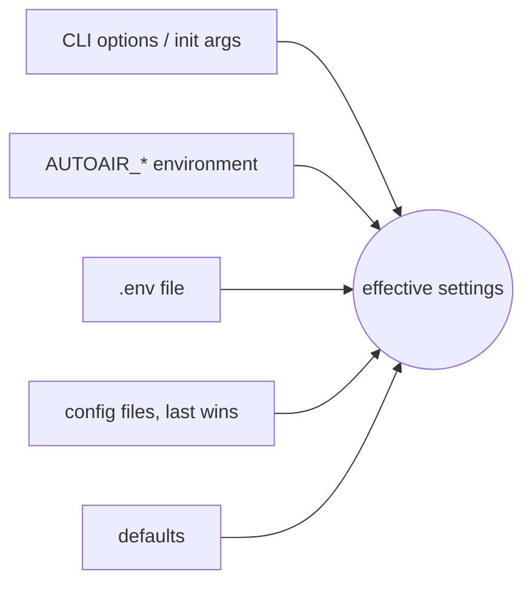

AutoAir is configured through one settings model. Every option has a dotted key (`storage.git.mode`), an environment variable (`AUTOAIR_STORAGE__GIT__MODE`), a type, a default and a description.

:::info Full option list
Every option, with its environment variable, configuration-file key, type, default, description and secret flag, is in the generated [configuration reference](/docs/reference/configuration).
:::

## Sources and precedence

AutoAir merges values from these sources, highest precedence first:

1. **Explicit arguments**: CLI options such as `autoair serve --dags-folder` or `--workers`, and keyword arguments when `Settings(...)` is built in code (the Airflow plugin and `autoair local` use this for their presets).
2. **Environment variables** with the `AUTOAIR_` prefix.
3. **The `.env` file** in the process's working directory.
4. **Configuration files**, in the order they are named; a later file overrides an earlier one.
5. **Defaults** from the settings model.

Values merge **per key**, not per section. A file that sets the whole `storage` section and an environment variable `AUTOAIR_STORAGE__GIT__MODE=pr` combine: only `storage.git.mode` is taken from the environment, everything else from the file.



One exception: a deploy target chosen in the UI (**Versions & Git → Deploy target…**) is stored in `<state dir>/deploy-target.json` and overrides the `storage.*` settings until it is reset. `GET /api/config` and the configuration page report those keys with the source `ui`. See [Deploy targets](/docs/user-guide/deploy).

## Environment variables

* Prefix: `AUTOAIR_`. The rest of the name is the dotted key in upper case with `__` (two underscores) between nesting levels: `ai.guardrails.pii_masking` is `AUTOAIR_AI__GUARDRAILS__PII_MASKING`.
* Lists and maps are JSON: `AUTOAIR_ENVIRONMENTS='["dev","prod"]'`, `AUTOAIR_LOGGING__LEVELS='{"autoair.storage":"DEBUG"}'`.
* Booleans accept `true`/`false` (also `1`/`0`, `yes`/`no`).
* `SecretStr` values (tokens, passwords, keys) are plain strings in the environment; AutoAir never prints them.

```bash
AUTOAIR_SUBFOLDER=autoair
AUTOAIR_STORAGE__MODE=git
AUTOAIR_STORAGE__GIT__PROVIDER=github
AUTOAIR_STORAGE__GIT__REPO=acme/dags
AUTOAIR_STORAGE__GIT__TOKEN=ghp_...            # secret
AUTOAIR_STORAGE__GIT__PR_LABELS='["autoair"]'   # JSON list
AUTOAIR_FEATURES__MARKETPLACE=false
```

## The `.env` file

A `.env` file in the working directory of `autoair serve`, `autoair local` or any other `autoair` command is read with the same variable names as the environment (`AUTOAIR_...=value`, one per line). Real environment variables override it. Values in `.env` are parsed like environment variables, so lists and maps are JSON there too.

Use `.env` for local development. In containers and Kubernetes, prefer real environment variables and secret mounts: a `.env` file is easy to bake into an image by accident.

## Configuration files

### Naming the files

All of these are loaded, in this order:

1. `[autoair] config_file = ...` in `airflow.cfg`, or `AIRFLOW__AUTOAIR__CONFIG_FILE`. Both the Airflow plugin and the standalone server read it.
2. `AUTOAIR_CONFIG_FILE`: one reference, a comma-separated list, or a JSON list.
3. `autoair --config FILE <command>` or `autoair serve --config FILE` (short form `-c`, repeatable). These are appended to `AUTOAIR_CONFIG_FILE`, so subprocesses that AutoAir starts (catalog builds, import checks) see the same files.

A later file overrides an earlier one, key by key. Environment variables and `.env` still override every file.

### Formats

| Reference | Format |
|---|---|
| `/etc/autoair/autoair.yaml`, `.yml` | YAML (PyYAML; a core dependency, also pulled in by the `autoair[yaml]` extra) |
| `/etc/autoair/autoair.json` | JSON |
| `/etc/autoair/autoair.ini`, `.cfg`, `.conf`, or `airflow.cfg` itself | INI, Airflow style |
| `/etc/autoair/settings.py`, `/etc/autoair/settings.py:attr` | Python file |
| `acme.autoair_settings`, `acme.autoair_settings:attr` | Importable Python module |

**YAML, JSON and Python** use nested mappings with the keys of the reference: `storage.git.mode` is `{"storage": {"git": {"mode": ...}}}`. A single top-level `autoair:` key may wrap the whole document.

```yaml
# /etc/autoair/autoair.yaml
subfolder: autoair
expose_config: non-sensitive-only
features: {marketplace: false, python_code: true}
policy:
  dag_id_pattern: "[a-z][a-z0-9_]*"
storage:
  mode: git
  git: {provider: github, repo: acme/dags, mode: pr, pr_labels: [autoair], pr_draft: true}
discovery:
  skip_dirs_extra: [build, dist]
```

**INI mapping.** `[autoair]` holds top-level keys. `[autoair.<a>.<b>]` sections hold nested keys (`[autoair.storage.git]` maps to `storage.git.*`), and a key may itself be dotted (`git.mode = push` inside `[autoair.storage]`). Values starting with `[`, `{` or `"` are parsed as JSON (lists, maps, quoted strings); everything else is a string converted by the field's type (`true`, `15`, `/path`). Sections that do not start with `autoair` are ignored, so the `[autoair*]` sections can live in `airflow.cfg`.

```ini
# airflow.cfg (or any .ini)
[autoair]
subfolder = autoair
required_tags = ["team"]

[autoair.storage.git]
provider = gitlab
repo = data/dags
mode = push

[autoair.features]
marketplace = false
```

**Python.** The attribute is a `dict`, a `Settings` object (only the values it was given are used) or a callable returning one of those. Without `:attr`, the attributes `AUTOAIR_CONFIG`, `config` and `settings` are tried in that order.

```python
# acme/autoair_settings.py  ->  AUTOAIR_CONFIG_FILE=acme.autoair_settings
import os

def AUTOAIR_CONFIG():
    return {"team": os.environ.get("TEAM", "data"), "storage": {"history_limit": 50}}
```

:::danger Python configuration runs code
A Python configuration file or module is executed with the privileges of the AutoAir process. Load only files that administrators control. Never point `--config` or `AUTOAIR_CONFIG_FILE` at a location users can write to.
:::

### Errors

Settings are validated when the process starts. An invalid value names its source, for example:

```text
storage.git.mode: Input should be 'pr' or 'push' (from /etc/autoair/autoair.yaml)
```

The server does not start, and CLI commands exit with code `2`. Unknown top-level keys in a file are logged and ignored. Template settings (`storage.git.*_template`) are also checked at load time: an unknown `{placeholder}` is an error naming the setting.

## Inspecting the effective configuration

### `autoair config show`

```bash
autoair config show              # every option: key = value  [source]
autoair config show --changed    # only values that differ from the default
autoair config show --json       # {"files": [...], "options": [{key, env, value, source}]}
autoair -c /etc/autoair/autoair.yaml config show --changed
```

Example output:

```text
# config file: /etc/autoair/autoair.yaml
features.marketplace = false  [env]
storage.git.token = "***"  [env]
subfolder = "autoair"  [file:/etc/autoair/autoair.yaml]
```

Sources are `default`, `env`, `dotenv`, `init` (CLI option or code), `file:<path>` and, in the API, `ui`. Secrets are always printed as `***` (or `null` when unset). The command reads the same sources as the server, so run it with the same environment, working directory and `--config` options.

### `GET /api/config`

`GET /api/config` returns every effective value with its key, environment variable, type, default, description, source and secret flag. It needs the `admin:config` permission (see [IAM](/docs/admin/iam)) and is controlled by `expose_config`, modelled on Airflow's `[api] expose_config`:

| `AUTOAIR_EXPOSE_CONFIG` | Behaviour |
|---|---|
| `false` (default) | `403`: "Your AutoAir administrator chose not to expose the configuration (AUTOAIR_EXPOSE_CONFIG)." The UI hides the configuration page. |
| `true` | Every value; secrets masked as `***`. |
| `non-sensitive-only` | Secrets are left out of the response entirely. |

### The configuration page in the UI

With `admin:config` and `expose_config` set to `true` or `non-sensitive-only`, the user menu (the person icon in the top bar) shows **AutoAir configuration**. Administrators also reach it from **AI → Set up AI…** when AI is not configured.

<Screenshot name="config-page" alt="The AutoAir configuration dialog: a search box, an 'All options' filter, the Features summary with on/off badges, and per-section tables with Option, Value, Type, Default and Source columns" caption="User menu → AutoAir configuration" />

The page is read-only. It shows:

* a search box (**Search options…**) over key, environment variable and description, and a filter (**All options** / **Changed from default**);
* the configuration files in effect (**Config files**), and a **Sensitive options hidden** badge with `non-sensitive-only`;
* a **Features** summary: every `features.*` flag as an on/off badge, with its environment variable in the tooltip;
* one table per section of the [configuration reference](/docs/reference/configuration) (top-level options under `[core]`) with **Option**, **Value**, **Type** (choices of literal types as chips, the current one highlighted), **Default** and **Source** (`default`, `environment`, `.env`, `argument`, `file`, `ui`).

The [admin panel](/docs/admin/admin-panel) has the same data in its **Configuration** tab. To change a value, change the environment or the configuration files and restart the process; nothing in the UI writes settings, except the deploy target dialog.

## Secrets

### What counts as a secret

A setting is treated as secret when any of these holds:

* its type is `SecretStr` (for example `storage.git.token`, `database.password`, `collab_secret`, `server.ssl_keyfile_password`, `ai.api_key`, `local.token`);
* the field is explicitly marked secret (for example `storage.storage_options`, whose fsspec options usually carry credentials);
* its name ends in `token`, `password`, `passwd`, `secret`, `api_key`, `private_key`, `credential(s)` or `headers`.

The last rule is a name heuristic, so a few non-sensitive switches are masked too: `server.security_headers`, `server.proxy_headers`, `cors_allow_headers`, `cors_expose_headers` and `cors_allow_credentials` show `***` in `/api/config` and `autoair config show`. Use the [configuration reference](/docs/reference/configuration) for their defaults.

Inside free-form maps (`team_storage`, `storage.storage_options`, `outbound.clients`, headers), keys that look like credentials are masked one by one: keys ending in `key`, `secret`, `token`, `password`, `passwd`, `pwd`, `credential`, `credentials`, `sas`, `sas_token`, `account_key`, `connection_string`, `client_secret`, `private_key`, `authorization`, `auth`, `session_token`, `security_token`, `cookie` or `signature`, and keys containing `access_key`, `secret`, `password`, `credential`, `token`, `connection_string` or `private_key` (case-insensitive). User information in URLs is masked as well: `postgresql://autoair:pw@db/autoair` is shown as `postgresql://autoair:***@db/autoair`.

### Recommendations

* Keep credentials in environment variables or secret mounts, not in configuration files that DAG code or other users can read.
* Prefer settings that keep the secret out of URLs: `database.password` instead of a password in `database.url`; `storage.git.github_private_key_file` instead of the key inline.
* For git deploys, prefer an Airflow connection (`storage.git.conn_id`, `storage.git.forced_conn_id`, or per-user credentials) over `storage.git.token`: AutoAir then never holds the token in its own settings. See [Deploy](/docs/user-guide/deploy).
* With several replicas, set the keys that would otherwise be generated per host: `collab_secret` and `ai.user_llm.encryption_key` (see [Scaling](/docs/admin/scaling)).

### Secrets and DAG code

Processes that run DAG code (import checks, Python DAG imports, test runs) do not inherit AutoAir's secrets. AutoAir removes from their environment every `AUTOAIR_*` variable whose name matches `sandbox.secret_env_pattern` (`TOKEN|SECRET|PASSWORD|PASSWD|API_KEY|PRIVATE_KEY|CREDENTIAL|EXTRA_HEADERS`) and the variables in `sandbox.scrub_env` (`ANTHROPIC_API_KEY`, `OPENAI_API_KEY`, `GEMINI_API_KEY`, `GOOGLE_API_KEY`). Airflow's own configuration is passed through. Extend the lists with:

```bash
AUTOAIR_SANDBOX__SCRUB_ENV_EXTRA='["AWS_SECRET_ACCESS_KEY","VAULT_TOKEN"]'   # any variable
AUTOAIR_SANDBOX__SECRET_ENV_PATTERNS_EXTRA='["^AUTOAIR_ACME_"]'             # regexes over AUTOAIR_* names
```

## Settings by area

Settings grouped by what they control. Each area links to the page that explains it in depth; exact types and defaults are in the [reference](/docs/reference/configuration).

### Core

| Variable | Default | Description |
|---|---|---|
| `AUTOAIR_MODE` | `standalone` (`plugin` inside Airflow, `local` for `autoair local`) | Deployment mode; set by the entry point |
| `AUTOAIR_DAGS_FOLDER` | Airflow `[core] dags_folder`, else `./dags` | Base folder for the local deploy target |
| `AUTOAIR_SUBFOLDER` | `autoair` | Sub-folder for generated DAGs; AutoAir's state folder is `<dags_folder>/<subfolder>/.autoair/` |
| `AUTOAIR_AIRFLOW_URL` | Airflow `[api] base_url`, else `http://localhost:8080` | Airflow REST API for pickers, status, runs and token checks |
| `AUTOAIR_AIRFLOW_SECRETS_BACKEND` | `false` | Connections/variables come from a secrets backend the REST API cannot list; hides the pickers' "not found" hint |
| `AUTOAIR_IMPORT_CHECK_ON_DEPLOY` | `true` | Import the DAG with a `DagBag` (warm worker pool) before writing |
| `AUTOAIR_TARGET_AIRFLOW_VERSION` | installed version | Validate features against another Airflow version (for example `3.1.0`) |
| `AUTOAIR_CORS_ORIGINS` | `[]` | Standalone CORS; see [TLS and HTTP headers](/docs/admin/tls-and-headers) |

### Feature flags

`AUTOAIR_FEATURES__<NAME>=false` switches a feature off: its API routes answer `404`, the matching CLI commands exit with code `2`, and `/api/meta` reports the flag so the UI hides it. Every flag and its UI impact is described in [Feature flags](/docs/admin/feature-flags).

### Storage and deploy target

| Variable | Description |
|---|---|
| `AUTOAIR_STORAGE__MODE` | `local` (default), `object` or `git` |
| `AUTOAIR_STORAGE__LOCAL_PATH` | Override the local folder (default `dags_folder/subfolder`) |
| `AUTOAIR_STORAGE__OBJECT_URL` | fsspec URL of an S3/GCS bundle prefix, for example `s3://bucket/dags/autoair/` |
| `AUTOAIR_STORAGE__STORAGE_OPTIONS` | JSON fsspec options (secret) |
| `AUTOAIR_STORAGE__GIT__PROVIDER` | `local` (git CLI, any remote), `github`, `gitlab`, `bitbucket`, `azure`, `gitea` (Gitea or Forgejo: git CLI push, pull requests over the REST API) |
| `AUTOAIR_STORAGE__GIT__REPO` | `owner/name` (GitHub), project id or path (GitLab), `workspace/repo` (Bitbucket Cloud), `organization/project/repository` (Azure DevOps), remote URL (local, gitea) |
| `AUTOAIR_STORAGE__GIT__API_URL` | REST API base URL for GitHub Enterprise, self-hosted GitLab, Azure DevOps Server; `gitea`: defaults to `<scheme>://<host>/api/v1` of an HTTP(S) remote, required for SSH remotes |
| `AUTOAIR_STORAGE__GIT__USERNAME` | Bitbucket app-password user (omit for access tokens) |
| `AUTOAIR_STORAGE__GIT__AZURE_BEARER` | Azure DevOps: the token is an Entra ID bearer token instead of a PAT |
| `AUTOAIR_STORAGE__GIT__BASE_BRANCH` | Branch Airflow's GitDagBundle tracks (default: the bundle ref, else `main`) |
| `AUTOAIR_STORAGE__GIT__SUBDIR` | Folder inside the repository |
| `AUTOAIR_STORAGE__GIT__MODE` | `pr` (default: a branch and pull request per DAG) or `push` (direct commit) |
| `AUTOAIR_STORAGE__GIT__TOKEN` | PAT or project token (secret) |
| `AUTOAIR_STORAGE__GIT__GITHUB_APP_ID`, `AUTOAIR_STORAGE__GIT__GITHUB_INSTALLATION_ID`, `AUTOAIR_STORAGE__GIT__GITHUB_PRIVATE_KEY`, `AUTOAIR_STORAGE__GIT__GITHUB_PRIVATE_KEY_FILE` | GitHub App authentication (recommended for GitHub) |
| `AUTOAIR_STORAGE__GIT__CONN_ID` | Airflow git connection holding the credentials |
| `AUTOAIR_STORAGE__GIT__CREDENTIALS_TTL` | Seconds credentials read from an Airflow connection are reused before the connection is read again (`60`); re-read at once and the operation retried after an authentication failure, so a rotated token needs no restart; `0` reads on every operation |
| `AUTOAIR_STORAGE__GIT__USE_AIRFLOW_BUNDLE`, `AUTOAIR_STORAGE__GIT__BUNDLE_NAME` | Read repo, branch, subdir and connection from Airflow's `dag_bundle_config_list` |
| `AUTOAIR_STORAGE__GIT__ENVIRONMENTS` | JSON map environment to branch for promotion, for example `{"dev":"dev","prod":"main"}` |
| `AUTOAIR_STORAGE__GIT__DIRECT_PUSH_ROLES` | `mode=pr`: roles that may push straight to the branch; enforced by IAM (see [IAM](/docs/admin/iam#pull-request-or-direct-push)) |
| `AUTOAIR_STORAGE__GIT__BRANCH_PREFIX`, `AUTOAIR_STORAGE__GIT__BRANCH_TEMPLATE` | Pending-change branch, default `{branch_prefix}{environment_path}{dag_id}` with prefix `autoair/` |
| `AUTOAIR_STORAGE__GIT__PROMOTE_BRANCH_TEMPLATE` | Promotion branch, default `{branch_prefix}promote/{from_env}-to-{to_env}/{dag_id}` |
| `AUTOAIR_STORAGE__GIT__COMMIT_MESSAGE_TEMPLATE`, `AUTOAIR_STORAGE__GIT__DELETE_MESSAGE_TEMPLATE`, `AUTOAIR_STORAGE__GIT__PROMOTE_MESSAGE_TEMPLATE` | Commit messages (`{dag_id}`, `{environment}`, `{author}`, `{from_env}`, `{to_env}` and the context placeholders) |
| `AUTOAIR_STORAGE__GIT__PR_TITLE_TEMPLATE`, `AUTOAIR_STORAGE__GIT__PR_BODY_TEMPLATE` | Pull request title and body (`{message}` is the commit message) |
| `AUTOAIR_STORAGE__GIT__PR_LABELS`, `AUTOAIR_STORAGE__GIT__PR_REVIEWERS`, `AUTOAIR_STORAGE__GIT__PR_DRAFT` | Labels; reviewers (GitHub logins or `org/team`, GitLab usernames, Bitbucket account UUIDs, Azure identity ids, Gitea usernames); draft PRs (Gitea: a `WIP: ` title prefix) |
| `AUTOAIR_STORAGE__GIT__DELETE_BRANCH_AFTER_MERGE` | Ask GitLab/Bitbucket/Azure DevOps to delete the source branch on merge (`true`; a repository setting on GitHub) |
| `AUTOAIR_STORAGE__GIT__COMMITTER_NAME`, `AUTOAIR_STORAGE__GIT__COMMITTER_EMAIL` | `provider=local` and `gitea`: committer identity |
| `AUTOAIR_STORAGE__GIT__SSH_KEY_FILE`, `AUTOAIR_STORAGE__GIT__CACHE_DIR`, `AUTOAIR_STORAGE__GIT__FETCH_INTERVAL` | `provider=local` and `gitea`: SSH key, clone cache, seconds between fetches (`5`) |
| `AUTOAIR_STORAGE__GIT__TIMEOUT`, `AUTOAIR_STORAGE__GIT__COMMAND_TIMEOUT`, `AUTOAIR_STORAGE__GIT__MAX_ATTEMPTS`, `AUTOAIR_STORAGE__GIT__READ_CACHE_SIZE` | REST timeout (30 s), git CLI timeout (300 s), retries when the branch moves (3), cached file reads (512) |
| `AUTOAIR_STORAGE__FILE_MODE`, `AUTOAIR_STORAGE__DIR_MODE` | `mode=local`: permissions of written files (`0644`) and created folders (umask) |
| `AUTOAIR_STORAGE__TEMP_DIR` | `mode=local`: folder of the temporary file of atomic writes; must be on the same file system |
| `AUTOAIR_STORAGE__HISTORY_LIMIT` | Saved versions kept per DAG (`100`) |

Example: conventional commits, draft PRs reviewed by a team, admins push directly.

```bash
AUTOAIR_STORAGE__GIT__COMMIT_MESSAGE_TEMPLATE='chore(dags): update {dag_id}'
AUTOAIR_STORAGE__GIT__PR_DRAFT=true AUTOAIR_STORAGE__GIT__PR_REVIEWERS='["acme/data-platform"]'
AUTOAIR_STORAGE__GIT__DIRECT_PUSH_ROLES='["Admin"]'
```

#### Deploy target policy

Administrators decide which kinds of targets exist and which credentials git deploys use. The deploy-target dialog and `PUT /api/deploy-target` cannot change these settings.

| Variable | Description |
|---|---|
| `AUTOAIR_STORAGE__ALLOWED_TARGETS` | Target kinds offered and accepted, for example `["git"]` or `["local"]` (default all three). `storage.mode` must be one of them; a UI-chosen target of another kind is refused (`400`) or ignored at start-up |
| `AUTOAIR_STORAGE__GIT__FORCED_CONN_ID` | Every git deploy uses this Airflow connection (overrides `conn_id` and the bundle's connection); shown read-only in the dialog |
| `AUTOAIR_STORAGE__GIT__CREDENTIALS_MODE` | `shared` (default: one service connection or token) or `per_user` (each user's own Airflow connection) |
| `AUTOAIR_STORAGE__GIT__USER_CONN_ID_TEMPLATE` | `per_user`: the user's connection id, default `git_{username}` (username lower-cased, characters outside `[A-Za-z0-9_.-]` become `_`) |
| `AUTOAIR_STORAGE__GIT__USER_CONN_ID_PATTERN` | `per_user`: regex of connection ids a user may pick in the deploy dialog instead, for example `git_.*` |
| `AUTOAIR_STORAGE__GIT__USER_CREDENTIALS_FALLBACK` | `per_user`: use the shared credentials when the user has no readable connection (default `false`: refuse) |
| `AUTOAIR_STORAGE__GIT__COMMIT_AUTHOR` | `auto` (default: the user with per-user credentials, else the service), `service` (the token's identity authors; the user is in the trailers and `Co-authored-by`), `user` (`Name <email>` of the user). GitHub's API always commits as the token owner |

**Per-user credentials.** With `credentials_mode=per_user`, every commit and pull request uses the deploying user's own Airflow connection. AutoAir first asks Airflow for the connection **with the user's token** (`GET /api/v2/connections/{id}`), so Airflow's RBAC decides whether the user may use it. Only then is the secret resolved server-side through Airflow's connections/secrets backend (Airflow's REST API never returns passwords), used for that one write and dropped; AutoAir stores no credentials. This needs AutoAir to see Airflow's connections: plugin mode, or standalone with Airflow installed and its metadata database or secrets backend configured. Reads (listing, history, pending pull requests) keep the shared credentials; without any, public repositories are read anonymously. A user without a readable connection gets a `403` (or the shared credentials with `user_credentials_fallback`). `GET /api/deploy-target/git-credentials` tells the UI which connection the caller's deploys use.

#### Deploy governance

Every commit and pull request AutoAir creates records who made it and what was checked:

* the user's **message** from the deploy dialog (first line = subject), or `commit_message_template`;
* a mandatory **context block**, always appended; users cannot remove it:

  ```text
  --- AutoAir deploy context ---
  Action: deploy
  DAG: etl_daily (environment prod)
  User: alice (Alice Smith <alice@acme.io>)
  Spec version: 1a2b3c4d5e6f -> 9f8e7d6c5b4a
  Validation: passed (0 errors, 2 warnings, 0 infos, import check ok)
  Approved by: bob
  Target: github:acme/dags@main (pr)
  AutoAir: 0.9.0
  Link: https://autoair.acme.io/ui/?dag=etl_daily
  ```

* **git trailers** as the last paragraph: `X-AutoAir-User`, `X-AutoAir-User-Name`, `X-AutoAir-Dag`, `X-AutoAir-Environment`, `X-AutoAir-Spec-Etag`, `X-AutoAir-Base-Etag`, `X-AutoAir-Validation`, `X-AutoAir-Version`, `Approved-by` (one per approver), and `Co-authored-by` when the service identity authors the commit. `git log --format='%(trailers:key=X-AutoAir-User)'` lists who deployed what.

The pull request description is `pr_body_template` (`{message}`, `{description}` = the PR description typed in the deploy dialog), with the context block appended unless the template places `{context}` itself. All commit and PR templates accept the context placeholders `{user}`, `{user_name}`, `{user_email}`, `{autoair_version}`, `{etag_before}`, `{etag_after}`, `{validation}`, `{approvals}`, `{link}`, `{target}`, `{description}`, `{context}`. User-supplied values are reduced to one line, so nobody can forge trailers. The deploy dialog shows a live preview (`POST /api/specs/{dag_id}/deploy-preview`). Local-folder and object-storage targets store the same message with each version. The link needs `AUTOAIR_SERVER__PUBLIC_URL`. Deploys, pull requests, direct pushes, deletes, promotions, proposals and reviews are audited with the same context (see [Audit](/docs/admin/audit)).

### Policy

The flat switches `AUTOAIR_ALLOW_PYTHON_CODE`, `AUTOAIR_ALLOW_PRIVILEGED_OPERATORS`, `AUTOAIR_REQUIRE_OWNER`, `AUTOAIR_REQUIRE_DESCRIPTION`, `AUTOAIR_MIN_RETRIES`, `AUTOAIR_REQUIRED_TAGS`, `AUTOAIR_FORBIDDEN_OPERATORS`, `AUTOAIR_MAX_TASKS`, `AUTOAIR_DAG_ID_PREFIX`, `AUTOAIR_PYTHON_REF_ALLOW` and the palette lists `AUTOAIR_OPERATOR_ALLOW` / `AUTOAIR_OPERATOR_DENY`, plus the pattern rules of the [`policy` section](/docs/reference/configuration#policy) (privileged operators, dag_id and task_id patterns, secret detection, extra Jinja names), are validation rules. On top of them, `policy.rules` holds declarative rules (match and check, with a severity) and `policy.opa_url`, `policy.opa_timeout`, `policy.opa_fail_mode`, `policy.opa_token`, `policy.opa_headers` and `policy.opa_cache_seconds` connect an Open Policy Agent. Their effect and where they are enforced are described in [Policy](/docs/admin/policy).

### Catalog and performance

| Variable | Description |
|---|---|
| `AUTOAIR_CATALOG_FILE` | Precomputed catalog (`autoair catalog build`) for fast start-up |
| `AUTOAIR_CATALOG_STRATEGY` | `static` (AST, no imports; default) or `import` |
| `AUTOAIR_CACHE_DIR` | Disk cache for the catalog (default `$XDG_CACHE_HOME/autoair`) |
| `AUTOAIR_EXTRA_OPERATOR_MODULES` | In-house operator modules to add to the palette |
| The `discovery` section | Discovery filters (all listed under [Operators](#operators-providers-third-party-packages-and-custom-code)); part of the cache key |
| `AUTOAIR_CATALOG_FALLBACK_TIMEOUT` | Seconds a build may spend introspecting classes in a subprocess (`300`) |
| `AUTOAIR_DAGBAG_POOL` | Warm DagBag validation workers (`true`) |
| `AUTOAIR_DAGBAG_POOL_SIZE` | Number of warm workers (`2`) |
| `AUTOAIR_DAGBAG_POOL_MAX_TASKS` | Checks per worker before it is recycled (`50`) |

The catalog cache is keyed by the installed Airflow distributions, the AutoAir version, the strategy, custom operator files, the discovery filters, a hash of AutoAir's catalog-building code and a hash of the cache layout. Upgrading or patching AutoAir therefore never serves a stale cache or a stale `AUTOAIR_CATALOG_FILE`; there is no format number to bump and no cache to clear by hand.

### Timeouts and limits

| Variable | Default | Description |
|---|---|---|
| `AUTOAIR_AIRFLOW_TIMEOUT` | `15` | Seconds per call to Airflow's REST API |
| `AUTOAIR_AUTH_TIMEOUT` | `10` | Standalone: seconds for the bearer-token check against Airflow |
| `AUTOAIR_AUTH_CACHE_TTL` | `60` | Standalone: seconds a verified token is trusted (`0` checks every request) |
| `AUTOAIR_IMPORT_CHECK_TIMEOUT` | `60` | Seconds per DagBag import check (validate, deploy) |
| `AUTOAIR_PYTHON_IMPORT_TIMEOUT` | `90` | Seconds to import a hand-written Python DAG |
| `AUTOAIR_MARKETPLACE_TIMEOUT` | `15` | Seconds per marketplace index or payload download |
| `AUTOAIR_MARKETPLACE_CACHE_TTL` | `300` | Seconds a fetched marketplace index is reused |
| `AUTOAIR_MARKETPLACE_MAX_BYTES` | `5242880` | Largest marketplace index or payload accepted |
| `AUTOAIR_COLLAB_TICKET_TTL` | `600` | Seconds a live-editing ticket is valid |
| `AUTOAIR_COLLAB_MAX_ROOMS` | `500` | Live-editing rooms per process |
| `AUTOAIR_DAGBAG_POOL_START_TIMEOUT` | `120` | Seconds a DagBag worker may take to start |
| `AUTOAIR_RUNNER__DEFAULT_TASK_TIMEOUT` / `AUTOAIR_RUNNER__DEFAULT_DAG_TIMEOUT` / `AUTOAIR_RUNNER__MAX_TIMEOUT` | `120` / `300` / `600` | Test runs: defaults and the largest timeout a request may ask for |
| `AUTOAIR_RUNNER__MAX_LOG_CHARS` / `AUTOAIR_RUNNER__MAX_VALUE_CHARS` | `64000` / `4000` | Test runs: log and return-value size returned |
| `AUTOAIR_INTERCHANGE__MAX_SOURCE_CHARS` / `AUTOAIR_INTERCHANGE__YAML_MAX_NODES` | `2000000` / `200000` | Largest import source; YAML alias-expansion guard |
| `AUTOAIR_EDITOR__MAX_SOURCE_CHARS`, `AUTOAIR_EDITOR__MAX_COMPLETIONS`, `AUTOAIR_EDITOR__MAX_DOC_CHARS` | `200000`, `100`, `4000` | Editor services |
| `AUTOAIR_EDITOR__SHELLCHECK_TIMEOUT`, `AUTOAIR_EDITOR__SHELLCHECK_EXCLUDE`, `AUTOAIR_EDITOR__SHELLCHECK_EXCLUDE_EXTRA`, `AUTOAIR_EDITOR__SHELLCHECK_IN_VALIDATION` | `5`, `SC1091,SC2034,SC2154`, `true` | ShellCheck |
| `AUTOAIR_EDITOR__PYTHON_LINT_SELECT`, `AUTOAIR_EDITOR__PYTHON_LINT_SELECT_EXTRA`, `AUTOAIR_EDITOR__PYTHON_LINT_IGNORE`, `AUTOAIR_EDITOR__PYTHON_LINT_IGNORE_EXTRA`, `AUTOAIR_EDITOR__PYTHON_LINT_TIMEOUT` | ruff `F,E9,B006,B008,B012,B018,PLE` / `F401`, `15` | Lint of task code |
| `AUTOAIR_EDITOR__VALIDATE_TIMEOUT`, `AUTOAIR_EDITOR__VALIDATE_COMMANDS` | `15`, `{}` | External checkers of code fields (`bash -n`, `sh -n`, `tsc`, `esbuild`, `gofmt`, `javac`) |
| `AUTOAIR_CODEGEN__LINE_LENGTH` / `AUTOAIR_CODEGEN__FORMAT_TIMEOUT` | `100` / `30` | Generated DAG files |
| `AUTOAIR_ICONS__MAX_UPLOAD_BYTES` / `AUTOAIR_ICONS__MAX_SIDE` / `AUTOAIR_ICONS__MAX_PIXELS` | `524288` / `128` / `16777216` | Custom icons |
| `AUTOAIR_LSP__PYTHON_SERVER` | `basedpyright` | Python language server behind `features.ide_language_server`: `basedpyright` or `pylsp` |
| `AUTOAIR_LSP__BASEDPYRIGHT_COMMAND`, `AUTOAIR_LSP__PYLSP_COMMAND`, `AUTOAIR_LSP__BASH_COMMAND` | `["basedpyright-langserver", "--stdio"]`, `["pylsp"]`, `["bash-language-server", "start"]` | Commands starting the language servers |
| `AUTOAIR_LSP__MAX_SESSIONS`, `AUTOAIR_LSP__MAX_SESSIONS_PER_USER` | `16`, `4` | Language-server processes alive at once, and per user |
| `AUTOAIR_LSP__IDLE_TIMEOUT`, `AUTOAIR_LSP__START_TIMEOUT` | `600`, `30` | Seconds without a message before a session closes; seconds a server may take to start |
| `AUTOAIR_LSP__MEMORY_LIMIT_MB`, `AUTOAIR_LSP__CPU_LIMIT_SECONDS`, `AUTOAIR_LSP__MAX_MESSAGE_BYTES` | `2048`, `3600`, `8388608` | Process limits and the largest JSON-RPC message |
| `AUTOAIR_SERVER__HOST` / `AUTOAIR_SERVER__PORT` | `127.0.0.1` / `8765` | `autoair serve` bind address |
| `AUTOAIR_SERVER__GZIP_MIN_SIZE` / `AUTOAIR_SERVER__GZIP_LEVEL` | `2048` / `6` | Response compression |
| `AUTOAIR_SERVER__AIRFLOW_FETCH_CONCURRENCY` / `AUTOAIR_SERVER__AIRFLOW_PAGE_SIZE` | `8` / `1000` | Airflow API client |
| `AUTOAIR_SERVER__OTEL_EXCLUDED_URLS` | `["health","ready","metrics"]` | Not traced |
| `AUTOAIR_PLUGIN__NAV_NAME`, `AUTOAIR_PLUGIN__NAV_CATEGORY`, `AUTOAIR_PLUGIN__DAG_TAB_NAME`, `AUTOAIR_PLUGIN__DAG_TAB` | `DAG Builder`, `browse`, `AutoAir`, `true` | Airflow UI entries (plugin mode) |

### Security notes

* Routes that execute DAG code on the AutoAir host (`/validate?import_check=true`, Python DAG import, the task runner) require the `code:execute` or `run:test` permission; see [IAM](/docs/admin/iam). Reading, static validation and code generation only need `builder:use`.
* Processes running DAG code do not inherit AutoAir's secrets (see [Secrets and DAG code](#secrets-and-dag-code)).
* The schedule preview (`/airflow/next-runs`) evaluates only the schedule, dates and timezone; params, tasks, callbacks and asset extras are never executed in the API process.
* `AUTOAIR_CORS_ORIGINS=["*"]` never sends `Access-Control-Allow-Credentials`; list explicit origins to allow credentialed cross-origin calls.

### Environments, teams and state

`AUTOAIR_ENVIRONMENTS`, `AUTOAIR_DEFAULT_ENVIRONMENT` and `AUTOAIR_TEAM` define environments and the deployment's team. `AUTOAIR_TEAM_STORAGE` is a JSON map team to storage settings, for example `{"team_a": {"mode": "git", "git": {"provider": "github", "repo": "acme/team-a-dags"}}}`: DAGs whose `team` is set are deployed there, and connection, pool and variable pickers offer only global and team objects. `AUTOAIR_TEAM_DAG_ID_PREFIX` requires `<team>_` dag ids. `AUTOAIR_TEMPLATES_URL`, `AUTOAIR_AUDIT_URL` and `AUTOAIR_ICONS_URL` are fsspec URLs for state that defaults to `<dags_folder>/<subfolder>/.autoair/templates`, `<dags_folder>/<subfolder>/.autoair/audit` and `<dags_folder>/<subfolder>/.autoair/icons`. Loader-mode DAGs apply the overlay named by `AUTOAIR_ENVIRONMENT` on the dag-processor and workers. See [Environments](/docs/user-guide/environments) and [Multi-team](/docs/user-guide/multi-team).

### Database (state store)

`AUTOAIR_DATABASE__BACKEND` selects where AutoAir keeps its own state (templates, audit trail, AI memory and audit, reviews and proposals, the UI-chosen deploy target, icons, collaboration snapshots): `file` (default), `sqlite` or `postgresql`. Backends, URLs, TLS, pooling and `autoair db` migrations are in [Database](/docs/admin/database); multi-replica behaviour is in [Scaling](/docs/admin/scaling).

### Server, TLS and HTTP security

`autoair serve` and `autoair local` read the [`server` section](/docs/reference/configuration#server): public URL, workers, TLS and mutual TLS, trusted proxies, security headers and CSP, HSTS, cookie attributes, the body-size limit, metrics and readiness checks. The most common ones are also CLI options (`--workers`, `--ssl-certfile`, `--ssl-keyfile`, `--ssl-ca-certs`, `--ssl-cert-reqs`, `--forwarded-allow-ips`). See [TLS and HTTP headers](/docs/admin/tls-and-headers). Sign-in with the Airflow UI session, CSRF and cookie scope are in [SSO and sessions](/docs/admin/sso).

### Outgoing connections: CA bundle, client certificates, proxies

One helper configures **every** outgoing client: the Airflow REST client and token checks, the sign-in proxy, git hosting APIs and the git CLI, marketplaces, AI providers (including the DNS-pinned transports), the reranker, online research, external MCP servers and the Open Policy Agent.

| Variable | Description |
|---|---|
| `AUTOAIR_OUTBOUND__CA_BUNDLE` | PEM file or hashed folder used instead of the default trust store (corporate root CA) |
| `AUTOAIR_OUTBOUND__CLIENT_CERT`, `AUTOAIR_OUTBOUND__CLIENT_KEY`, `AUTOAIR_OUTBOUND__CLIENT_KEY_PASSWORD` | Mutual TLS towards servers |
| `AUTOAIR_OUTBOUND__VERIFY` | `true`; `false` disables verification and logs a warning per client (test setups only) |
| `AUTOAIR_OUTBOUND__HTTP_PROXY`, `AUTOAIR_OUTBOUND__HTTPS_PROXY`, `AUTOAIR_OUTBOUND__NO_PROXY` | Proxies (explicit ones win over the environment); `no_proxy` entries are hosts, `.domain` suffixes, IPs or `host:port` |
| `AUTOAIR_OUTBOUND__TRUST_ENV` | Also honour `HTTP_PROXY`, `HTTPS_PROXY`, `NO_PROXY`, `SSL_CERT_FILE` from the environment (`true`) |
| `AUTOAIR_OUTBOUND__CLIENTS` | Per-client overrides, for example `{"git": {"ca_bundle": "/etc/ssl/gitlab.pem"}, "ai": {"proxy": "http://egress:3128"}}`; clients `airflow`, `git`, `marketplace`, `ai`, `research`, `login`, `mcp`, `opa` |

The git CLI (`provider=local`) gets the same settings as `http.sslCAInfo`/`http.sslCAPath`, `http.sslVerify`, `http.sslCert`/`http.sslKey` and `http.proxy` (through `GIT_CONFIG_*` variables, never on the command line) and `NO_PROXY`. AI research keeps its own `ai.research.proxy` when set.

### Logging, rate limits and UI

| Variable | Description |
|---|---|
| `AUTOAIR_LOGGING__LEVEL`, `AUTOAIR_LOGGING__FORMAT`, `AUTOAIR_LOGGING__LEVELS` | Root level (`INFO`), `text` or `json`, per-logger levels; see [Observability](/docs/admin/observability) |
| `AUTOAIR_LIMITS__RATE_LIMITS` | Requests per user and window: `{"validate": 240, "import": 60, "ai": 60, "test_runs": 30, "deploy": 60, "catalog_refresh": 6}` (`0` = unlimited); above it `429` with `Retry-After` |
| `AUTOAIR_LIMITS__ROLE_RATE_LIMITS` | Per AutoAir role, for example `{"Admin": {"ai": 0}, "Viewer": {"validate": 30}}`; the most generous limit of the user's roles applies (`0` wins) |
| `AUTOAIR_LIMITS__WINDOW_SECONDS`, `AUTOAIR_LIMITS__RATE_LIMITS_ENABLED`, `AUTOAIR_LIMITS__MAX_TRACKED_USERS` | Window (60 s), switch, memory bound; counters are per process |
| `AUTOAIR_UI__TITLE`, `AUTOAIR_UI__LOGO_URL`, `AUTOAIR_UI__ACCENT_COLOR` | Branding: title in the tab and on the sign-in page, logo, accent strip (hex or a Chakra palette name) |
| `AUTOAIR_UI__BANNER_TEXT`, `AUTOAIR_UI__BANNER_COLOR` | A banner above the builder, for example `PRODUCTION` in `red`, or a maintenance notice |
| `AUTOAIR_UI__DEFAULT_LANGUAGE`, `AUTOAIR_UI__DEFAULT_TIMEZONE`, `AUTOAIR_UI__DATE_LOCALE` | Defaults for users who never chose (language `en`/`tr`; IANA zone; BCP 47 locale) |

Session and token lifetimes: Airflow's `[api_auth] jwt_expiration_time` bounds sessions; `AUTOAIR_AUTH_CACHE_TTL` (verified tokens), `AUTOAIR_COLLAB_TICKET_TTL`, and `AUTOAIR_SSO__REFRESH_MARGIN_SECONDS` / `AUTOAIR_SSO__SESSION_CHECK_SECONDS` (UI) are AutoAir's own. See [SSO and sessions](/docs/admin/sso).

### Observability

`AUTOAIR_OTEL_ENABLED=true` (with `pip install 'autoair[otel]'`) instruments the API with OpenTelemetry. Prometheus metrics are at `/api/metrics` unless `AUTOAIR_SERVER__METRICS_ENABLED=false`. See [Observability](/docs/admin/observability). Audit records go to the sinks in `audit.sinks` (`file`, `db`, `log`, `otel`); see [Audit](/docs/admin/audit#audit-sinks).

### AI & MCP

AI features (generate and edit, explain, write code, fix, review, leak scan, optimise, docs, ask, research) run on [pydantic-ai](https://ai.pydantic.dev) with **Anthropic, OpenAI and OpenAI-compatible endpoints (Azure OpenAI, vLLM, LM Studio, LiteLLM), Google Gemini / Vertex AI, Ollama, Bedrock, Groq, Mistral and Cohere**. Install `autoair[ai]` plus the provider extra (`ai-anthropic`, `ai-openai`, `ai-google`, `ai-ollama`, `ai-bedrock`, `ai-groq`, `ai-mistral`, `ai-cohere`, `ai-all`); without it AI is off and the admin panel names the extra to install. All AI settings live in the **`ai` section** (`AUTOAIR_AI__<FIELD>`, `AUTOAIR_AI__<SUBSECTION>__<FIELD>`). Design and deployment are described in [AI architecture](/docs/ai/overview), providers in [AI providers](/docs/ai/providers), guardrails in [Guardrails](/docs/ai/guardrails), the separate AI service in [AI service](/docs/ai/ai-service) and the MCP server in [MCP](/docs/ai/mcp).

`features.ai=false` hides AI entirely (only `GET /api/ai/status` answers, with `enabled: false`). `ai.enabled=false` keeps the rules-only features (leak scan, review, optimise, search) and answers `503` for LLM features. `features.mcp=false` unmounts `/mcp`.

**Model (central)**

| Variable | Default | Description |
|---|---|---|
| `AUTOAIR_AI__PROVIDER` | inferred | `anthropic`, `openai`, `gemini`, `ollama`. Inferred from a `provider:` prefix in the model, else from the first key found (`ANTHROPIC_API_KEY`, `OPENAI_API_KEY`, `GEMINI_API_KEY`/`GOOGLE_API_KEY`) |
| `AUTOAIR_AI__MODEL` | per provider | `claude-sonnet-5-5` (Anthropic; also `claude-opus-5-5`, `claude-haiku-5-5`), `gpt-4.1`, `gemini-2.5-pro`, `qwen3:14b`. A `provider:` prefix also selects the provider (`openai:gpt-4.1`, `ollama:llama3.1:8b`) |
| `AUTOAIR_AI__MODELS` | provider suggestions | JSON list of models users may pick per request |
| `AUTOAIR_AI__API_KEY` | none | Key of the configured provider (secret, never logged). For Anthropic, `AUTOAIR_AI__ANTHROPIC_API_KEY`, `AUTOAIR_ANTHROPIC_API_KEY` and `ANTHROPIC_API_KEY` also work |
| `AUTOAIR_AI__BASE_URL` | provider default | OpenAI-compatible base URL (`http://vllm:8000/v1`), Azure deployment URL, Ollama URL or a gateway |
| `AUTOAIR_AI__API_VERSION`, `AUTOAIR_AI__EXTRA_HEADERS`, `AUTOAIR_AI__EFFORT` | none | Azure `api-version`; JSON gateway headers; Anthropic `effort` / OpenAI `reasoning_effort` |
| `AUTOAIR_AI__LLM_CONN_ID` | none | Airflow connection with the provider credentials (wins over the variables above) |
| `AUTOAIR_AI__TIMEOUT_SECONDS` / `AUTOAIR_AI__MAX_RETRIES` / `AUTOAIR_AI__MAX_OUTPUT_TOKENS` | `180` / `3` / `16000` | Per call; retries use jittered backoff and honour `Retry-After` |
| `AUTOAIR_AI__PRICING` | `{}` | USD per million tokens per model (prefix match); enables `usage.cost_usd` and cost budgets |
| `AUTOAIR_AI__LLM_MODE` | `central` | `central`, `per_user` (every user sets *My AI model*), `both` (the user's model when set) |
| `AUTOAIR_AI__USER_LLM__ALLOWED_PROVIDERS` | `["anthropic", "openai", "gemini", "ollama"]` | Providers users may choose |
| `AUTOAIR_AI__USER_LLM__ALLOWED_MODELS` | `["*"]` | Models users may choose (fnmatch) |
| `AUTOAIR_AI__USER_LLM__ALLOWED_BASE_URLS` | `[]` | Base URL prefixes users may set (empty = provider defaults only) |
| `AUTOAIR_AI__USER_LLM__ALLOW_PRIVATE_NETWORKS` | `false` | Allow user base URLs on private networks (SSRF) |
| `AUTOAIR_AI__USER_LLM__ALLOWED_CONN_IDS` | `[]` | Airflow connection ids users may reference instead of a key (fnmatch; empty = not allowed) |
| `AUTOAIR_AI__USER_LLM__ENCRYPTION_KEY` | key file in the state folder | Fernet key encrypting stored user API keys (set it for several replicas) |
| `AUTOAIR_AI__USER_LLM__STORE_URL` | `<state>/ai-users` | Where per-user model settings are stored |

**Agent, streaming, guardrails, audit**

| Variable | Default | Description |
|---|---|---|
| `AUTOAIR_AI__AGENT__MAX_STEPS` / `AUTOAIR_AI__AGENT__TOKEN_BUDGET` / `AUTOAIR_AI__AGENT__COST_BUDGET_USD` | `8` / `250000` / none | Per agent run; the last step withdraws the tools so the model answers |
| `AUTOAIR_AI__AGENT__TIMEOUT_SECONDS` / `AUTOAIR_AI__AGENT__TOOL_TIMEOUT_SECONDS` | `300` / `90` | Wall clock per run / per tool call |
| `AUTOAIR_AI__STREAM_HEARTBEAT_SECONDS` | `15` | SSE keep-alive interval |
| `AUTOAIR_AI__GUARDRAILS__REDACT_SECRETS` / `AUTOAIR_AI__GUARDRAILS__REDACT_PATTERNS` | `true` / `[]` | Secret redaction before text leaves AutoAir (plus site regexes) |
| `AUTOAIR_AI__GUARDRAILS__PII_MASKING` / `AUTOAIR_AI__GUARDRAILS__PII_ENTITIES` | `false` | Mask e-mails, phones, cards, IBANs, SSNs (IPv4 optional) |
| `AUTOAIR_AI__GUARDRAILS__PROMPT_INJECTION` | `flag` | `off`, `flag`, `block` for retrieved content and tool outputs (`AUTOAIR_AI__GUARDRAILS__INJECTION_PATTERNS_EXTRA`: more regexes) |
| `AUTOAIR_AI__GUARDRAILS__TOOL_ALLOWLIST` | per role | JSON `{"viewer": ["search_*", "get_operator", "validate_spec", "lint_spec", "render_code", "get_saved_spec", "list_dag_runs", "list_task_instances", "run_statistics", "read_source", "list_installed_packages", "get_package_info", "fetch_doc", "get_current_spec", "propose_spec_change", "write_code", "list_conventions", "remember"], "editor": ["*"], "admin": ["*"]}` (fnmatch over tool names) |
| `AUTOAIR_AI__GUARDRAILS__CHECK_GENERATED_CODE` | `true` | Writers must pass validation, ruff and ShellCheck before code is presented as valid |
| `AUTOAIR_AI__GUARDRAILS__EXTERNAL` | `[]` | `llm_guard`, `nemo:<dir>`, `guardrails_ai`, or `module:factory` (`autoair[ai-guardrails]`) |
| `AUTOAIR_AI__AUDIT__ENABLED` / `AUTOAIR_AI__AUDIT__URL` / `AUTOAIR_AI__AUDIT__INCLUDE_PROMPTS` | `true` / `<state>/ai-audit` / `false` | Audit log of AI calls (`GET /api/ai/audit`, `ai:admin`); see [Audit](/docs/admin/audit) |
| `AUTOAIR_AI__AUDIT__RETENTION_DAYS` / `AUTOAIR_AI__AUDIT__MAX_TOTAL_MB` | `90` / `1024` | AI audit retention by age and by size (`0` = no limit) |
| `AUTOAIR_AI__PROMPTS__OVERRIDE_DIR` | none | `<NAME>.md` replaces the system prompt `NAME` (`GET /api/ai/prompts` lists them) |
| `AUTOAIR_AI__WRITERS__MAX_REPAIRS` | `2` | Validate-and-repair rounds of the code writers |

**Retrieval, research, knowledge base**

| Variable | Default | Description |
|---|---|---|
| `AUTOAIR_AI__EMBEDDING__PROVIDER` / `AUTOAIR_AI__EMBEDDING__MODEL` / `AUTOAIR_AI__EMBEDDING__BASE_URL` | none | `openai`, `gemini`, `ollama`: hybrid retrieval (BM25 plus embeddings fused with RRF; vectors cached in `<cache>/ai-embeddings.sqlite3`) |
| `AUTOAIR_AI__RETRIEVAL__TOP_K` / `AUTOAIR_AI__RETRIEVAL__CANDIDATE_POOL` / `AUTOAIR_AI__RETRIEVAL__RRF_K` | `8` / `40` / `60` | Ranking |
| `AUTOAIR_AI__RETRIEVAL__CHUNK_SIZE` / `AUTOAIR_AI__RETRIEVAL__CHUNK_OVERLAP` | `1200` / `150` | Code-aware chunking |
| `AUTOAIR_AI__RETRIEVAL__RERANKER` | `none` | `cross_encoder` (`autoair[ai-rerank]`), `llm`, `cohere`, `voyage`, `jina` (plus `AUTOAIR_AI__RETRIEVAL__RERANK_MODEL`, `AUTOAIR_AI__RETRIEVAL__RERANK_API_KEY`) |
| `AUTOAIR_AI__RETRIEVAL__QUERY_EXPANSION` / `AUTOAIR_AI__RETRIEVAL__LLM_QUERY_REWRITE` / `AUTOAIR_AI__RETRIEVAL__SYNONYMS` | `true` / `false` / `{}` | Vocabulary expansion (plus site terms); LLM rewrites for research |
| `AUTOAIR_AI__ASSIST__MAX_LOG_CHARS` | `12000` | Tail of a failed task's log sent to fix |
| `AUTOAIR_AI__ASSIST__MAX_CODE_CHARS` | `40000` | Code sent to explain-code (truncated) |
| `AUTOAIR_AI__ASSIST__FINDINGS_MAX_TOKENS` | `12000` | `max_tokens` of review / leak / optimise / fix calls |
| `AUTOAIR_AI__ASSIST__EXPLAIN_MAX_TOKENS` / `AUTOAIR_AI__ASSIST__EXPLAIN_CODE_MAX_TOKENS` / `AUTOAIR_AI__ASSIST__TASK_CODE_MAX_TOKENS` | `6000` / `3000` / `8000` | `max_tokens` of explain-DAG, explain-code and task-code / writer calls |
| `AUTOAIR_AI__ASSIST__FIX_ROUNDS` | `2` | Patch-and-revalidate rounds of fix |
| `AUTOAIR_AI__ASSIST__DEFAULT_TASK_TIMEOUT_SECONDS` / `AUTOAIR_AI__ASSIST__DEFAULT_SENSOR_TIMEOUT_SECONDS` | `3600` / `21600` | Timeouts the rules suggest for tasks and sensors |
| `AUTOAIR_AI__ASSIST__MEMORY_MAX_ITEMS` | `2000` | Conventions/preferences the AI memory keeps |
| `AUTOAIR_AI__RESEARCH__ONLINE` | `false` | Air-gapped by default; `true` allows `fetch_doc` and PyPI on `AUTOAIR_AI__RESEARCH__ALLOWED_DOMAINS` |
| `AUTOAIR_AI__RESEARCH__ALLOWED_DOMAINS` | airflow.apache.org, pypi.org, raw.githubusercontent.com | Online allow-list (sub-domains included) |
| `AUTOAIR_AI__RESEARCH__PROXY` / `AUTOAIR_AI__RESEARCH__RATE_LIMIT_PER_MINUTE` / `AUTOAIR_AI__RESEARCH__MAX_BYTES` / `AUTOAIR_AI__RESEARCH__CACHE_TTL_SECONDS` | none / `30` / 2 MiB / 1 day | Online fetch limits |
| `AUTOAIR_AI__RESEARCH__PACKAGE_PATTERNS` / `AUTOAIR_AI__RESEARCH__EXTRA_SOURCE_DIRS` | `apache-airflow*`, `airflow*` / `[]` | What the installed-environment index covers; extra folders `read_source` may read |
| `AUTOAIR_AI__KNOWLEDGE__DISABLED` / `AUTOAIR_AI__KNOWLEDGE__EXTRA_DIRS` / `AUTOAIR_AI__KNOWLEDGE__STORE_URL` | `[]` / `[]` / `<state>/ai-knowledge` | Built-in docs to switch off; site folders (same file name replaces a built-in doc); where UI overrides live |
| `AUTOAIR_AI__MEMORY_URL` | `<state>/ai-memory` | Conventions and preferences memory |

**Assistants, troubleshooting, external MCP servers, rules** (see [Assistants](/docs/ai/assistants) and [AI troubleshooting](/docs/ai/troubleshooting))

| Variable | Default | Description |
|---|---|---|
| `AUTOAIR_AI__ASSISTANTS__DEVELOPER__ENABLED` / `AUTOAIR_AI__ASSISTANTS__ADMIN__ENABLED` | `true` | Assistant switched on |
| `AUTOAIR_AI__ASSISTANTS__DEVELOPER__TOOLS` / `AUTOAIR_AI__ASSISTANTS__ADMIN__TOOLS` | `["*"]` | Tool allow-list (fnmatch) |
| `AUTOAIR_AI__ASSISTANTS__DEVELOPER__MAX_STEPS` / `AUTOAIR_AI__ASSISTANTS__ADMIN__MAX_STEPS` | `10` / `12` | Model turns per chat turn |
| `AUTOAIR_AI__ASSISTANTS__DEVELOPER__MEMORY` / `AUTOAIR_AI__ASSISTANTS__ADMIN__MEMORY` | `true` | Use and offer to store memories in the assistant's scope |
| `AUTOAIR_AI__ASSISTANTS__DEVELOPER__ALLOW_EXTERNAL_MCP` / `AUTOAIR_AI__ASSISTANTS__ADMIN__ALLOW_EXTERNAL_MCP` | `true` | Attach the external MCP servers scoped to the assistant |
| `AUTOAIR_AI__ASSISTANTS__COMPACTION_TRIGGER_CHARS` / `AUTOAIR_AI__ASSISTANTS__COMPACTION_KEEP_MESSAGES` | `40000` / `6` | Summarise older turns of long threads |
| `AUTOAIR_AI__ASSISTANTS__MAX_THREADS_PER_USER` / `AUTOAIR_AI__ASSISTANTS__MAX_MESSAGES_PER_THREAD` / `AUTOAIR_AI__ASSISTANTS__STORE_URL` | `200` / `400` / `<state>/ai-threads` | Thread retention and location (SQL rows with a database backend) |
| `AUTOAIR_AI__TROUBLESHOOT__ENABLED` | `true` | "Analyze with AI" on runs and task instances |
| `AUTOAIR_AI__TROUBLESHOOT__RESOURCES__CONNECTIONS`, `AUTOAIR_AI__TROUBLESHOOT__RESOURCES__VARIABLES`, `AUTOAIR_AI__TROUBLESHOOT__RESOURCES__POOLS`, `AUTOAIR_AI__TROUBLESHOOT__RESOURCES__XCOM_KEYS`, `AUTOAIR_AI__TROUBLESHOOT__RESOURCES__OTHER_RUNS`, `AUTOAIR_AI__TROUBLESHOOT__RESOURCES__IMPORT_ERRORS` (`true`); `AUTOAIR_AI__TROUBLESHOOT__RESOURCES__XCOM_VALUES`, `AUTOAIR_AI__TROUBLESHOOT__RESOURCES__AIRFLOW_CONFIG` (`false`) | as listed | What the agent may read at most (users can only narrow it) |
| `AUTOAIR_AI__TROUBLESHOOT__FILESYSTEM__ROOTS` / `AUTOAIR_AI__TROUBLESHOOT__FILESYSTEM__INCLUDE_DAGS_FOLDER` | `[]` / `false` | Read-only sandbox for log files (`AUTOAIR_AI__TROUBLESHOOT__FILESYSTEM__ALLOW_GLOBS`, `AUTOAIR_AI__TROUBLESHOOT__FILESYSTEM__DENY_GLOBS`, `AUTOAIR_AI__TROUBLESHOOT__FILESYSTEM__MAX_FILE_BYTES`, `AUTOAIR_AI__TROUBLESHOOT__FILESYSTEM__MAX_READ_CHARS`) |
| `AUTOAIR_AI__TROUBLESHOOT__MAX_TASKS` / `AUTOAIR_AI__TROUBLESHOOT__MAX_TRIES` / `AUTOAIR_AI__TROUBLESHOOT__MAX_LOG_CHARS` / `AUTOAIR_AI__TROUBLESHOOT__MAX_STEPS` / `AUTOAIR_AI__TROUBLESHOOT__TIMEOUT_SECONDS` | `4` / `4` / `12000` / `12` / `420` | Evidence pack and agent limits |
| `AUTOAIR_AI__MCP_CLIENT__SERVERS` | `[]` | External MCP servers: `[{"name": "grafana", "url": "https://.../mcp", "headers": {"Authorization": "Bearer ..."}, "tools": ["query_*"], "agents": ["troubleshoot"]}]` (`transport` http, sse or stdio) |
| `AUTOAIR_AI__MCP_CLIENT__DATABASE_SERVERS` | `true` | Also offer servers defined in the admin panel (HTTP/SSE only) |
| `AUTOAIR_AI__PROMPTS__REPLACE` / `AUTOAIR_AI__PROMPTS__APPEND` / `AUTOAIR_AI__PROMPTS__VARIABLES` / `AUTOAIR_AI__PROMPTS__ORGANIZATION` | none | Replace or extend system prompts; `${variables}` |
| `AUTOAIR_AI__RULES__ENABLED` / `AUTOAIR_AI__RULES__MAX_CHARS` | `true` / `8000` | Project rules injected into authoring prompts |
| `AUTOAIR_AI__UPGRADE__RUFF_RULES` / `AUTOAIR_AI__UPGRADE__MAX_DAGS` | `["AIR3"]` / `100` | Airflow upgrade assistant |

**Separate AI service and MCP**

| Variable | Default | Description |
|---|---|---|
| `AUTOAIR_AI__SERVICE_URL` | none | Proxy `/api/ai/*` to `autoair ai-serve` instead of running AI in-process |
| `AUTOAIR_AI__SERVICE__SHARED_SECRET` | none | HMAC secret: the proxy signs the caller identity, the service trusts it |
| `AUTOAIR_AI__SERVICE__PROXY_MCP` / `AUTOAIR_AI__SERVICE__SERVE_MCP` | `false` / `true` | Proxy `/mcp` to the service / the service serves `/mcp` |
| `AUTOAIR_AI__SERVICE__TIMEOUT_SECONDS` | `600` | Proxy timeout (streams) |
| `AUTOAIR_AI__MCP__ALLOW_WRITES` | `true` | `false` makes the MCP server read-only |

**Airflow connection** (`AUTOAIR_AI__LLM_CONN_ID`, compatible with `common.ai` / pydantic-ai style connections): password = API key, host = base URL, `extra.model` = model with an optional provider prefix (`anthropic:claude-sonnet-5-5`, `openai:gpt-4.1`, `google-gla:gemini-2.5-pro`, `ollama:qwen3`), or the provider from `extra.provider` or the connection type (`anthropic`, `openai`, `azure_openai`, `google_gemini`, `ollama`). Optional extras: `api_version`, `headers`, `keep_alive`, `num_ctx`, `think` (Ollama), `thinking_budget` (Gemini), `reasoning_effort`, `embedding_model`. The connection is read lazily on first use.

Examples:

```bash
# Claude (default model claude-sonnet-5-5; offer Opus for the hardest reviews)
AUTOAIR_ANTHROPIC_API_KEY=sk-ant-...  AUTOAIR_AI__MODELS='["claude-opus-5-5","claude-haiku-5-5"]'
# Self-hosted vLLM / LM Studio (OpenAI-compatible, no key)
AUTOAIR_AI__PROVIDER=openai AUTOAIR_AI__BASE_URL=http://vllm:8000/v1 AUTOAIR_AI__MODEL=qwen3-32b
# Azure OpenAI
AUTOAIR_AI__PROVIDER=openai AUTOAIR_AI__BASE_URL=https://acme.openai.azure.com/openai/deployments/gpt-4-1 \
  AUTOAIR_AI__API_VERSION=2025-04-01-preview AUTOAIR_AI__API_KEY=...
# Gemini, with Gemini embeddings and an LLM reranker
AUTOAIR_AI__PROVIDER=gemini GEMINI_API_KEY=... AUTOAIR_AI__EMBEDDING__PROVIDER=gemini \
  AUTOAIR_AI__RETRIEVAL__RERANKER=llm
# Fully local and air-gapped: Ollama for chat and embeddings
AUTOAIR_AI__MODEL=ollama:qwen3:14b AUTOAIR_AI__BASE_URL=http://ollama:11434 \
  AUTOAIR_AI__EMBEDDING__PROVIDER=ollama AUTOAIR_AI__EMBEDDING__MODEL=nomic-embed-text
# Users bring their own keys; only OpenAI/Anthropic, and the company gateway as endpoint
AUTOAIR_AI__LLM_MODE=both AUTOAIR_AI__USER_LLM__ALLOWED_PROVIDERS='["openai","anthropic"]' \
  AUTOAIR_AI__USER_LLM__ALLOWED_BASE_URLS='["https://llm-gateway.acme.io/v1"]' \
  AUTOAIR_AI__USER_LLM__ENCRYPTION_KEY=<fernet key>
# Separate AI service
autoair ai-serve --port 8790        # AI pod
AUTOAIR_AI__SERVICE_URL=http://autoair-ai:8790 AUTOAIR_AI__SERVICE__SHARED_SECRET=...  # main server
```

Privacy: secrets (and, with `pii_masking`, personal data) are redacted from everything sent to a model. The leak scan replaces detected secret values with `***REDACTED***`, evidence snippets in findings are masked, and answers are scrubbed of secrets. Review, leak scan and optimise run their deterministic rules without any LLM (`use_ai: false`, or when AI is not configured).

### Collaboration and Python editor

`features.collab` (default `true`) needs `pip install 'autoair[collab]'`. Each DAG is a Yjs room served over WebSockets at `/autoair/collab/<dag_id>` inside Airflow and `/collab/<dag_id>` standalone. To join, the browser asks the API for a ticket valid for `AUTOAIR_COLLAB_TICKET_TTL` seconds (`POST /api/collab/<dag_id>/ticket`, which needs `spec:write` and Airflow's edit permission on that DAG) and opens the WebSocket with `?ticket=`; anything else gets `403`. Tickets are HMAC-signed with `AUTOAIR_COLLAB_SECRET`, by default derived from Airflow's `[api_auth] jwt_secret`; without either, a key is created once in the database (SQL backends) or in `<state>/collab.key`, so a ticket issued by one replica is valid on all of them. No JWT is ever put in a URL. Rooms live in memory (at most `AUTOAIR_COLLAB_MAX_ROOMS` per process); the stored spec stays the source of truth and deploys still go through ETag locking. Each editor's undo and redo only revert their own changes. Sharing rooms between replicas (the [`collab` section](/docs/reference/configuration#collab): `collab.sync`, `collab.redis_url`, `collab.redis_channel`, `collab.poll_seconds`, `collab.join_timeout`, `collab.snapshot_seconds`, `collab.snapshot_ttl_seconds`, `collab.retention_seconds`) is described in [Scaling](/docs/admin/scaling#collaboration-transport). See also [Collaboration](/docs/user-guide/collaboration).

The Python editors' completion, hover and signature help (`/api/lsp/python/*`) use jedi on the server, so they know the Airflow and providers installed there. Nothing is executed. Shell commands (BashOperator, `@task.bash`, `.sh` script files) are checked with ShellCheck through `/api/lsp/shell/lint` when it is installed (`pip install 'autoair[shell]'` ships the binary); without it the editor still completes but shows no diagnostics. Jinja is masked with same-length placeholders before checking, so reported columns match the editor; the process gets the scrubbed user-code environment and a 5 s timeout. `features.ide_language_server` switches to per-session language servers (`AUTOAIR_LSP__*`).

### Marketplace

`AUTOAIR_MARKETPLACE_SOURCES` is a JSON list of signed template indexes:

```json
[{"name": "acme", "url": "https://dags.acme.io/market/index.json", "public_key": "<base64 ed25519>"}]
```

`url` may be `https://`, `file://`, `s3://`, `gs://` and other fsspec URLs. The index must be signed with the pinned Ed25519 key (`require_signature: false` allows unsigned internal indexes, shown as UNSIGNED), and every payload must match its SHA-256 in the index; otherwise nothing is installed. `dag` and `fragment` entries install into the template gallery (tagged `marketplace:<source>`; needs `template:write`); `extension` entries only show their `pip install` line, so Python code is never installed at runtime. Publishing:

```bash
autoair marketplace keygen --out market.pem          # prints the public key
autoair marketplace build ./market --name acme --key market.pem   # templates/*.json (+ extensions.json) -> index.json
autoair marketplace verify ./market/index.json --public-key <key>
```

See [Marketplace](/docs/user-guide/marketplace) and [Publishing a marketplace](/docs/extending/marketplace).

### Operators: providers, third-party packages and custom code

The catalog lists every operator, sensor and notifier class it can find, statically (nothing is imported in the server process):

* **Providers and Airflow libraries**: every module of every installed package that is an Airflow provider (`apache_airflow_provider` entry point) or depends on Airflow, not only the modules declared in `provider.yaml` (`AUTOAIR_SCAN_PROVIDER_PACKAGES=true`).
* **Custom operators in folders**: Airflow's `plugins_folder` and `dags_folder` (`AUTOAIR_DISCOVER_AIRFLOW_FOLDERS=true`) plus `AUTOAIR_CUSTOM_OPERATOR_PATHS` (JSON list of folders, for example `["/opt/airflow/include"]`). Each folder is an import root, exactly as in Airflow.
* **Custom packages**: `AUTOAIR_EXTRA_OPERATOR_PACKAGES` (every module of the named installed import packages) and `AUTOAIR_EXTRA_OPERATOR_MODULES` (single modules).
* **pip distributions**: `AUTOAIR_EXTRA_OPERATOR_DISTRIBUTIONS='["acme-airflow-ops"]'`, every module shipped by the distribution, even when it neither requires Airflow nor declares a provider entry point.
* **Files and package folders**: `AUTOAIR_EXTRA_OPERATOR_PATHS='["/opt/acme/acme_ops/jira.py", "/opt/vendor/acme_ops"]'`; the import root is inferred from `__init__.py` files.

**Discovery filters** (the `discovery` section, applied to every source; changing them rebuilds the catalog). Each list or pattern can be overridden, or extended with the matching `_EXTRA` variable ([reference](/docs/reference/configuration#discovery)):

| Variable | Default |
|---|---|
| `AUTOAIR_DISCOVERY__SKIP_DIRS` / `AUTOAIR_DISCOVERY__SKIP_DIRS_EXTRA` | `__pycache__`, `.git`, `.hg`, `.venv`, `venv`, `.tox`, `.nox`, `node_modules`, `site-packages`, `.autoair`, `.ipynb_checkpoints` (dot-folders always) |
| `AUTOAIR_DISCOVERY__SKIP_MODULE_PATTERN` / `AUTOAIR_DISCOVERY__SKIP_MODULE_PATTERNS_EXTRA` | modules named `tests`, `example_dags`, `system`, `migrations`, `_vendor`, `decorators`, `conftest` |
| `AUTOAIR_DISCOVERY__SKIP_CLASS_PATTERN` / `AUTOAIR_DISCOVERY__SKIP_CLASS_PATTERNS_EXTRA` | `Decorated(Sensor)?Operator$` (TaskFlow internals) |
| `AUTOAIR_DISCOVERY__CLASS_HINT_PATTERN` / `AUTOAIR_DISCOVERY__CLASS_HINT_PATTERNS_EXTRA` | `Operator\|Sensor\|Notifier`: a file is parsed only when it defines a class and matches |
| `AUTOAIR_DISCOVERY__EXCLUDE_DISTRIBUTIONS` / `AUTOAIR_DISCOVERY__EXCLUDE_DISTRIBUTIONS_EXTRA` | `apache-airflow`, `apache-airflow-core`, `apache-airflow-task-sdk`, `autoair` (fnmatch) |
| `AUTOAIR_DISCOVERY__MAX_FILE_BYTES` | `2000000` |
| `AUTOAIR_DISCOVERY__PARALLEL_THRESHOLD`, `AUTOAIR_DISCOVERY__WORKERS`, `AUTOAIR_DISCOVERY__CACHE_MAX_FILES`, `AUTOAIR_DISCOVERY__PROBE_TIMEOUT` | `300`, `min(4, CPUs)`, `8`, `120` |

```yaml
extra_operator_distributions: [acme-airflow-ops]
extra_operator_paths: [/opt/airflow/include/acme_ops]
discovery:
  skip_dirs_extra: [build, dist]
  skip_module_patterns_extra: ['\.legacy(\.|$)']    # hide a deprecated sub-package
  class_hint_patterns_extra: ['Task']                # classes named *Task
  exclude_distributions_extra: ['acme-airflow-testing*']
```

Parameters, defaults, docstrings, templated fields and inherited parameters are read from the classes; edits to custom operator files refresh the catalog. See [Custom operators](/docs/extending/custom-operators) and [Catalog sources](/docs/extending/catalog-sources).

### Python references

Parameters that take Python objects (such as `python_callable`, Kafka `producer_function` or `GrpcOperator.stub_class`) are given as an import path: `{"$type": "import", "path": "acme_ops.funcs.greet"}` ("Python reference" in the parameter's value menu). The generated DAG imports the object. Because this runs arbitrary code, it needs `AUTOAIR_ALLOW_PYTHON_CODE=true`; `AUTOAIR_PYTHON_REF_ALLOW` (fnmatch patterns, default `["*"]`) restricts what may be referenced, for example `["acme_ops.*"]`. Validation checks statically that the module exists and defines the name. The object must be importable where Airflow runs.

### Canvas icons

Operator nodes, palette rows and the inspector show the logo of the integration an operator talks to; about 180 logos ship with AutoAir, and operators without one get a concept glyph. **Custom icons** (*Icon → Change... → Upload...* in a node's inspector) are framed in the browser and uploaded as a 64 px PNG; the server re-encodes them with Pillow (at most `icons.max_side` px, metadata stripped). Storage: `AUTOAIR_ICONS_URL` (fsspec; default `<state>/icons`, holding the PNGs and `assignments.json`, or rows in the SQL database). Icons are canvas-only and never appear in generated DAG files. Image URLs (`/api/icons/<id>`) are public so `` tags work with bearer-token auth; listing, uploading and assigning need `builder:use` / `icon:write`. `features.custom_icons=false` disables uploads.

## Related pages

* [Configuration reference](/docs/reference/configuration): every option
* [Feature flags](/docs/admin/feature-flags)
* [IAM](/docs/admin/iam) and [SSO and sessions](/docs/admin/sso)
* [Database](/docs/admin/database) and [Scaling](/docs/admin/scaling)
* [CLI reference](/docs/reference/cli)
