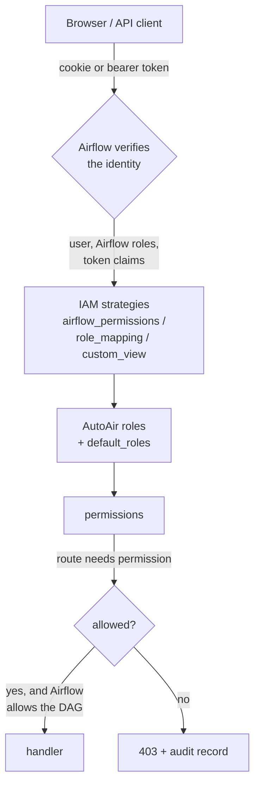

AutoAir has no user database. **Airflow authenticates every user**, and Airflow decides, through one of three mapping strategies, which AutoAir roles each user holds. A role is a set of fine-grained AutoAir permissions such as `spec:write`, `deploy` or `deploy:direct_push`; every API route requires one or more permissions. On top of that, routes about one DAG still require Airflow's own per-DAG permission.

Settings are in the `iam` section ([Settings reference](#settings-reference), [configuration reference](/docs/reference/configuration#iam)). With no IAM configuration AutoAir behaves like a plain Airflow extension: every DAG editor may save and deploy, and only Airflow admins may push straight past a pull request.

## How a request is authorized



1. **Authentication** is Airflow's: its session cookie or a bearer token, verified by Airflow's auth manager (plugin mode) or against Airflow's API (standalone).
2. **Strategies** turn the user's Airflow identity into AutoAir roles (the union of every configured strategy, plus `iam.default_roles`).
3. **Roles** expand into permissions (built-in roles, overridden or extended by `iam.roles`).
4. The **route** checks its permission. Routes about one DAG additionally check Airflow's DAG read/edit permission for that `dag_id`.
5. A **denial** answers `403` and is recorded in the audit trail.

## Authentication

| | Plugin mode (inside Airflow's API server) | Standalone (`autoair serve`) |
|---|---|---|
| Who signs the user in | Airflow (its login page, the `_token` cookie, or `Authorization: Bearer`) | Airflow: the browser holds an **Airflow** access token or Airflow's session cookie |
| How AutoAir checks it | Airflow's `get_user` dependency on every route (the auth manager decodes and validates the JWT) | `TokenVerifier`: `GET {airflow}/api/v2/dags?limit=1` with the token, cached for `AUTOAIR_AUTH_CACHE_TTL` seconds (never past the token's `exp`) |
| How the user gets a token | Airflow's login | The Airflow UI session cookie on the same host, the username/password form (`POST /api/auth/login`), or a pasted token. See [SSO and sessions](/docs/admin/sso) |
| Proxied Airflow calls | The caller's cookie or bearer is forwarded, so Airflow enforces its RBAC | Same |
| No authentication | Not available | `autoair serve --no-auth` (development only; see [Anonymous access](#anonymous-access)) |

Standalone rejects a token whose `exp` has passed without asking Airflow (`401 Airflow token expired`); the UI then shows the sign-in panel again.

## Permissions

Each permission has an Airflow custom-view equivalent used by the `custom_view` strategy. The FAB action is derived from the HTTP method: `GET` = `can_read`, `POST` = `can_create`, `PUT` = `can_edit`, `DELETE` = `can_delete`. Resource names are `<iam.custom_view_prefix> <Resource>`, by default `AutoAir <Resource>`.

| Permission | Allows | Airflow custom view |
|---|---|---|
| `builder:use` | Operator catalog, code preview, validation, diff/merge, templates, icons, YAML/JSON import, editor services (LSP) | `can_read` on `AutoAir Builder` |
| `spec:read` | List and read stored specs, history, versions, VCS status, reviews, proposals | `can_read` on `AutoAir Specs` |
| `audit:read` | A DAG's audit trail | `can_read` on `AutoAir Audit Log` |
| `airflow:read` | Read Airflow objects through AutoAir: runs, logs, XCom, pools, connections, variables, assets, import errors, status, next-runs preview | `can_read` on `AutoAir Airflow Resources` |
| `connection:write` | Create and test Airflow connections from the builder | `can_create` on `AutoAir Airflow Resources` |
| `spec:write` | Save a spec. In git PR mode a save opens or updates a pull request. Also joins live co-editing | `can_edit` on `AutoAir Specs` |
| `spec:delete` | Delete a spec and its DAG files | `can_delete` on `AutoAir Specs` |
| `code:execute` | Run DAG code on the AutoAir server: import check (`/validate?import_check=true`), Python and Airflow DAG import, applying the code mode | `can_create` on `AutoAir Code Execution` |
| `code:raw` | Save raw code DAGs: hand-written DAG files deployed as written (arbitrary Python). Also needs `features.code_editor` and `features.python_code`. See [Raw code DAGs](/docs/user-guide/code-mode#raw-code-dags) | `can_edit` on `AutoAir Raw Code` |
| `run:test` | Test a task or DAG from the builder | `can_create` on `AutoAir Test Runs` |
| `catalog:refresh` | Rebuild the operator catalog | `can_create` on `AutoAir Catalog` |
| `ai:use` | All AI assistant routes | `can_create` on `AutoAir AI` |
| `review` | Approve, request changes on, or comment a spec version | `can_create` on `AutoAir Reviews` |
| `deploy` | Saves that go live: local and object targets, git push mode, direct pushes | `can_create` on `AutoAir Deploy` |
| `deploy:direct_push` | Git PR mode: `direct_push: true` pushes straight to the branch | `can_create` on `AutoAir Direct Push` |
| `promote` | Promote a DAG between environments | `can_create` on `AutoAir Promote` |
| `run:trigger` | Trigger runs, create asset events | `can_create` on `AutoAir DAG Runs` |
| `run:manage` | Pause/unpause, clear, backfill | `can_edit` on `AutoAir DAG Runs` |
| `template:write` | Save and delete templates, install marketplace entries | `can_create` on `AutoAir Templates` |
| `icon:write` | Upload and delete icons, set default icons | `can_create` on `AutoAir Icons` |
| `admin:deploy_target` | Change, test or reset the server-wide deploy target | `can_edit` on `AutoAir Deploy Target` |
| `admin:config` | Read AutoAir's configuration (`/api/config`); maintenance actions in the admin panel (apply migrations, clear caches, manage MCP servers) | `can_edit` on `AutoAir Configuration` |
| `admin:panel` | Open the [admin panel](/docs/admin/admin-panel): audit browser, users, AI usage, approvals, database and caches | `can_read` on `AutoAir Admin Panel` |
| `ai:admin` | Administer AI: knowledge base, prompt overrides, AI rules, the AI audit log, privileged AI tools; also the AI role used by a separate AI service | `can_edit` on `AutoAir AI Settings` |

## Built-in roles

| Role | Permissions |
|---|---|
| **Viewer** | `builder:use`, `spec:read`, `audit:read`, `airflow:read` |
| **Author** | Viewer + `spec:write`, `code:execute`, `code:raw`, `run:test`, `ai:use`, `connection:write`, `catalog:refresh`. Authors *propose*: in git PR mode their saves open pull requests. On local and object targets, and in push mode, they cannot go live without `deploy`. |
| **Reviewer** | Viewer + `review`, `ai:use` |
| **Deployer** | Viewer + `spec:write`, `spec:delete`, `deploy`, `promote`, `run:trigger` |
| **Operator** | Viewer + `run:trigger`, `run:manage` |
| **TemplateManager** | Viewer + `template:write`, `icon:write` |
| **Admin** | Every permission except `deploy:direct_push` |
| *Authenticated* | Baseline of the `airflow_permissions` strategy: `builder:use`, `airflow:read`, `ai:use`, `connection:write`, `run:trigger`, `run:manage`. Airflow still enforces its own RBAC on every proxied call. |

`autoair iam roles` prints the effective table (built-in roles plus `iam.roles`), and `--json` prints it as JSON:

```text
$ autoair iam roles
Authenticated: Baseline of every signed-in user in the 'airflow_permissions' strategy.
  ai:use, airflow:read, builder:use, connection:write, run:manage, run:trigger
Viewer: Read specs, catalog, code preview, history and audit.
  airflow:read, audit:read, builder:use, spec:read
Author: Create and edit specs and raw code DAGs, validate, test runs, AI assist; proposes changes (PRs).
  ai:use, airflow:read, audit:read, builder:use, catalog:refresh, code:execute, code:raw, connection:write, run:test, spec:read, spec:write
Reviewer: Read everything, approve spec versions, AI review.
  ai:use, airflow:read, audit:read, builder:use, review, spec:read
Deployer: Deploy live, delete, promote between environments, trigger runs.
  airflow:read, audit:read, builder:use, deploy, promote, run:trigger, spec:delete, spec:read, spec:write
Operator: Trigger, backfill, clear, pause/unpause runs.
  airflow:read, audit:read, builder:use, run:manage, run:trigger, spec:read
TemplateManager: Curate templates, marketplace installs and icons.
  airflow:read, audit:read, builder:use, icon:write, spec:read, template:write
Admin: Everything, including the deploy target and configuration.
  admin:config, admin:deploy_target, admin:panel, ai:admin, ai:use, airflow:read, audit:read, builder:use, catalog:refresh, code:execute, code:raw, connection:write, deploy, icon:write, promote, review, run:manage, run:test, run:trigger, spec:delete, spec:read, spec:write, template:write
deploy:direct_push: roles ['Admin'] (storage.git.direct_push_roles)
```

In the UI, the user menu shows the caller's roles as chips; hovering a chip lists the permissions it grants.

### Direct push

`deploy:direct_push` is in **no** role definition. It goes to the roles in `AUTOAIR_IAM__DIRECT_PUSH_ROLES` (default `["Admin"]`). A deploy target can override that list with `AUTOAIR_STORAGE__GIT__DIRECT_PUSH_ROLES` (or the same field in `team_storage`): unset (the default) means `iam.direct_push_roles` applies, `[]` means nobody. Set `iam.direct_push_roles` to `[]` to forbid direct pushes everywhere, except for users granted the permission explicitly.

`deploy:direct_push` only ever comes from a **trusted** grant: a role from a verified Airflow check or a verified role claim, an explicit `"deploy:direct_push"` in a custom role held through such a grant, or the Airflow custom view. It is never granted by a wildcard (`"*"`, `"deploy*"`), never through unverified roles (standalone `airflow_permissions`), and never to anonymous users (`--no-auth`).

### Custom roles

Custom roles, or overrides of built-in ones, go in `AUTOAIR_IAM__ROLES`. Wildcards (fnmatch) are allowed:

```bash
AUTOAIR_IAM__ROLES='{"Auditor": ["spec:read", "audit:*"], "Pusher": ["spec:*", "deploy", "deploy:direct_push"]}'
AUTOAIR_IAM__DEFAULT_ROLES='["Viewer"]'   # every signed-in user
```

The settings are checked at start-up. An unknown permission in `iam.roles` (a typo, or a wildcard that matches nothing) is an error and the server does not start. An unknown role name in `default_roles`, `anonymous_roles`, `direct_push_roles`, `role_mapping` or `airflow_permission_roles` is logged as a warning (it grants nothing).

### Per-DAG access stays with Airflow

Routes about one DAG (`/specs/{dag_id}`, `/vcs/{dag_id}/*`, `/collab/{dag_id}/*`) still need Airflow's DAG access for that DAG: `requires_access_dag("GET"|"PUT")` with the `dag_id`, honouring Airflow's per-DAG permissions and multi-team. The AutoAir permission is checked **in addition**. A Deployer still cannot deploy a DAG they cannot edit in Airflow. In standalone mode Airflow enforces DAG access only on the calls AutoAir proxies.

## Mapping strategies

`AUTOAIR_IAM__STRATEGIES` is a list. The user's permissions are the **union** of what each listed strategy grants, plus `iam.default_roles`.

### `airflow_permissions` (default)

AutoAir roles are derived from Airflow's standard permissions, evaluated for the request's `dag_id` when it has one:

| Airflow permission | Setting | Default AutoAir roles |
|---|---|---|
| signed in | `AUTOAIR_IAM__AIRFLOW_PERMISSION_ROLES__AUTHENTICATED` | Authenticated |
| DAG read | `AUTOAIR_IAM__AIRFLOW_PERMISSION_ROLES__DAG_READ` | Viewer |
| DAG edit | `AUTOAIR_IAM__AIRFLOW_PERMISSION_ROLES__DAG_EDIT` | Author, Reviewer, Deployer, Operator, TemplateManager |
| Configuration edit | `AUTOAIR_IAM__AIRFLOW_PERMISSION_ROLES__CONFIGURATION_EDIT` | Admin (plugin mode only) |

:::warning Standalone mode
Standalone AutoAir cannot ask Airflow these questions. With `airflow_permissions`, every signed-in user gets all the roles above, **including Admin**. These roles are *unverified*, so they never unlock direct push, and Airflow still enforces its RBAC on every proxied call. To get real roles in standalone mode, use `role_mapping` **alone**. Combined with `airflow_permissions` (for example `["airflow_permissions", "role_mapping"]`), the union still gives every user every role, so the mapping restricts nothing; AutoAir logs a warning at start-up for that combination.
:::

### `role_mapping`: Airflow role names to AutoAir roles

Where the user's Airflow roles come from:

* **FAB** (plugin mode): `user.roles` (role names, including roles from groups resolved at login).
* **SimpleAuthManager** (plugin mode): `user.role` (`ADMIN`, `OP`, `USER`, `VIEWER`).
* **Standalone**: the token's claims named in `AUTOAIR_IAM__ROLES_CLAIMS` (default `role`, `roles`). SimpleAuthManager tokens carry `role`. These claims are trusted only because Airflow verified the token. FAB tokens carry only `sub`, so for FAB use plugin mode or `custom_view`.

How names are mapped (case-insensitive):

* `AUTOAIR_IAM__ROLE_MAPPING`. The default maps `Admin` to Admin; `Op` to Author, Reviewer, Deployer, Operator and TemplateManager; `User` to Author and Operator; `Viewer` to Viewer. Your own mapping replaces the default, for example `{"data-eng": ["Author", "Deployer"]}`.
* `AUTOAIR_IAM__ROLE_PREFIX` (default `"AutoAir "`): an Airflow role named `AutoAir Deployer` grants Deployer. In FAB, create these roles (empty, or with `autoair iam sync-fab --create-roles`) and assign them to users or groups in **Security → List Users**. An empty prefix disables this rule.

### `custom_view`: AutoAir permissions as Airflow permissions

Each AutoAir permission is checked with the auth manager's `is_authorized_custom_view(method, "AutoAir <Resource>")` (see the permission table). Admins grant them directly, for example "can_create on AutoAir Direct Push" to a `Release Managers` role. This works in plugin mode only. The answers are cached per user and token for `AUTOAIR_IAM__CUSTOM_VIEW_CACHE_SECONDS` (30 s; `0` disables the cache), so one request does not cost about twenty synchronous auth-manager checks; a permission revoked in Airflow therefore takes up to that long to apply.

| Auth manager | `is_authorized_custom_view` | User roles exposed | Recommended strategy |
|---|---|---|---|
| **FAB** (`apache-airflow-providers-fab`) | Real check: `(can_<action>, resource)` in the user's permissions. The permissions must exist in FAB's database: run `autoair iam sync-fab` once. | `user.roles` | `custom_view` (fine-grained in the Airflow UI) or `role_mapping` |
| **SimpleAuthManager** (Airflow default) | **Grants every custom view to every user with any role**, whatever the method. AutoAir therefore ignores `custom_view` with it and logs a warning. | `user.role`, also in the JWT | `role_mapping` |
| **Keycloak** (`apache-airflow-providers-keycloak`) | Real check: resource type `Custom`, resource id `<custom_view_prefix> <resource>` (`AutoAir Builder`, `AutoAir Specs`, `AutoAir Audit Log`, `AutoAir Airflow Resources`, `AutoAir Code Execution`, `AutoAir Test Runs`, `AutoAir Catalog`, `AutoAir AI`, `AutoAir Reviews`, `AutoAir Deploy`, `AutoAir Direct Push`, `AutoAir Promote`, `AutoAir DAG Runs`, `AutoAir Templates`, `AutoAir Icons`, `AutoAir Deploy Target`, `AutoAir Configuration`, `AutoAir Admin Panel`, `AutoAir AI Settings`), scope = method. Define them in Keycloak authorization. | not exposed | `custom_view` |
| **AWS** (`apache-airflow-providers-amazon`) | Real check: Verified Permissions entity `Custom::<custom_view_prefix> <resource>` (the resources listed for Keycloak, such as `Custom::AutoAir Deploy`), action = method | not exposed | `custom_view` |
| Custom auth managers | Whatever they implement | `user.roles` / `user.role` when present | either |

:::note Keycloak decision strategy
With Keycloak, the client's authorization *decision strategy* must be **Affirmative**. With the default *Unanimous*, overlapping role permissions deny every request, including Airflow's own API.
:::

### Combining strategies

Strategies combine as a union. In plugin mode, `["airflow_permissions", "role_mapping"]` keeps the default behaviour for everybody and adds Reviewer to users with the `AutoAir Reviewer` role. To *restrict* who can deploy, leave out `airflow_permissions`: with it, every DAG editor is a Deployer.

## FAB: registering permissions with `autoair iam sync-fab`

FAB only lets admins grant permissions that exist in its database. `autoair iam sync-fab` creates every AutoAir permission as a FAB permission, named as in the [Permissions](#permissions) table (for example `can_create on AutoAir Deploy`). With `--create-roles` it also creates one Airflow role per AutoAir role (`AutoAir Viewer`, `AutoAir Author`, `AutoAir Reviewer`, `AutoAir Deployer`, `AutoAir Operator`, `AutoAir TemplateManager` and `AutoAir Admin`, named with `iam.role_prefix`) holding the matching permissions.

Run it where Airflow runs (it uses Airflow's FAB application and metadata database):

```bash
airflow fab-db migrate                      # once, if FAB is new
autoair iam sync-fab --create-roles
# Airflow UI -> Security -> List Roles: "AutoAir Deployer" holds "can create on AutoAir Deploy" and the other Deployer permissions
AUTOAIR_IAM__STRATEGIES='["custom_view"]'   # or '["role_mapping"]', or both
```

* The command is idempotent: existing permissions and roles are kept, and permissions are only ever added to roles, never removed (admins may have customised them). Run it again after upgrading AutoAir to register new permissions such as `admin:panel`.
* `--create-roles` refuses to run with an empty `iam.role_prefix`: the roles would be named `Viewer`, `Author`, `Reviewer`, `Deployer`, `Operator`, `TemplateManager` and `Admin`, and it would modify Airflow's own built-in roles.
* Custom roles from `iam.roles` are created too; the `Authenticated` baseline is not.

## Plugin mode and standalone mode compared

| | Plugin mode | Standalone |
|---|---|---|
| Identity | Airflow's `get_user` (auth manager) | Token or cookie verified against Airflow's API |
| `airflow_permissions` | Real per-DAG and configuration checks | Every signed-in user gets every role (unverified) |
| `role_mapping` | FAB `user.roles`, SimpleAuthManager `user.role` | JWT claims (`iam.roles_claims`); not available with FAB tokens |
| `custom_view` | Supported (FAB, Keycloak, AWS) | Not available |
| Direct push from `airflow_permissions` | Admin via configuration edit | Never (unverified roles) |
| Recommended | `custom_view` or `role_mapping`, with or without `airflow_permissions` | `role_mapping` alone |

## Pull request or direct push

The git deploy mode is set per target with `AUTOAIR_STORAGE__GIT__MODE` (`pr` or `push`). The deploy request (`PUT /api/specs/{dag_id}`) takes `direct_push: true | false | null`.

| Target mode | `direct_push` | Result | Permissions needed |
|---|---|---|---|
| `pr` | `null` (default) | branch `autoair/<dag_id>` and a pull request | `spec:write` |
| `pr` | `true` | commit to the target branch | `spec:write`, `deploy`, `deploy:direct_push` (otherwise **403**) |
| `push` | `null` | commit to the branch; or a PR if `AUTOAIR_IAM__FORCE_PR_WITHOUT_DIRECT_PUSH=true` and the user lacks `deploy:direct_push` | `spec:write`, plus `deploy` when it goes live |
| `push` | `false` | pull request (always allowed) | `spec:write` |
| `push` | `true` | commit to the branch | `deploy`, `deploy:direct_push` |
| local / object targets | any | written live | `spec:write`, `deploy` (`direct_push: true` still needs `deploy:direct_push`) |

The flag cannot raise anyone's privileges: `direct_push: true` without the permission is refused (`403`, audited), never silently downgraded. A direct push in PR mode accepts the `base_etag` of the open pull request's version, so an admin can push the proposal as it is.

## Four-eyes approvals and deploy proposals

With `AUTOAIR_IAM__REQUIRE_APPROVAL=true`, a deploy that **goes live** needs an approval of that exact spec version (its etag) by **another** user holding `review`. On local, object and git push targets saving *is* deploying, so an unapproved deploy becomes a **deploy proposal** instead of being written:

1. `PUT /api/specs/{dag_id}` (needs `spec:write`; an Author may propose without `deploy`) validates the spec, stores it as a proposal and answers **202**: `{"deployed": false, "status": "pending_approval", "proposal_etag": "<etag>", "report": {...}, "message": "..."}`. Nothing is written. Proposing the same version again keeps the first proposal and its author. A spec that fails validation is not stored (`status: "invalid"`).
2. Reviewers find it with `GET /api/specs/{dag_id}/proposals` (needs `spec:read`) and read it with `GET /api/specs/{dag_id}/proposals/{etag}`: the proposed `spec`, the stored spec now (`current_spec`/`current_etag`, the diff base), `stale` (the stored spec changed since the author's `base_etag`), `reviews`, `approved_by`, `changes_requested_by`, `approved`.
3. `POST /api/specs/{dag_id}/reviews` with `{"etag": "<proposal etag>", "verdict": "approve" | "request_changes" | "comment", "comment": "..."}` (needs `review`). The proposal's author cannot approve it (`403`).
4. `POST /api/specs/{dag_id}/proposals/{etag}/deploy` (needs `deploy`; optional body `{"force": false, "message": "..."}`) deploys it once a user other than its author approved it. Anyone holding `deploy` may do this, **including the author**. The proposal is then removed and the `deploy` audit record carries `approved_by` and `proposed_by`.

A direct `PUT` of a version that already has an approval (by someone other than the deployer, or than the author of the pending proposal of that version) deploys immediately (`deploy` needed). Each reviewer's latest verdict counts, so a later `request_changes` withdraws an approval. Reviews of stored versions (not proposals) are accepted too; self-approvals of those do not count.

Proposals and reviews live in their own store: `AUTOAIR_IAM__PROPOSALS_URL` (any fsspec URL, default `<state>/proposals`) with the file backend, or the `proposals` and `reviews` tables with a SQL backend ([Database](/docs/admin/database)). They are not kept in the audit trail, so checking an approval never scans the audit log (reviews are still audited). They expire after `AUTOAIR_IAM__PROPOSAL_TTL_SECONDS` (7 days); a deployed proposal is removed at once. The admin panel's **Approvals** tab lists pending proposals and recent reviews.

Pull requests are exempt: on git targets in PR mode the pull request *is* the proposal and its review happens in the git host. A direct push (`direct_push: true`) goes live, so it follows the rule above (a proposal deployed later keeps its `direct_push` request, and the deploying user then needs `deploy:direct_push`). With `REQUIRE_APPROVAL=false` none of this applies. The user-facing flow is described in [Reviews and approvals](/docs/user-guide/reviews-and-approvals).

## Import check on deploy and `code:execute`

`import_check_on_deploy` (default on) imports the generated DAG file with a DagBag in a sandboxed subprocess on the AutoAir server. That **executes DAG code**, including inline Python callables and decorators. With `AUTOAIR_IAM__IMPORT_CHECK_REQUIRES_CODE_EXECUTE=true` (the default), a deploy runs it only when the deploying user holds `code:execute`. For others it is skipped and the report carries an info problem (`code: import_check_skipped`, "import check skipped: ..."); the deploy is still validated statically (spec, policy, code generation).

The trade-off: a Deployer without `code:execute` cannot run code on the AutoAir server, but their deploy may then ship a DAG that fails to import in Airflow (Airflow shows the import error). Give deployers `code:execute` (for example the Author role too) to keep the pre-deploy import check, or set the setting to `false` to always run it (any user with `deploy` can then execute code on the AutoAir server through the sandbox).

## Switching IAM off

`AUTOAIR_FEATURES__IAM=false` turns AutoAir's own authorization layer off. AutoAir then behaves as it did before it had roles:

* every signed-in user gets the **`Authenticated` baseline** plus the roles Airflow's standard permissions grant (the built-in `airflow_permissions` defaults: DAG read to Viewer, DAG edit to Author/Reviewer/Deployer/Operator/TemplateManager, configuration edit to Admin). In standalone mode, where AutoAir cannot ask Airflow about DAG permissions, that is every role; Airflow still enforces its RBAC on every proxied call;
* `iam.strategies`, `iam.role_mapping`, `iam.role_prefix`, `iam.roles`, `iam.default_roles` and custom views are ignored;
* no four-eyes approvals (`iam.require_approval` is ignored: deploys go live directly);
* no direct-push roles and no forced pull requests: **the git target's mode decides** (PR mode always opens a pull request, push mode always pushes; `direct_push=true` is refused);
* sign-in (`iam.login_*`), denial auditing and `iam.anonymous_roles` (`--no-auth`) keep their configured values; MCP tools follow the same rules.

`GET /api/me` still answers, with `"iam_enabled": false` and `strategies: ["airflow_permissions"]`, so the UI shows what the user may do.

## Anonymous access

* **`autoair serve --no-auth`** disables authentication. Every caller gets `iam.anonymous_roles` (default `["Admin"]`) but never `deploy:direct_push`, and token role claims are never read. Calls AutoAir proxies to Airflow are still subject to Airflow's own authentication. Use it for development only.
* **`autoair local`** binds `127.0.0.1` without authentication unless `--token` (or `AUTOAIR_LOCAL__TOKEN`) is set; binding another address without a token is refused. See [Local mode](/docs/installation/local).
* **`autoair mcp-serve --http --no-auth`** and **`autoair ai-serve --no-auth`** behave the same way for the MCP and AI services.

Narrow the anonymous roles when a development server is reachable by others:

```bash
AUTOAIR_IAM__ANONYMOUS_ROLES='["Viewer"]' autoair serve --no-auth
```

## What the UI asks: `GET /api/me`

`GET /api/me` (also embedded as `iam` in `GET /api/meta`) describes the caller. The deploy rights are those on the deploy target of this deployment's team (`AUTOAIR_TEAM`), or of `?team=<name>`:

```json
{
  "user": "alice",
  "roles": ["Author"],
  "permissions": ["ai:use", "airflow:read", "audit:read", "builder:use", "catalog:refresh",
                  "code:execute", "code:raw", "connection:write", "run:test", "spec:read", "spec:write"],
  "auth": "bearer",
  "mode": "standalone",
  "strategies": ["role_mapping"],
  "login_enabled": true,
  "iam_enabled": true,
  "deploy": {
    "git_mode": "pr",
    "can_save": true,
    "can_deploy_live": false,
    "direct_push": false,
    "default_opens_pr": true,
    "require_approval": false
  },
  "role_permissions": {"Author": ["ai:use", "airflow:read", "audit:read", "builder:use", "catalog:refresh", "code:execute", "code:raw", "connection:write", "run:test", "spec:read", "spec:write"]}
}
```

The frontend hides or disables actions the user lacks: Deploy/Save (`spec:write`, or `deploy` when `default_opens_pr` is false), the "push directly" option (`deploy.direct_push`), Delete (`spec:delete`), Promote (`promote`), Trigger/Backfill/Clear/Pause (`run:trigger` / `run:manage`), test runs (`run:test`), import check and Python import (`code:execute`), new raw code DAGs and **Convert to raw code** (`code:raw`), the AI panel (`ai:use`), template save and marketplace install (`template:write`), icon upload (`icon:write`), the deploy-target dialog (`admin:deploy_target`), the configuration page (`admin:config`), the admin panel (`admin:panel`), the audit tab (`audit:read`) and Approve (`review`). Disabled items explain the missing permission in their tooltip. **The server enforces all of these whatever the UI shows.**

## Routes and permissions

Paths are relative to the API base (`/api` standalone, `/autoair/api` in plugin mode).

| Route(s) | Permission(s) | Plus Airflow per-DAG check |
|---|---|---|
| `GET /meta`, `GET /me` | signed in | |
| `GET /health`, `/ready`, `/metrics`, `GET /icons/{id}` (files) | none | |
| `/auth/*` (standalone sign-in, session, refresh, logout) | none (rate-limited) | |
| `/catalog/*` (GET) | `builder:use` | |
| `POST /catalog/refresh` | `catalog:refresh` | |
| `GET /airflow/*`, `POST /airflow/next-runs` | `airflow:read` | Airflow enforces |
| `POST /airflow/connections`, `/airflow/connections/test` | `airflow:read` + `connection:write` | Airflow enforces |
| `POST /airflow/dags/{id}/trigger`, `/airflow/assets/{id}/events` | `airflow:read` + `run:trigger` | Airflow enforces |
| `PUT /airflow/dags/{id}/paused`, `PUT /airflow/dags/{id}/scheduling-state`, `POST /airflow/dags/{id}/runs/{run_id}/clear`, `POST /airflow/dags/{id}/backfill` | `airflow:read` + `run:manage` | Airflow enforces |
| `/ai/*` | `ai:use` (administration routes: `ai:admin`) | |
| `/lsp/*`, `/codegen`, `/validate`, `/export/dag-factory`, `/schema/spec`, `/interchange/*` | `builder:use` | |
| `/validate?import_check=true`, `POST /interchange/python/import` | + `code:execute` | |
| `POST /interchange/airflow/{id}/import` | + `airflow:read` + `code:execute` | Airflow enforces (reads the DAG source) |
| `GET /templates*` / `POST`, `DELETE /templates*` | `builder:use` / `template:write` | |
| `GET /icons`, `GET /icons/assignments` / `POST /icons`, `DELETE /icons/{id}`, `PUT /icons/assignments` | `builder:use` / `icon:write` | |
| `GET /specs`, `GET /specs/{id}`, `GET /specs/{id}/reviews` | `spec:read` | DAG read |
| `GET /specs/{id}/proposals`, `GET /specs/{id}/proposals/{etag}` | `spec:read` | DAG read |
| `POST /specs/{id}/proposals/{etag}/deploy` | `deploy` (+ an approval by a user other than the author, + `deploy:direct_push` if the proposal asked for it) | DAG edit |
| `GET /specs/{id}/audit` | `audit:read` | DAG read |
| `POST /specs/{id}/reviews` | `review` | DAG read |
| `PUT /specs/{id}` | `spec:write` (+ `deploy` if live, + `deploy:direct_push` for `direct_push: true`; with approvals required an unapproved live deploy becomes a proposal, `202`) | DAG edit |
| `PUT /specs/{id}`, `POST /specs/{id}/deploy-preview` with a raw code DAG (`raw_code` set) | + `code:raw`; `404` while `features.code_editor` or `features.python_code` is off | DAG edit |
| `DELETE /specs/{id}` | `spec:delete` | DAG edit |
| `/vcs/*` (reads, diff, merge) | `spec:read` | DAG read |
| `POST /vcs/{id}/promote` | `promote` | DAG edit |
| `POST /runner/test-task`, `/runner/test-dag` | `run:test` | |
| `POST /collab/{id}/ticket` | `spec:write` | DAG edit |
| `GET /deploy-target` / `PUT`, `POST /test`, `DELETE` | `builder:use` / `admin:deploy_target` | |
| `GET /marketplace` / `POST /marketplace/install` | `builder:use` / `template:write` | |
| `/config` | `admin:config` | |
| `GET /admin/*` | `admin:panel` | |
| `DELETE /admin/templates/{id}` | `admin:panel` + `template:write` | |
| `POST /admin/database/upgrade`, `POST /admin/caches/{cache}/clear`, `PUT /admin/mcp-servers/{name}`, `DELETE /admin/mcp-servers/{name}`, `POST /admin/mcp-servers/{name}/test` | `admin:panel` + `admin:config` | |

A test fails when a new route has no permission, so this table cannot silently drift from the code. The REST API is documented on the [API reference](/api) page.

## Audit of denials

Denials (`403`) are recorded in the audit trail as `permission_denied`, with the user, permission, method, path, roles and the `dag_id` when there is one; they then also show in that DAG's audit. Turn this off with `AUTOAIR_IAM__AUDIT_DENIALS=false`. Deploys record `direct_push` (and `approved_by`/`proposed_by` with approvals), proposals are `propose` records and reviews are `review` records. See [Audit](/docs/admin/audit).

## Settings reference

Types and full descriptions are in the configuration reference under [`iam`](/docs/reference/configuration#iam) and [`iam.airflow_permission_roles`](/docs/reference/configuration#iamairflow_permission_roles).

| Setting | Default | Description |
|---|---|---|
| `AUTOAIR_IAM__STRATEGIES` | `["airflow_permissions"]` | `airflow_permissions`, `role_mapping`, `custom_view` (union) |
| `AUTOAIR_IAM__AIRFLOW_PERMISSION_ROLES__AUTHENTICATED` | `["Authenticated"]` | Roles granted by signing in (see [above](#airflow_permissions-default)) |
| `AUTOAIR_IAM__AIRFLOW_PERMISSION_ROLES__DAG_READ` | `["Viewer"]` | Roles granted by DAG read (see [above](#airflow_permissions-default)) |
| `AUTOAIR_IAM__AIRFLOW_PERMISSION_ROLES__DAG_EDIT` | `["Author", "Reviewer", "Deployer", "Operator", "TemplateManager"]` | Roles granted by DAG edit (see [above](#airflow_permissions-default)) |
| `AUTOAIR_IAM__AIRFLOW_PERMISSION_ROLES__CONFIGURATION_EDIT` | `["Admin"]` | Roles granted by configuration edit (see [above](#airflow_permissions-default)) |
| `AUTOAIR_IAM__ROLE_MAPPING` | `{"Admin": ["Admin"], "Op": ["Author", "Reviewer", "Deployer", "Operator", "TemplateManager"], "User": ["Author", "Operator"], "Viewer": ["Viewer"]}` | Airflow role to AutoAir roles |
| `AUTOAIR_IAM__ROLE_PREFIX` | `"AutoAir "` | `AutoAir <Role>` Airflow roles grant `<Role>` |
| `AUTOAIR_IAM__ROLES_CLAIMS` | `["role", "roles"]` | Standalone: JWT claims with role names |
| `AUTOAIR_IAM__ROLES` | `{}` | Custom or overridden roles (wildcards) |
| `AUTOAIR_IAM__DEFAULT_ROLES` | `[]` | Roles of every signed-in user |
| `AUTOAIR_IAM__ANONYMOUS_ROLES` | `["Admin"]` | Roles with `--no-auth` (never direct push) |
| `AUTOAIR_IAM__CUSTOM_VIEW_PREFIX` | `AutoAir` | Airflow resource name prefix |
| `AUTOAIR_IAM__DIRECT_PUSH_ROLES` | `["Admin"]` | Roles with `deploy:direct_push` (a target's `storage.git.direct_push_roles` overrides) |
| `AUTOAIR_IAM__FORCE_PR_WITHOUT_DIRECT_PUSH` | `false` | Push mode: open PRs for users without `deploy:direct_push` |
| `AUTOAIR_IAM__REQUIRE_APPROVAL` | `false` | Four-eyes rule for live deploys |
| `AUTOAIR_IAM__PROPOSALS_URL` | `<state>/proposals` | Store of deploy proposals and reviews (file backend; fsspec URL) |
| `AUTOAIR_IAM__PROPOSAL_TTL_SECONDS` | `604800` | Proposals and reviews expire after this |
| `AUTOAIR_IAM__IMPORT_CHECK_REQUIRES_CODE_EXECUTE` | `true` | Deploy import check only for users with `code:execute` |
| `AUTOAIR_IAM__CUSTOM_VIEW_CACHE_SECONDS` | `30` | `custom_view` answers cached per user and token |
| `AUTOAIR_IAM__AUDIT_DENIALS` | `true` | Audit `403`s |
| `AUTOAIR_IAM__LOGIN_ENABLED` | `true` | Standalone password sign-in ([SSO and sessions](/docs/admin/sso)) |
| `AUTOAIR_IAM__LOGIN_MAX_FAILURES` / `AUTOAIR_IAM__LOGIN_WINDOW_SECONDS` | `5` / `300` | Sign-in rate limit |
| `AUTOAIR_IAM__LOGIN_MAX_TRACKED_KEYS` | `10000` | Rate limiter memory cap (IPs and usernames) |
| `AUTOAIR_IAM__LOGIN_TIMEOUT` | `10` | Timeout (s) of Airflow's token call |

## Examples

**Plugin mode with FAB, managed in Airflow's Security pages.** Only users in `AutoAir Deployer` may deploy; every DAG editor may still propose through pull requests.

```bash
autoair iam sync-fab --create-roles
AUTOAIR_IAM__STRATEGIES='["role_mapping"]'
AUTOAIR_IAM__DEFAULT_ROLES='["Viewer"]'
AUTOAIR_STORAGE__GIT__MODE=pr
```

**Standalone next to SimpleAuthManager.** Roles come from the token's `role` claim.

```bash
AUTOAIR_IAM__STRATEGIES='["role_mapping"]'
AUTOAIR_IAM__ROLE_MAPPING='{"ADMIN": ["Admin"], "OP": ["Author", "Deployer", "Operator"], "USER": ["Author"], "VIEWER": ["Viewer"]}'
```

**Four-eyes deploys to a local or object target**, with an auditor role.

```yaml
iam:
  strategies: [custom_view]
  require_approval: true
  roles:
    Auditor: ["spec:read", "audit:read", "admin:panel"]
```

## Limitations

* The MCP endpoint (`/mcp`) runs its own tools against the services and does not go through these route permissions; see [MCP](/docs/ai/mcp) and `AUTOAIR_AI__MCP__ALLOW_WRITES`.
* Standalone mode cannot evaluate Airflow's per-DAG or configuration permissions locally. Use `role_mapping` with token claims, or plugin mode, for real governance.
* With the file backend, the sign-in rate limiter is in memory, per process; with a SQL backend it is shared ([Scaling](/docs/admin/scaling)).

## Separate AI service

When the AI backend runs as its own service (`autoair ai-serve`, `ai.service_url`), the main server authorises the caller (`ai:use`) and forwards an HMAC-signed identity (`ai.service.shared_secret`). Unsigned calls that reach the service directly are verified against Airflow and resolved through the **same IAM strategies** as the main server: they need `ai:use`, and the AI role (viewer/editor/admin) follows `code:execute` / `ai:admin`. There is no implicit admin for direct callers. See [AI service](/docs/ai/ai-service).
