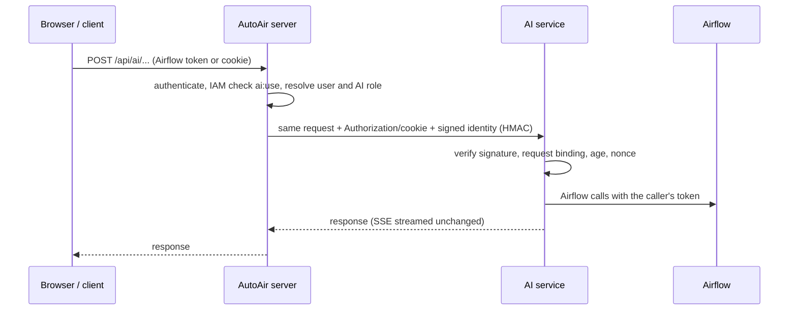

By default AI runs **in-process**: the `/api/ai/*` routes live in the AutoAir server itself, whether
that is the Airflow plugin or `autoair serve`. Nothing extra has to be deployed. Optionally the same
code can run as a **separate AI service** (`autoair ai-serve`) that the main server proxies to.
Behaviour is identical in both modes; only where the work happens changes.

## When to use it

| Criterion | In-process (default) | Separate AI service |
|---|---|---|
| Operations | Nothing to deploy; works in the Airflow plugin | One more container or Deployment and a shared secret |
| Isolation | LLM calls share the API server's event loop and memory | Agent runs, rerank models and research indexing cannot starve the builder API; crashes stay contained |
| Scaling | Scales with the API server | Scale AI independently (more replicas for long streams, a GPU node for a local cross-encoder) |
| Dependencies | AI extras land in the Airflow image | pydantic-ai and the provider SDKs, sentence-transformers and guardrail libraries live only in the AI image (a proxy-mode main server needs no `autoair[ai]`) |
| Security | Provider keys are in the API server's environment | Provider keys and the per-user key store live only in the AI pod; egress can be restricted to that pod |
| Latency | None added | One extra hop; streams pass through unbuffered |

Choose the separate service when AI workloads are heavy (long agent runs, many concurrent streams,
local reranking or LLM Guard models), when you want to keep the Airflow image lean, or when network
policy should allow model-provider egress from one pod only.

## Running it

```bash
pip install 'autoair[standalone,mcp,format,shell,ai,ai-anthropic]'   # ai-serve exits with a hint without `ai`
autoair ai-serve --host 0.0.0.0 --port 8790
```

| Option | Default | |
|---|---|---|
| `--host` | `127.0.0.1` | Bind address |
| `--port` | `8790` | Port |
| `--no-auth` | off | Do not require a bearer token on direct (unsigned) calls; for local experiments only |

The service exposes:

| Path | |
|---|---|
| `/api/ai/*` | The AI API, identical to the in-process routes |
| `/mcp/` | The MCP server, when `ai.service.serve_mcp` is true (default) and the `mcp` extra is installed |
| `/health` | Liveness: `{"status": "ok", "service": "ai", "version": …}` |
| `/ready` | Readiness: `{"ready": true, "llm": <whether a central model is configured>}` |

Then point the main server at it:

```bash
AUTOAIR_AI__SERVICE_URL=http://autoair-ai:8790
AUTOAIR_AI__SERVICE__SHARED_SECRET=<random secret, same value on both sides>
AUTOAIR_AI__SERVICE__PROXY_MCP=true   # optional: serve /mcp from the AI service too
```

With `ai.service_url` set, the main server mounts a proxy for `/api/ai/*` instead of the AI routes.

## Shared configuration

The AI service reads the same settings as the main server and must see the same state, because it
builds the operator catalog, reads saved specs and templates, and uses the memory, knowledge base,
threads, analyses, rules, per-user model store and audit log:

- the same `AUTOAIR_*` environment (or configuration files), including `AUTOAIR_AIRFLOW_URL`;
- the same catalog: set `AUTOAIR_CATALOG_FILE` to a precomputed catalog (`autoair catalog build`) so
  both build the identical palette, or install the same providers in both images;
- shared state: the same SQL [database](/docs/admin/database), or object-storage URLs / a shared
  volume for `ai.knowledge.store_url`, `ai.user_llm.store_url`, `ai.audit.url`,
  `ai.assistants.store_url`, `ai.troubleshoot.store_url`, `ai.rules.store_url` and `ai.memory_url`;
- the same `AUTOAIR_AI__USER_LLM__ENCRYPTION_KEY`, otherwise user API keys stored by one side cannot
  be decrypted by the other.

## Authentication between the server and the service



1. The main server authenticates the caller first, exactly like every other API route (Airflow's auth
   manager in plugin mode, the bearer-token verifier standalone), and checks `ai:use`.
2. The proxy forwards the request with the caller's `Authorization` header and Airflow cookie, so the
   service calls Airflow on the user's behalf and Airflow's RBAC still applies. It also forwards
   `content-type`, `accept`, `accept-language`, `x-request-id` and `traceparent`.
3. With `ai.service.shared_secret` set, the proxy adds an HMAC-SHA256 signed identity
   (`x-autoair-ai-identity`, `x-autoair-ai-signature`) carrying the user and the AI role. The signature
   is bound to this one request: method, path, query and a hash of the body, plus a timestamp and a
   single-use nonce.
4. The service accepts a signed request only if the signature is valid, the timestamp is within
   5 minutes, the request matches the signed method/path/query/body, and the nonce has not been seen.
   Anything else is rejected with 401 *invalid AI service identity*. With a SQL database backend, seen
   nonces are shared across service replicas (`ai.service.replay_cache_max_entries`, 100000, divided
   among 256 buckets; a full bucket rejects new requests until entries expire).
5. **Unsigned** requests (MCP clients or automation calling the service directly) must carry an
   Airflow bearer token, verified against Airflow when `ai.service.verify_tokens` is true (default).
   The service then resolves the caller's IAM principal itself and requires `ai:use`.

Without a shared secret the service cannot trust the proxy's identity, so every call is treated as a
direct call and authenticated with the forwarded token. Set the secret in production.

## Streaming and timeouts

Responses, including Server-Sent Events, are streamed back unchanged. The proxy asks the service for
uncompressed responses so the main server's gzip middleware still applies (SSE is never compressed).
When the client disconnects, the upstream request is closed, which cancels the AI run. If the service
is unreachable the proxy answers 502 *the AI service is unreachable*; a stream that fails midway ends
with an incomplete body, which the UI reports as *The connection ended before the AI finished*.

| Setting | Default | |
|---|---|---|
| `ai.service_url` | – | Base URL of the AI service; enables proxy mode |
| `ai.service.shared_secret` | – | HMAC secret shared by both sides (secret) |
| `ai.service.verify_tokens` | `true` | Verify unsigned bearer tokens against Airflow |
| `ai.service.timeout_seconds` | 600 | Proxy timeout; streams may run this long |
| `ai.service.serve_mcp` | `true` | The service serves `/mcp` |
| `ai.service.proxy_mcp` | `false` | The main server proxies its `/mcp` to the service (same auth as the API), so clients keep one URL |
| `ai.service.replay_cache_max_entries` | 100000 | Nonces retained for replay detection (SQL backend) |

Outbound TLS settings for the proxy client use the client name `ai` of the outbound TLS configuration
([TLS and headers](/docs/admin/tls-and-headers)). Give ingresses and load balancers a read timeout above
`ai.agent.timeout_seconds` (and `ai.troubleshoot.timeout_seconds`) and do not buffer
`text/event-stream`; AutoAir sends `X-Accel-Buffering: no` and a keep-alive comment every
`ai.stream_heartbeat_seconds` (15).

## Deployment

Container images, Kubernetes manifests and Helm values for the AI service are in
[Deploying the AI service](/docs/deployment/ai-service).

## Related pages

- [`ai.service`](/docs/reference/configuration#aiservice)
- [MCP: where it runs](/docs/ai/mcp#where-the-server-runs)
- [AI architecture](/docs/ai/overview)
- [CLI reference](/docs/reference/cli)
