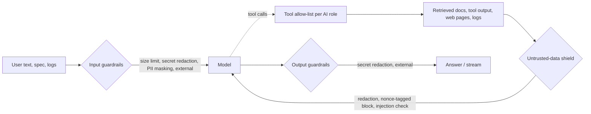

Every model call of every AI feature passes a pydantic-ai capability that applies the guardrail
pipeline to what is sent (prompts, earlier answers, tool results) and to what comes back (answers,
structured outputs; streamed tokens through a scrubber). The built-in guardrails have no
dependencies and are on by default, so a deployment without any extras is protected; external
libraries can be added on top.

## The pipeline



Text has one of three directions, and each guardrail acts on the directions it is meant for:

| Direction | Text | Built-in checks |
|---|---|---|
| `input` | What the user or AutoAir sends to the model | size limit, secret redaction, PII masking |
| `untrusted` | Retrieved documents, tool results, task logs, fetched pages, MCP tool output | secret redaction, PII masking, prompt-injection shield |
| `output` | What the model returns (answers, JSON, streamed tokens) | secret redaction |

External guardrails then run on every direction, in the configured order.

## Built-in guardrails

| Guardrail | What it does | Settings (`ai.guardrails.*`) |
|---|---|---|
| Input size limit | Rejects user text over the limit (HTTP 422) | `max_input_chars` (200000) |
| Secret redaction | Masks secret-looking strings (the leak-scan patterns plus your regexes) before text leaves AutoAir: outgoing text, tool results, logs | `redact_secrets` (on), `redact_patterns` |
| PII masking | Masks e-mail addresses, phone numbers, payment cards (Luhn-checked), IBANs, US SSNs and, if listed, IPv4 addresses | `pii_masking` (off), `pii_entities` (`email`, `phone`, `credit_card`, `iban`, `ssn`; add `ipv4`) |
| Prompt-injection shield | Wraps untrusted text in a nonce-tagged `<untrusted-data>` block that the system prompt declares to be data, removes look-alike closing tags, and checks for injection phrasing: "ignore / disregard / forget previous instructions", "you are now a / an / in", "new instructions:", requests to reveal or leak the system prompt, API keys, secrets or credentials, fake `<system>`, `<assistant>` and `<instructions>` tags or `[system]` / `[INST]` markers, "developer mode", "do anything now" and "send it to https://". `flag` keeps the text with a warning attribute; `block` replaces it with a removal notice | `prompt_injection` (`off`, `flag` default, `block`), `injection_patterns_extra` (case-insensitive regexes) |
| Secret output scrubbing | Redacts secrets the model writes into answers, suggestions, JSON and streamed tokens (a streaming scrubber holds back partial matches) | `block_secret_output` (on) |
| Tool allow-list per AI role | Agents only get the tools their role allows (fnmatch patterns) | `tool_allowlist` |
| Generated-code policy | Writers must pass syntax, ruff, ShellCheck, import, catalog and validation checks before code is presented as valid ([Writers](/docs/ai/writers)) | `check_generated_code` (on) |
| Structured outputs | Answers are validated with Pydantic and repaired with the validation error | – |
| Budgets | Steps, tokens, cost and wall clock per agent run | `ai.agent.*` (below) |

Each action is recorded as a note (`redacted`, `masked`, `flagged`, `blocked`, `denied`), streamed to
the UI as a `guardrail` event and written to the audit log. A blocking guardrail ends the request with
HTTP 422 (or an `error` event with status 422 in a stream).

### Tool allow-list

The AI role comes from IAM: `admin` with `ai:admin`, `editor` with `code:execute`, otherwise
`viewer`. The default allow-list:

```json
{
  "viewer": ["search_*", "get_operator", "validate_spec", "lint_spec", "render_code",
             "get_saved_spec", "list_dag_runs", "list_task_instances", "run_statistics",
             "read_source", "list_installed_packages", "get_package_info", "fetch_doc",
             "get_current_spec", "propose_spec_change", "write_code", "list_conventions",
             "remember"],
  "editor": ["*"],
  "admin": ["*"]
}
```

So viewers cannot run tools that execute DAG code (deploy dry run, Python import). A role missing from
the map falls back to the `viewer` patterns. The developer assistant is additionally limited by
`ai.assistants.developer.tools`; see [Chat assistants](/docs/ai/assistants).

```bash
# Viewers: search and validation only, no code writing
AUTOAIR_AI__GUARDRAILS__TOOL_ALLOWLIST='{"viewer": ["search_*", "get_operator", "validate_spec"], "editor": ["*"], "admin": ["*"]}'
AUTOAIR_AI__GUARDRAILS__PII_MASKING=true
AUTOAIR_AI__GUARDRAILS__PROMPT_INJECTION=block
AUTOAIR_AI__GUARDRAILS__REDACT_PATTERNS='["ACME-[0-9]{8}"]'
```

## External guardrails

`ai.guardrails.external` adds third-party guardrails behind the same `Guardrail` protocol: an async
`check(text, direction)` that returns the (possibly rewritten) text and notes, or raises
`GuardrailViolation` to block.

| Value | Library | Behaviour |
|---|---|---|
| `llm_guard` | [LLM Guard](https://github.com/protectai/llm-guard) (`pip install 'autoair[ai-guardrails]'`) | Input: `PromptInjection` and `Secrets` scanners; output: `Sensitive` scanner. A failing scanner blocks |
| `nemo:<config dir>` | NeMo Guardrails (`pip install nemoguardrails`) | The rails of that config directory check input and output; a refusing rail blocks |
| `guardrails_ai` | Guardrails AI (`pip install guardrails-ai`) | Validates every text with a `Guard` from the hub configuration of the environment |
| `package.module:factory` | Your code | A class, factory or object implementing the protocol |

External guardrails are loaded lazily, once per process, in a worker thread (LLM Guard downloads
models on first use). A guardrail that cannot be loaded (missing library, bad configuration) logs a
warning (*guardrail … unavailable*) and is skipped; it never breaks start-up. The built-in guardrails
keep running either way.

```bash
pip install 'autoair[ai-guardrails]'
AUTOAIR_AI__GUARDRAILS__EXTERNAL='["llm_guard", "acme.ai.guards:make_guard"]'
```

A minimal custom guardrail:

```python
# acme/ai/guards.py
from autoair.ai.guardrails import GuardrailResult, GuardrailViolation


class BlockProjectNames:
    name = "acme_projects"

    async def check(self, text, direction):
        if direction == "input" and "PROJECT-ORION" in text:
            raise GuardrailViolation(self.name, "codename must not leave the network")
        return GuardrailResult(text)


def make_guard():
    return BlockProjectNames()
```

## Token and cost limits

| Setting | Default | Limit |
|---|---|---|
| `ai.max_output_tokens` | 16000 | Upper bound of `max_tokens` for any call |
| `ai.agent.max_tokens_per_call` | 8000 | `max_tokens` of each agent call |
| `ai.agent.max_steps` | 8 | Model turns per agent run (assistants: `ai.assistants.<mode>.max_steps`; troubleshooting: `ai.troubleshoot.max_steps`) |
| `ai.agent.token_budget` | 250000 | Input + output tokens per agent run |
| `ai.agent.cost_budget_usd` | unset | USD per agent run; needs `ai.pricing` |
| `ai.agent.timeout_seconds` | 300 | Wall clock per agent or writer run (troubleshooting: `ai.troubleshoot.timeout_seconds`) |
| `ai.agent.tool_timeout_seconds` | 90 | One tool call |
| `ai.assist.*_max_tokens` | see [Assist](/docs/ai/assist#limits) | Per assist feature |

When a run reaches a limit it stops with the reason (`step limit (8) reached`, `token budget … reached`,
`cost budget ($…) reached`, `time limit … reached`); the last step is reserved for a forced final
answer, so you still get a result.

**Costs** are reported only for models with a price in `ai.pricing`, in USD per million tokens and
matched by model-id prefix:

```bash
AUTOAIR_AI__PRICING='{"claude-sonnet-5-5": {"input": 3, "output": 15, "cache_read": 0.3, "cache_write": 3.75}}'
```

Usage (tokens, cache hits, cost) is returned with each result and summarised per user and model in
the admin panel's **AI usage** tab (`GET /api/admin/ai-usage`, `admin:panel`). There is no built-in
per-user or per-day quota; use the budgets above to bound individual runs and the usage tab or the
audit log to monitor spend.

## AI audit log

Every AI request is recorded, separately from the builder's DAG [audit trail](/docs/admin/audit):

| Field | Content |
|---|---|
| `timestamp`, `user`, `role` | Who, with which AI role |
| `feature` | `generate`, `task_code`, `explain`, `explain_dag`, `explain_code`, `describe`, `review`, `leaks`, `optimize`, `fix`, `ask`, `write:<kind>` (one per [writer](/docs/ai/writers)), `model_test`, `upgrade`, `deploy_message`, `assistant:developer`, `assistant:admin`, `assistant:proposal_approve`, `assistant:proposal_reject`, `troubleshoot`, `troubleshoot:approve`, `troubleshoot:reject`, `troubleshoot:applied` |
| `provider`, `model`, `llm_source` | Model used and whether it was `central`, `user`, `user-connection` or `service` |
| `usage` | Input/output tokens, cache hits, cost |
| `tools` | Tools offered and run |
| `guardrails` | Guardrail actions |
| `duration_ms`, `outcome`, `error` | Duration; outcome `ok`, `error` or `cancelled`; the error message |
| `sources` | Sources the answer used (docs, files, audit ids) |
| `detail` | Feature specifics: thread or analysis id, DAG and run ids, proposal decisions (never secrets) |
| `prompt` | Only with `include_prompts=true`, redacted |

Storage: JSON lines under `ai.audit.url` (any fsspec URL, default `<state>/ai-audit`), one file per day
and process so replicas never write the same file, or rows of the `ai_audit` table when
`database.backend` is `sqlite` or `postgresql`.

| Setting | Default | |
|---|---|---|
| `ai.audit.enabled` | `true` | Record every AI request |
| `ai.audit.url` | `<state>/ai-audit` | Folder (fsspec URL) |
| `ai.audit.include_prompts` | `false` | Also store redacted prompts; they may still contain sensitive data |
| `ai.audit.retention_days` | 90 | Delete day folders older than this (0 = keep) |
| `ai.audit.max_total_mb` | 1024 | Delete the oldest days while the log is larger (0 = no limit) |

Read it with `GET /api/ai/audit?limit=100&user=…` (`ai:admin`; `limit` 1–1000) or ask the
[admin assistant](/docs/ai/assistants) ("How much did AI cost this month, per user?").

## Related pages

- [`ai.guardrails`](/docs/reference/configuration#aiguardrails), [`ai.audit`](/docs/reference/configuration#aiaudit), [`ai.agent`](/docs/reference/configuration#aiagent)
- [AI features: what data leaves the server](/docs/ai/introduction#what-data-leaves-the-server)
- [Security overview](/docs/security/overview)
