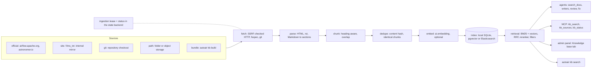

The documentation knowledge base (KB) indexes the official documentation that matches your
installation: Apache Airflow core, the Task SDK, the provider packages, the Helm chart,
airflowctl and Astronomer's Airflow guides. AutoAir's assistants, writers and reviews cite it,
MCP clients search it with `kb_search`, and administrators manage it in the admin panel or with
`autoair kb`.

It is separate from the curated [AI knowledge base](/docs/ai/research-and-knowledge#knowledge-base)
(AutoAir's own Markdown guides with admin overrides): that one holds a few hand-written
documents, this one holds thousands of pages fetched or imported from the documentation sites.

| Page | Covers |
|---|---|
| [Sources and versions](/docs/ai/knowledge-base-sources) | Components, providers, versions, source kinds, incremental refreshes |
| [Air-gapped setup](/docs/ai/knowledge-base-air-gapped) | Git mirror, object storage, local folders, an internal HTTP mirror, bundles |
| [Stores](/docs/ai/knowledge-base-stores) | Local SQLite (default), pgvector, Elasticsearch |
| [Tuning](/docs/ai/knowledge-base-tuning) | Chunking, retrieval, embeddings, reranking |
| [Security](/docs/ai/knowledge-base-security) | SSRF policy, limits, credentials, prompt-injection handling, permissions |

## Quick start

On a server with internet access:

```bash
export AUTOAIR_KB__ONLINE=true      # allow airflow.apache.org and astronomer.io
autoair kb refresh                  # first build: a few thousand pages, minutes
autoair kb status
autoair kb search "deferrable S3KeySensor"
```

`autoair serve` and the Airflow plugin also build the index on their own: shortly after start-up
when it is empty (`kb.refresh_on_start`, on) and then every `kb.refresh_interval_hours` (24).
Without `kb.online` the default `official` source is skipped; see
[Air-gapped setup](/docs/ai/knowledge-base-air-gapped) for the alternatives.

## Architecture



1. **Plan.** Each source lists *units*: one docs package at one version, for example
   `apache-airflow` 3.1.0. A unit has a fingerprint (the Sphinx `searchindex.js`, the `llms.txt`
   index or the git commit). A unit whose fingerprint did not change since the last refresh is
   skipped without reading a page.
2. **Fetch.** Pages are requested conditionally (`If-None-Match` / `If-Modified-Since` with the
   stored ETag and Last-Modified), at most `kb.fetch.concurrency` (4) at a time and
   `kb.fetch.requests_per_second` (4) overall.
3. **Parse.** HTML keeps only the page's main content (`div[role=main]`, `<main>`,
   `<article>`); reStructuredText and Markdown are converted to text. Every heading becomes a
   section with its heading path (`Amazon S3 > Operators > Create an Amazon S3 bucket`) and anchor.
4. **Chunk** per section (short sections merged), **dedupe** identical chunks of a page, and
   skip pages whose content hash did not change.
5. **Embed** new chunks when an embedder is configured; vectors are cached by text hash in
   `<kb cache>/embeddings.sqlite3`, so re-chunking or re-importing does not re-embed unchanged text.
6. **Index** the page atomically: page metadata, the parsed sections (compressed, for exports and
   re-chunking), chunks with their keyword index, vectors.
7. **Remove** pages that disappeared from a source, but only after that source was listed
   completely. A network failure, the page limit or the time limit never deletes anything.

Only one replica ingests into a given index at a time: a refresh takes a lease (document
`lock-<store>` of the `kb_state` collection in AutoAir's state backend) with an atomic
read-modify-write, renews it every third of `kb.lock_ttl_seconds` (600) and releases it at the
end. A replica that dies frees it after the TTL. Progress, per-source results and errors are
written to the `status-<store>` document every two seconds, so every replica's admin panel
shows the same status.

### Retrieval

1. The query is tokenised the same way as the index (identifier-aware: `S3KeySensor` matches
   `s3 key sensor`) and expanded with AutoAir's Airflow synonyms (`ai.retrieval.synonyms` adds
   site terms).
2. The store returns a **lexical** ranking (BM25 in SQLite FTS5 or Elasticsearch, `ts_rank_cd` in
   PostgreSQL) and, when the index has vectors of the configured embedding model, a **dense**
   ranking; each contributes `kb.search.candidate_pool` (50) candidates.
3. Both rankings are fused with **Reciprocal Rank Fusion** (`kb.search.rrf_k`, 60) in AutoAir,
   identically for every store.
4. The top `kb.search.rerank_top_n` (20) candidates are reranked when `ai.retrieval.reranker`
   is set and `kb.search.rerank` is on.
5. At most `kb.search.max_per_page` (2) results come from one page; the result is capped at
   `kb.search.max_results` (20) whatever the caller asks for.

Filters: `component`, `package`, `version` and `source`. Every hit carries the citation fields:
`url` (with the section anchor), `title`, `heading`, `version`, `package`, `component`, `source`
and `updated`.

### Without `autoair[ai]`

The KB does not import pydantic-ai. Without the AI extra, or without `ai.embedding.provider`,
search is BM25 only (`mode: lexical`) and works fully: the REST API, the MCP tools, the CLI and
the admin tab stay available while `features.ai` is off. Install `autoair[ai]` and configure
[embeddings](/docs/ai/providers#embeddings) for hybrid search; the next refresh embeds the
existing chunks without fetching again.

## Who uses it

| Consumer | How |
|---|---|
| Developer and admin assistants, troubleshooting | The research tool `search_docs` searches the KB with scope `docs` (included by default) and fuses its hits with the installed-package results; hits become numbered citations with the page URL |
| Writers | Reference material for code writers includes up to three KB passages |
| Review and fix | The knowledge context of `/api/ai/review` and `/api/ai/fix` includes up to two KB passages |
| MCP clients | `kb_search`, `kb_sources`, `kb_status` (see [MCP](#mcp)) |
| Admin panel | The **Knowledge base** tab: sources, status, refresh, test queries, bundles |
| CLI | `autoair kb` (see [CLI](#cli)) |

Retrieved text reaches models only as untrusted data (see
[Security](/docs/ai/knowledge-base-security#retrieved-text-in-prompts)).

## Switching it off

`features.kb` (`AUTOAIR_FEATURES__KB`, default on) switches the whole feature: the `/api/kb/*`
routes answer 404, the MCP tools are refused, `search_docs` stops adding documentation hits,
the CLI exits with code 2 and the scheduler stops starting refreshes. Like every flag it can be
switched at runtime in the admin panel's **Features** tab unless it is locked
([Feature flags](/docs/admin/feature-flags)).

## REST API

Mounted under `/api/kb` (standalone) or `/autoair/api/kb` (plugin).

| Method and path | Permission | Purpose |
|---|---|---|
| `GET /kb/status` | `ai:use` | Store statistics, search mode, sources, last and running refresh |
| `GET /kb/sources` | `ai:use` | Configured sources with admin overrides and indexed page counts |
| `GET /kb/search?q=&component=&package=&version=&source=&limit=` | `ai:use` | Hybrid search with citations (`limit` 1-50, capped by `kb.search.max_results`) |
| `PUT /kb/sources/{source_id}` | `ai:admin` or `admin:config` | Override `enabled`, `components`, `versions` of a configured source |
| `DELETE /kb/sources/{source_id}/override` | `ai:admin` or `admin:config` | Back to the configured values |
| `POST /kb/refresh` | `ai:admin` or `admin:config` | `{"mode": "refresh" \| "rebuild", "sources": [...]}`: starts in the background (202); 409 while one runs anywhere |
| `POST /kb/cancel` | `ai:admin` or `admin:config` | Ask the running refresh to stop (it keeps what it indexed) |
| `GET /kb/export?source=` | `ai:admin` or `admin:config` | Download the index as an unsigned bundle (zip) |
| `POST /kb/import?source_id=bundle` | `ai:admin` or `admin:config` | Import a bundle (request body: the zip) |

Overrides, refreshes, exports and imports are recorded in the audit trail (`kb_source_override`,
`kb_source_reset`, `kb_refresh`, `kb_export`, `kb_import`).

## MCP

The main MCP server (`/mcp`, `autoair mcp`) has three read-only tools, each needing `ai:use` and
`features.kb`:

| Tool | Returns |
|---|---|
| `kb_search` | Hits for `query` with optional `component`, `package`, `version` filters and `limit` (1-20) |
| `kb_sources` | Sources, components and the provider mode (`installed` or `all`) |
| `kb_status` | Index size, store, search mode, last refresh and its errors |

`autoair kb mcp` runs a standalone MCP server over stdio with only these three tools, for an IDE
agent that needs Airflow documentation but not AutoAir's DAG-authoring tools. Like every stdio
MCP server it runs as the local user without an AutoAir principal; feature switches still apply.

## CLI

| Command | Does |
|---|---|
| `autoair kb sources [--json]` | Sources, usability, components, versions, pages indexed |
| `autoair kb status [--json]` | Store, counts per component and version, last and next refresh |
| `autoair kb refresh [--rebuild] [--source ID]... [--json]` | Refresh now in the foreground (exit 3 when another refresh holds the lease, 1 when it failed) |
| `autoair kb search QUERY [--component C]... [--package P] [--version V] [--limit N] [--json]` | Search (no reranking) |
| `autoair kb build --out FILE [--sign-key PEM] [--store-path PATH] [--source ID]... [--online/--no-online] [--description TEXT]` | Fetch and write a bundle |
| `autoair kb import FILE [--source-id ID] [--json]` | Import a bundle into the configured store |
| `autoair kb keygen [--out FILE]` | Create an Ed25519 signing key for bundles |
| `autoair kb mcp` | Standalone KB MCP server (stdio) |

The commands read the same settings as the server (`AUTOAIR_*`, `--config`).

## Related pages

- [Retrieval, research and knowledge](/docs/ai/research-and-knowledge)
- [`kb` settings reference](/docs/reference/configuration#kb)
- [MCP server and client](/docs/ai/mcp)
