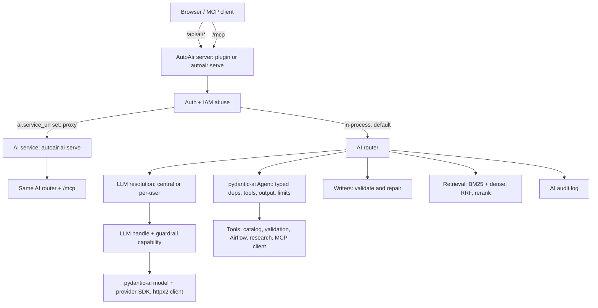

How the AI backend is put together, and why. For configuration start at
[AI features](/docs/ai/introduction); every field is in the [`ai` settings reference](/docs/reference/configuration#ai).

## Request flow



The AI service runs the same router code as the in-process mode, so the two behave identically.

## Package map

`src/autoair/ai/`:

| Module | Role |
|---|---|
| `config.py` | `AiSettings` (the `ai` settings section) |
| `availability.py` | Whether the `autoair[ai]` extra (pydantic-ai) is installed, and the install hint |
| `llm.py` | `ModelConfig` and the `LLM` handle: central, Airflow-connection or per-user model, limits, pricing, guardrails; `complete_text` / `complete_json` / `complete_structured` / `stream_text` (import-light) |
| `models.py` | pydantic-ai glue: models and providers from the configuration (httpx2 clients with the outbound settings), the `AutoAirCalls` capability (usage, guardrails), error mapping, embeddings |
| `agent.py`, `tools.py` | The agent runtime on a pydantic-ai `Agent` and the tool definitions (`AgentTool`) |
| `testing.py` | `FakeLLM`, a scripted model on pydantic-ai's `FunctionModel` |
| `events.py` | SSE event model, `stream_job` (cancellation, result/error/done framing) |
| `guardrails.py` | The guardrail pipeline, the `Guardrail` protocol, the `StreamScrubber` |
| `rag.py`, `chunking.py`, `query.py`, `rerank.py`, `corpus.py` | Retrieval |
| `research/` | Air-gapped and online research and its tools |
| `writers.py` | Specialised code writers with validate-and-repair loops |
| `user_llm.py`, `net.py`, `access.py` | Per-user models (encrypted keys), SSRF policy, caller identity and AI role |
| `knowledge.py`, `prompts.py` | Knowledge base overrides, prompt overrides and variables |
| `audit_log.py` | Audit log of AI calls |
| `service.py`, `proxy.py` | The separate AI service and the main server's proxy |
| `assistants/` | Chat assistants, threads, compaction, troubleshooting, upgrade, deploy messages, project rules, MCP client, filesystem sandbox |

## In-process or a separate service

Both, with in-process as the default. The Airflow plugin (AutoAir inside Airflow's API server, no
extra pods) is the most common deployment and must work with zero setup. Setting `ai.service_url`
switches the main server to **proxy mode**; the AI service is the same code
(`autoair.ai.service.create_ai_service`, run by `autoair ai-serve`), and one test suite covers both
by running the main app proxying to the AI app in-process.

| Criterion | In-process | Separate AI service |
|---|---|---|
| Operations | Nothing to deploy | One more Deployment and a shared secret |
| Isolation | Shares the API server's event loop and memory | Heavy AI work cannot starve the builder API |
| Scaling | With the API server | Independently, including GPU nodes |
| Dependencies | Extras in the Airflow image | Extras only in the AI image |
| Security | Keys in the API server | Keys and the per-user store only in the AI pod |
| Latency | None added | One hop; streams unbuffered |

The proxy authenticates the caller first, forwards the caller's credentials so the service still calls
Airflow on the user's behalf, and with `ai.service.shared_secret` adds an HMAC-signed identity bound to
the request (method, path, query, body hash, timestamp, single-use nonce). Unsigned direct calls are
verified against Airflow and get an IAM principal of their own. Details:
[Separate AI service](/docs/ai/ai-service).

## Async end to end, with streaming

- **Models.** Every call goes through [pydantic-ai](https://ai.pydantic.dev), the library of
  Airflow's common.ai provider: the provider SDKs are async, retry with backoff, stream natively and
  report usage. AutoAir gives each provider an `httpx2.AsyncClient` (one per event loop) built from
  the outbound settings, and records usage and cost of every response. See
  [Providers and models](/docs/ai/providers).
- **No event-loop blocking.** Model calls, research fetches, query embeddings and rerank APIs are
  awaited. CPU and file work (BM25 index builds, catalog validation, ruff and ShellCheck, reading
  Airflow connections) runs in worker threads; older sync features run in the thread pool with
  context (usage meters) propagated.
- **Concurrent tools.** When the model asks for several tools in one turn, they run concurrently.

### Server-Sent Events

Streaming endpoints include `POST /api/ai/ask/stream`, `/api/ai/explain-code/stream`,
`/api/ai/write/stream`, `/api/ai/assistant/chat/stream` and `/api/ai/troubleshoot/stream`. Frames are
`event: <type>` with a JSON `data` payload:

| Type | Payload |
|---|---|
| `status` | `stage` (`model`, `research`, `plan`, `write`, `validate`, `repair`, `environment`, and for assistants and troubleshooting `thread`, `compact`, `collect`, `analyze`, `mcp`) and `message` |
| `token` | `text`: answer tokens as they arrive |
| `tool_call` / `tool_result` | id, name, arguments / ok, preview, duration |
| `guardrail` | guardrail and action (`redacted`, `masked`, `flagged`, `blocked`, `denied`) |
| `usage` | Running token and cost totals |
| `result` | `kind` (`agent`, `writer`, `explain_code`, `assistant_turn`, `troubleshoot`) and the structured result |
| `error` | `message` and `status` (502 LLM error, 422 guardrail, 504 timeout) |
| `done` | End of stream |

Problems detectable up front (AI not configured, model not allowed, per-user model missing) are
normal HTTP errors before the stream starts (503, 422, 428). A keep-alive comment is sent every
`ai.stream_heartbeat_seconds` (15), and `X-Accel-Buffering: no` disables proxy buffering. Closing the
connection (the UI's **Cancel** or **Stop**) cancels the run, and the audit log records it as
`cancelled`.

## The agent runtime

`arun_agent(AgentTask) -> AgentResult` runs one pydantic-ai `Agent` per task:

- **Deps**: the run's typed `RunState` (recorded steps, a per-run tool cache, guardrail notes, usage).
- **Tools**: AutoAir's `AgentTool`s (typed Pydantic inputs, sync or async handlers; external MCP tools
  keep the server's JSON schema) become pydantic-ai tools. Each call is validated, time-boxed,
  cached when repeated, truncated and wrapped as untrusted data; a failing tool is reported to the
  model as a failed result and never fails the run. pydantic-ai runs the calls of one turn
  concurrently.
- **Output**: a typed `final_answer` (a DagSpec in it is validated) or plain text.
- **Limits**: when the step, token or cost budget is spent, or only the final-turn grace period of the
  wall-clock budget is left, the tools are withdrawn so the next turn must answer; `UsageLimits` is
  the hard stop, and a timeout returns the completed steps with `stopped=timeout`.
- **History**: chat turns replay the thread's stored pydantic-ai messages; a history processor
  shortens the tool results of earlier turns.

Features whose context is known up front (review, leak scan, fix, explain, writers) use single
structured calls or a validate-and-repair loop instead of an open agent: cheaper, faster and
deterministic to test. See [Writers and agent](/docs/ai/writers).

## Guardrails

A capability on every pydantic-ai model request applies the pipeline to every call of every feature
(outgoing prompts, earlier answers and tool results redacted / masked; answers and structured outputs
scrubbed and checked), and the agent runtime adds tool allow-lists and budgets:

| Guardrail | Where | Setting |
|---|---|---|
| Structured outputs validated with Pydantic, repaired with the validation error (output retries) | `complete_structured`, writers, generator | – |
| Secret redaction (leak-scan patterns + site regexes) | Outgoing text, tool results, logs | `ai.guardrails.redact_secrets`, `redact_patterns` |
| PII masking | Outgoing text | `pii_masking`, `pii_entities` |
| Prompt-injection defence: nonce-tagged untrusted-data blocks, look-alike closing tags removed, injection phrasing flagged or dropped | Agent runtime, fix, review, writers, research | `prompt_injection` |
| Secrets in model answers redacted | Answers, JSON outputs, streamed tokens | `block_secret_output` |
| Tool allow-lists per AI role | Agent tool selection | `tool_allowlist` |
| Steps, token and cost budgets, timeouts | Agent runtime | `ai.agent.max_steps`, `token_budget`, `cost_budget_usd`, `timeout_seconds`, `tool_timeout_seconds`, `final_turn_grace_seconds`, `max_tokens_per_call` ([`ai.agent`](/docs/reference/configuration#aiagent)) |
| Input size limit | Pipeline | `max_input_chars` |
| Output policy for generated code | Writers | `check_generated_code` |
| Audit log of every call | Router | `ai.audit.enabled`, `url`, `include_prompts`, `retention_days`, `max_total_mb` ([`ai.audit`](/docs/reference/configuration#aiaudit)) |

AI roles come from the IAM principal: `admin` with `ai:admin`, `editor` with `code:execute`,
`viewer` otherwise. Using AI at all requires `ai:use`.

Third-party guardrails were evaluated and plug in behind the async `Guardrail` protocol: LLM Guard
(closest to AutoAir's needs; `autoair[ai-guardrails]`), NeMo Guardrails (`nemo:<config dir>`),
Guardrails AI (`guardrails_ai`), and provider moderation or Llama Guard through the `module:factory`
hook. A missing library logs a warning instead of breaking start-up. See
[Guardrails and AI audit](/docs/ai/guardrails).

## Retrieval and research

- **Corpus**: catalog operators, the knowledge base, saved DAG specs and templates; research adds
  installed provider docstrings and metadata, example DAGs and fetched pages.
- **Chunking**: Markdown by heading path, Python by syntax tree, plain text by paragraph windows.
- **Hybrid search**: BM25 plus dense embeddings fused with Reciprocal Rank Fusion; several query
  variants (vocabulary expansion, optional LLM rewrites) fused the same way.
- **Reranking**: local cross-encoder, the chat model, or hosted Cohere / Voyage / Jina APIs; failures
  keep the fused order.
- **Incremental indexing and caching**: fingerprint-based rebuilds, vectors per text hash, TTL/LRU
  query cache, on-disk embedding cache.
- **Evaluation**: a labelled query set in the test suite asserts recall@k and MRR for BM25, hybrid and
  reranked retrieval, so ranking changes are measured.
- **Research**: air-gapped by default (installed distributions, provider metadata, docstrings parsed
  with `ast`, example DAGs, `read_source` confined to site-packages and configured folders); online
  mode fetches only allow-listed domains with SSRF checks on every redirect hop, rate limits, size
  limits and a disk cache.

Details: [Retrieval, research and knowledge](/docs/ai/research-and-knowledge).

## Writers

`POST /api/ai/write[/stream]` and the MCP tool `write_code` cover task bodies, inline functions, Bash,
SQL, operator configs, custom operators and DAG specs. Prompts are built from the installed
environment, team conventions, retrieved docs (untrusted) and, for operator configs, the installed
catalog's schemas. Output is checked (syntax, ruff, ShellCheck, import availability, SQL checks,
operator structure, catalog schema and AutoAir validation, leak rules) and repaired for up to
`ai.writers.max_repairs` rounds. See [Writers and agent](/docs/ai/writers).

## LLM connection modes

`ai.llm_mode` is `central` (one server-side model; users may pick among `ai.models`), `per_user`
(every user configures their own model; AI answers 428 until they do) or `both`. Per-user API keys are
Fernet-encrypted, never returned or logged; administrators restrict providers, models, endpoints
(prefix allow-list with SSRF checks and IP pinning) and Airflow connections. See
[Providers and models](/docs/ai/providers).

## Assistants, troubleshooting and the MCP client

- **Chat assistants** (`assistants/chat.py`): the developer and admin assistants are two profiles of
  the agent runtime (`AgentTask` carries the history and a custom final model, so multi-turn
  conversations and structured answers need no second agent implementation). Each has its own system
  prompt, tool allow-list and memory scope. Threads persist in the `ai_threads` collection; every
  answer stores the turn's pydantic-ai messages (never returned by the API) for the next turn; long
  threads are compacted into a rolling summary. Tools are wrapped by a source collector that numbers
  every source for `[n]` citations and records the tools that ran for the audit trail. Proposals are
  validated server-side and applied only after explicit approval. See [Chat assistants](/docs/ai/assistants).
- **Troubleshooting** (`assistants/troubleshoot.py`): a deterministic evidence pack followed by an
  agent whose tools are restricted to the effective scope (server settings intersected with the
  user's choice), a sandboxed read-only filesystem reader and attached external MCP tools. The
  structured report is stored in `ai_troubleshoot`; approve, reject and applied are separate, audited
  calls. See [Troubleshooting runs](/docs/ai/troubleshooting).
- **MCP client** (`assistants/mcp_client.py`, fastmcp `Client` from `autoair[mcp]`): external MCP
  tools become agent tools with the server's JSON schema for the duration of a run; the connection is
  opened and closed in the run's task.
- **Prompts**: overrides, `ai.prompts.replace` / `append` / `variables`, and admin-managed project
  rules appended to every authoring prompt.

## MCP placement

The same FastMCP server can be served (1) mounted in the main app at `/mcp`, the default, with the same
auth as the API; (2) by the AI service at `/mcp` (`ai.service.serve_mcp`), optionally proxied by the
main server (`ai.service.proxy_mcp`) so clients keep one URL; (3) standalone with
`autoair mcp-serve --http` (bearer token verified against Airflow) or over stdio. See
[MCP](/docs/ai/mcp).

## Deployment

Extras: `ai` with a provider extra (`ai-anthropic`, `ai-openai`, `ai-google`, `ai-ollama`,
`ai-bedrock`, `ai-groq`, `ai-mistral`, `ai-cohere`, `ai-all`), `ai-rerank` (sentence-transformers,
pulls PyTorch), `ai-guardrails` (LLM Guard); `mcp` (also the external MCP servers), `shell`
(ShellCheck) and `format` (ruff) are useful for the writers. Everything is imported lazily, so the
plugin and server start without any extra; without `autoair[ai]` the AI is off and the UI and
`/api/meta` name the extra to install.

In-process (plugin or standalone), add the extras to the Airflow image:

```dockerfile
RUN pip install "autoair[git,mcp,format,shell,ai,ai-anthropic]"
```

For a separate AI service, build an image with the AI extras and the same providers as the Airflow
image (so both build the same catalog), and run `autoair ai-serve`. Manifests and Helm values are in
[Deploying the AI service](/docs/deployment/ai-service). Streams stay open for the length of an agent
run: give ingresses a read timeout above `ai.agent.timeout_seconds` and do not buffer
`text/event-stream`.

## Configuration

All AI settings are in the `ai` section (`AUTOAIR_AI__<FIELD>`, nested sections joined with `__`);
every field has a description and a default, and secrets are `SecretStr`. Retrieval sizes, timeouts,
budgets, research limits and writer rounds are settings.
`features.ai=false` hides AI (only `GET /api/ai/status` answers, with `enabled: false`);
`features.mcp=false` unmounts `/mcp`.

## Future work

- Human-in-the-loop approval of tool calls (pydantic-ai deferred tools).
- `outbound.*` for the Groq and Cohere providers once their SDKs accept an `httpx2` client.
- Vector index persistence beyond the embedding cache (an ANN index for very large corpora) and an
  evaluation set for research over provider docs.
- Token-level streaming for structured outputs (writers stream stage progress today).
- Online research through the docs sites' search indexes; a signed fetch cache shared across replicas.
