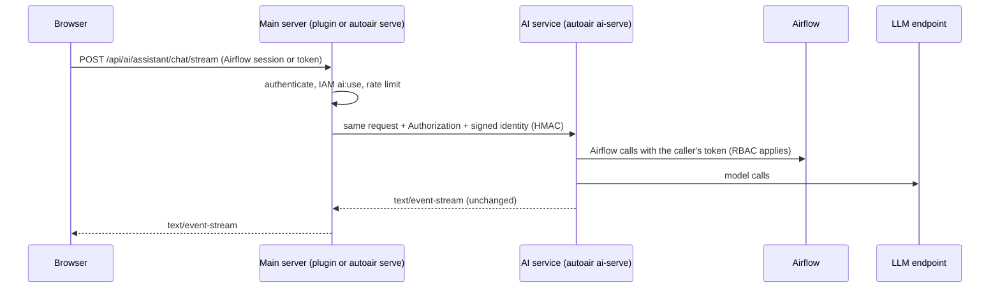

By default AutoAir runs its AI features **in-process**: in the Airflow API server (plugin) or in `autoair serve`. `autoair ai-serve` runs the same AI code as a separate service; the main server then proxies `/api/ai/*` (and optionally `/mcp`) to it. Why you might deploy it, and how the proxy and identity signing work, is explained in [AI service](/docs/ai/ai-service) and [AI architecture](/docs/ai/overview).

Run the AI service separately when you want to:

- keep LLM provider keys, the per-user key store and AI egress in one pod with a restrictive network policy;
- keep the AI extras (pydantic-ai and the provider SDKs, sentence-transformers, guardrail libraries) out of the Airflow image: a proxy-mode main server needs no `autoair[ai]`;
- scale AI streams independently, or put a local cross-encoder reranker on a GPU node;
- prevent long agent runs from competing with the builder API for the API server's event loop.

## How requests flow



## Command and endpoints

```bash
autoair ai-serve --host 0.0.0.0 --port 8790
```

| Option | Default | |
|---|---|---|
| `--host` | `127.0.0.1` | Bind address |
| `--port` | `8790` | Port |
| `--no-auth` | off | Do not require a bearer token. Never use it on a reachable network |

| Path | Purpose |
|---|---|
| `/api/ai/...` | The AI API (same routes as in-process) |
| `/mcp` | MCP endpoint when `ai.service.serve_mcp=true` (default) |
| `/health` | Liveness |
| `/ready` | Readiness: `{"ready": true, "llm": <configured>}` |

## Settings

On the **main server**:

```bash
AUTOAIR_AI__SERVICE_URL=http://autoair-ai:8790
AUTOAIR_AI__SERVICE__SHARED_SECRET=...         # same value as on the AI service
AUTOAIR_AI__SERVICE__PROXY_MCP=true            # optional: clients keep one MCP URL
AUTOAIR_AI__SERVICE__TIMEOUT_SECONDS=600       # proxy timeout; streams may run this long
```

On the **AI service**:

```bash
AUTOAIR_AIRFLOW_URL=http://airflow-api-server:8080
AUTOAIR_AI__SERVICE__SHARED_SECRET=...
AUTOAIR_AI__SERVICE__VERIFY_TOKENS=true        # verify unsigned bearer tokens against Airflow
AUTOAIR_AI__PROVIDER=anthropic
AUTOAIR_AI__API_KEY=...
AUTOAIR_AI__USER_LLM__ENCRYPTION_KEY=...       # if users bring their own keys
```

| Setting | Side | Default | Purpose |
|---|---|---|---|
| `ai.service_url` | main | none | Switches the main server to proxy mode |
| `ai.service.shared_secret` | both | none | HMAC secret: the proxy signs the caller identity (user, AI role, timestamp, 5-minute validity); the service trusts signed requests |
| `ai.service.verify_tokens` | service | `true` | Verify unsigned bearer tokens against Airflow, so MCP clients and automation can call the service directly |
| `ai.service.proxy_mcp` | main | `false` | Also proxy `/mcp` to the service |
| `ai.service.serve_mcp` | service | `true` | The service serves `/mcp` |
| `ai.service.timeout_seconds` | main | `600` | Proxy timeout |
| `ai.service.replay_cache_max_entries` | service | `100000` | Signed-request nonces retained for replay detection with a SQL backend |

A forged or stale signature is rejected with 401. Unsigned direct calls are verified against Airflow and resolved through the same IAM strategies as the main server; they need `ai:use`.

## Shared configuration and state

The AI service needs the same view of the world as the main server:

- **Same providers and catalog.** Build it from the same base image or install the same providers, and use the same `AUTOAIR_CATALOG_FILE`, so AI tools see the same operators as the palette.
- **Same state.** Point both at the same PostgreSQL (the same `AUTOAIR_DATABASE__BACKEND`, `AUTOAIR_DATABASE__URL` and `AUTOAIR_DATABASE__PASSWORD`), or at the same object-storage URLs for the file backend (`AUTOAIR_AI__KNOWLEDGE__STORE_URL`, `AUTOAIR_AI__USER_LLM__STORE_URL`, `AUTOAIR_AI__AUDIT__URL`, `AUTOAIR_AI__MEMORY_URL`, `AUTOAIR_AI__ASSISTANTS__STORE_URL`, `AUTOAIR_AI__TROUBLESHOOT__STORE_URL`, `AUTOAIR_AI__MCP_CLIENT__STORE_URL`, `AUTOAIR_AI__RULES__STORE_URL`, `AUTOAIR_TEMPLATES_URL`).
- **Same deploy target settings.** Tools that read saved specs read them from the deploy target, so give the AI service the same [`storage`](/docs/reference/configuration#storage) and [`storage.git`](/docs/reference/configuration#storagegit) settings as the main server.
- **Same AI settings.** Model, guardrails, retrieval and assistant settings are read by the service, which actually runs the AI.

## Image

The main Airflow image stays lean; the AI image carries the AI extras:

```dockerfile
FROM apache/airflow:3.3.2            # same providers as the Airflow image => same catalog
COPY dist/autoair-*.whl /tmp/
RUN pip install --no-cache-dir "$(ls /tmp/autoair-*.whl)[standalone,mcp,format,shell,postgres,ai,ai-anthropic]" \
        apache-airflow-providers-amazon apache-airflow-providers-snowflake \
    && rm /tmp/autoair-*.whl
RUN autoair catalog build --output /opt/airflow/autoair-catalog.json
ENV AUTOAIR_CATALOG_FILE=/opt/airflow/autoair-catalog.json
CMD ["autoair", "ai-serve", "--host", "0.0.0.0", "--port", "8790"]
```

## Kubernetes manifests

```yaml
apiVersion: apps/v1
kind: Deployment
metadata:
  name: autoair-ai
spec:
  replicas: 2
  selector: { matchLabels: { app: autoair-ai } }
  template:
    metadata: { labels: { app: autoair-ai } }
    spec:
      containers:
        - name: autoair-ai
          image: registry.example.com/autoair-ai:0.1.0
          args: ["autoair", "ai-serve", "--host", "0.0.0.0", "--port", "8790"]
          ports: [{ containerPort: 8790, name: http }]
          env:
            - { name: AUTOAIR_AIRFLOW_URL, value: "http://airflow-api-server:8080" }
            - { name: AUTOAIR_DATABASE__BACKEND, value: postgresql }
            - { name: AUTOAIR_DATABASE__URL, value: "postgresql+psycopg://autoair@autoair-db:5432/autoair" }
            - { name: AUTOAIR_DATABASE__MIGRATE_ON_START, value: "false" }
            - { name: AUTOAIR_AI__PROVIDER, value: anthropic }
            - name: AUTOAIR_DATABASE__PASSWORD
              valueFrom: { secretKeyRef: { name: autoair-db, key: password } }
            - name: AUTOAIR_AI__SERVICE__SHARED_SECRET
              valueFrom: { secretKeyRef: { name: autoair-ai, key: shared-secret } }
            - name: AUTOAIR_AI__API_KEY
              valueFrom: { secretKeyRef: { name: autoair-ai, key: api-key } }
            - name: AUTOAIR_AI__USER_LLM__ENCRYPTION_KEY
              valueFrom: { secretKeyRef: { name: autoair-ai, key: fernet-key } }
          readinessProbe: { httpGet: { path: /ready, port: http }, periodSeconds: 10 }
          livenessProbe: { httpGet: { path: /health, port: http }, periodSeconds: 20 }
          resources:
            requests: { cpu: 250m, memory: 1Gi }
            limits: { memory: 4Gi }
---
apiVersion: v1
kind: Service
metadata: { name: autoair-ai }
spec:
  selector: { app: autoair-ai }
  ports: [{ port: 8790, targetPort: http, name: http }]
```

Main server values for the Airflow Helm chart (API server):

```yaml
env:
  - { name: AUTOAIR_AI__SERVICE_URL, value: "http://autoair-ai:8790" }
  - { name: AUTOAIR_AI__SERVICE__PROXY_MCP, value: "true" }
secret:
  - { envName: AUTOAIR_AI__SERVICE__SHARED_SECRET, secretName: autoair-ai, secretKey: shared-secret }
```

Generate the secrets once:

```bash
kubectl create secret generic autoair-ai \
  --from-literal=shared-secret="$(openssl rand -hex 32)" \
  --from-literal=api-key="$ANTHROPIC_API_KEY" \
  --from-literal=fernet-key="$(python -c 'from cryptography.fernet import Fernet; print(Fernet.generate_key().decode())')"
```

### Network policy

Allow ingress to the AI service only from the API-server (and standalone) pods, and egress only to Airflow, PostgreSQL and the LLM endpoint. Remove LLM egress from the Airflow pods.

```yaml
apiVersion: networking.k8s.io/v1
kind: NetworkPolicy
metadata: { name: autoair-ai-ingress }
spec:
  podSelector: { matchLabels: { app: autoair-ai } }
  policyTypes: [Ingress]
  ingress:
    - from:
        - podSelector: { matchLabels: { component: api-server } }
      ports: [{ port: 8790 }]
```

Adjust the selector to the labels your Airflow chart applies to API-server pods.

## Replicas and sessions

- With PostgreSQL state the service is stateless apart from in-memory caches; several replicas are fine.
- Assistant threads, including each turn's pydantic-ai message history, live in the shared thread store, so any replica continues a conversation; no sticky sessions are needed.
- Replay detection of signed identities is shared through the SQL database (`ai.service.replay_cache_max_entries`); with the file backend it is per replica, bounded by the identity's 5-minute validity.

## Timeouts and streaming

Streams stay open for the length of an agent run. Keep `ai.service.timeout_seconds` (600) above `ai.agent.timeout_seconds` (300) and `ai.troubleshoot.timeout_seconds` (420), and make every proxy in between unbuffered for `text/event-stream` with a read timeout of the same order; see [Standalone behind a proxy](/docs/deployment/standalone-proxy).

## Verify

```bash
kubectl exec deploy/autoair-ai -- curl -s localhost:8790/ready         # {"ready":true,"llm":true}
curl -s -H "Authorization: Bearer $TOKEN" https://airflow.example.com/autoair/api/ai/status
```

`/api/ai/status` through the main server should report AI as enabled. If the main server answers 502/504 for AI routes, check `AUTOAIR_AI__SERVICE_URL`, the network policy and that both sides have the same `shared_secret` (a mismatch gives 401 from the service).

## Related pages

- [AI service](/docs/ai/ai-service)
- [AI architecture](/docs/ai/overview)
- [AI providers](/docs/ai/providers)
- [`ai.service` settings](/docs/reference/configuration#aiservice)
