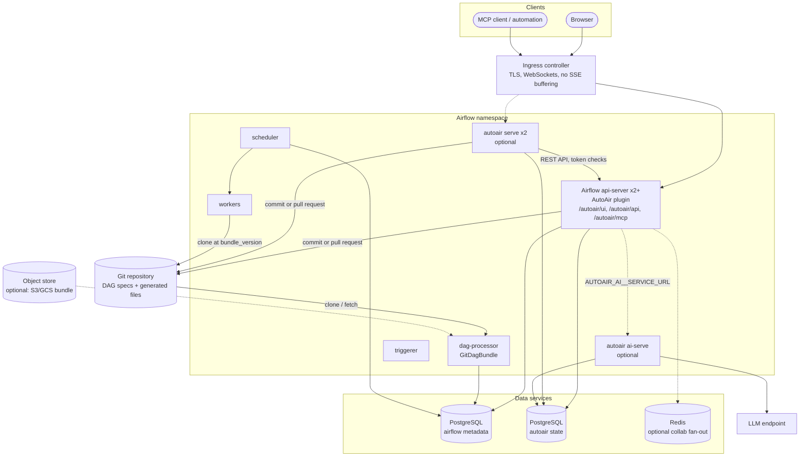

A production layout on Kubernetes has Airflow 3 deployed with the official Apache Airflow Helm chart, AutoAir loaded as a plugin in every API-server replica, PostgreSQL for AutoAir's own state and a git repository as the deploy target. A standalone AutoAir deployment and a separate AI service are optional additions.

## Architecture



### Components

| Component | Role | Replicas | State |
|---|---|---|---|
| Airflow `api-server` with the AutoAir plugin | Serves Airflow's UI and API plus AutoAir's UI, API, collaboration WebSocket and MCP endpoint | 2 or more | Stateless when AutoAir state is in PostgreSQL and DAGs go to git or object storage |
| Airflow `scheduler` | Schedules runs; unaffected by AutoAir | per Airflow sizing | Airflow metadata DB |
| Airflow `dag-processor` | Parses DAGs from the bundle AutoAir writes to | per Airflow sizing | Bundle checkouts |
| Airflow `triggerer`, `workers` | Execute tasks; need every provider and every Python object the generated DAGs import | per Airflow sizing | none for AutoAir |
| `autoair serve` (optional) | Standalone AutoAir on its own host name, for example when the Airflow image cannot change | 2 | none (shares PostgreSQL) |
| `autoair ai-serve` (optional) | AI routes and MCP, isolated from the API server | 1 or more | shares PostgreSQL / object storage |
| PostgreSQL for AutoAir | Templates, audit trail, reviews, proposals, AI records, collaboration snapshots, replica heartbeats | managed service | backups required |
| Git repository | Deploy target: `<dag_id>.autoair.json` specs and generated DAG files | hosted | the source of truth for DAGs |
| Redis (optional) | Collaboration fan-out through pub/sub (`collab.redis_url`) | 1 | none |

AutoAir does not need a shared volume in this layout. The API-server pods only talk to PostgreSQL, the git host's API and Airflow.

## Replica settings

| Concern | Setting | Recommendation |
|---|---|---|
| State backend | `AUTOAIR_DATABASE__BACKEND=postgresql` | Required for more than one replica without sticky sessions |
| Migrations | `AUTOAIR_DATABASE__MIGRATE_ON_START=false` + `autoair db upgrade` in a Job or init container | Replicas refuse to start on an older schema instead of racing to migrate it |
| Collaboration | `AUTOAIR_COLLAB__SYNC=auto` (default) | Resolves to `database` with PostgreSQL (`LISTEN/NOTIFY`), or `redis` when `AUTOAIR_COLLAB__REDIS_URL` is set |
| Collaboration tickets | `AUTOAIR_COLLAB_SECRET` | Plugin mode derives the key from Airflow's `[api_auth] jwt_secret`, which all API servers share; set it explicitly for standalone replicas |
| Deploy target picked in the UI | `AUTOAIR_DATABASE__SYNC_SECONDS` (5) | Other replicas apply the change within this interval |
| Operator catalog | `AUTOAIR_CATALOG_FILE` baked into the image | Every replica serves the identical palette and starts warm |
| Per-user AI keys | `AUTOAIR_AI__USER_LLM__ENCRYPTION_KEY` | Set explicitly; otherwise a Fernet key is created once in the database |
| Sign-in rate limit | `AUTOAIR_DATABASE__SHARED_RATE_LIMIT=true` (default) | One limit across replicas (standalone password sign-in) |
| Uvicorn workers (standalone) | `AUTOAIR_SERVER__WORKERS` | Prefer more pods over more workers per pod; each worker has its own connection pool |

With the `file` backend instead of PostgreSQL, route `/autoair/collab/<dag_id>` (or `/collab/<dag_id>`) with **sticky sessions keyed by path**, so every editor of a DAG reaches the same replica. The other limits of that setup are listed in [State and scaling](/docs/admin/scaling).

Still per replica, by design: the operator catalog cache, marketplace index caches (`marketplace_cache_ttl`), and the verified-token cache (`auth_cache_ttl`, 60 s). Assistant threads are stored in the shared state, so the AI service needs no sticky sessions.

## Probes

The Airflow chart owns the API server's probes. Keep them; AutoAir's endpoints are additional signals you can scrape or alert on.

For `autoair serve` and `autoair ai-serve` Deployments:

| Pod | Liveness | Readiness |
|---|---|---|
| `autoair serve` | `GET /api/health` | `GET /api/ready` |
| `autoair ai-serve` | `GET /health` | `GET /ready` |
| plugin (for monitoring) | `GET /autoair/api/health` | `GET /autoair/api/ready` |

`/api/ready` returns 503 with a `checks` map when the catalog cannot be loaded, when the deploy target is unreachable or read-only (`server.ready_check_storage`, default `true`) or when Airflow's health endpoint fails (`server.ready_check_airflow`, default `false`; each check limited by `server.ready_timeout`, 5 s). A git target that is temporarily unreachable therefore takes a standalone replica out of rotation; set `AUTOAIR_SERVER__READY_CHECK_STORAGE=false` if you prefer to keep serving the editor during a git outage.

A deploy target that cannot be built at startup (for example `storage.git.conn_id` names an Airflow connection that does not exist yet, or the GitDagBundle configuration cannot be read) does not crash the pod. AutoAir starts degraded: the log shows `deploy target (storage.mode=git) unavailable, starting degraded: <reason>`, the editor loads, listing DAGs returns nothing, deploys fail with `the git deploy target is unavailable: <reason>`, and `/api/ready` answers 503 with `"storage": "error: <reason>"`. Each readiness call retries building the target at most every 10 seconds (every deploy retries at once), so the pod becomes ready on its own once the connection or bundle exists; no restart is needed. Because liveness uses `/api/health`, which stays `200`, Kubernetes does not restart a degraded pod. With `AUTOAIR_SERVER__READY_CHECK_STORAGE=false` the degraded pod is reported ready and only the deploy-target panel and the log show the error.

The first start without `AUTOAIR_CATALOG_FILE` builds the catalog, which can take minutes with every provider installed. Give the readiness probe a generous `initialDelaySeconds` or a `startupProbe` in that case.

## Standalone AutoAir Deployment

Complete, hardened manifests for this layout (Deployment, PodDisruptionBudget, probes, NetworkPolicies, validator, AI service, HorizontalPodAutoscaler) are in [`deploy/kustomize`](https://github.com/ctolon/autoair/tree/main/deploy/kustomize); see [Kubernetes with Kustomize](/docs/deployment/kustomize). The sketch below shows the essentials.

A minimal standalone Deployment next to Airflow. It uses the image built for the plugin (Airflow's image contains uvicorn); see [Plugin with the Airflow Helm chart](/docs/deployment/helm-plugin) for the image.

```yaml
apiVersion: apps/v1
kind: Deployment
metadata:
  name: autoair
spec:
  replicas: 2
  selector: { matchLabels: { app: autoair } }
  template:
    metadata: { labels: { app: autoair } }
    spec:
      initContainers:
        - name: migrate
          image: registry.example.com/my-airflow-autoair:3.3.2
          command: ["autoair", "db", "upgrade"]
          envFrom: [{ configMapRef: { name: autoair-env } }, { secretRef: { name: autoair-secrets } }]
      containers:
        - name: autoair
          image: registry.example.com/my-airflow-autoair:3.3.2
          command: ["autoair", "serve", "--host", "0.0.0.0", "--port", "8765"]
          ports: [{ containerPort: 8765, name: http }]
          envFrom: [{ configMapRef: { name: autoair-env } }, { secretRef: { name: autoair-secrets } }]
          readinessProbe: { httpGet: { path: /api/ready, port: http }, periodSeconds: 10, timeoutSeconds: 6 }
          livenessProbe: { httpGet: { path: /api/health, port: http }, periodSeconds: 20 }
          resources:
            requests: { cpu: 250m, memory: 768Mi }
            limits: { memory: 2Gi }
---
apiVersion: v1
kind: ConfigMap
metadata: { name: autoair-env }
data:
  AUTOAIR_AIRFLOW_URL: http://airflow-api-server:8080
  AUTOAIR_SERVER__PUBLIC_URL: https://autoair.example.com
  AUTOAIR_SERVER__FORWARDED_ALLOW_IPS: '["10.0.0.0/8"]'
  AUTOAIR_SSO__AIRFLOW_PUBLIC_URL: https://airflow.example.com
  AUTOAIR_DATABASE__BACKEND: postgresql
  AUTOAIR_DATABASE__URL: postgresql+psycopg://autoair@autoair-db:5432/autoair
  AUTOAIR_DATABASE__SSL_MODE: verify-full
  AUTOAIR_DATABASE__MIGRATE_ON_START: "false"
  AUTOAIR_STORAGE__MODE: git
  AUTOAIR_STORAGE__GIT__PROVIDER: github
  AUTOAIR_STORAGE__GIT__REPO: acme/airflow-dags
  AUTOAIR_STORAGE__GIT__BASE_BRANCH: main
  AUTOAIR_STORAGE__GIT__SUBDIR: dags/autoair
  AUTOAIR_LOGGING__FORMAT: json
```

`autoair-secrets` holds `AUTOAIR_DATABASE__PASSWORD`, `AUTOAIR_COLLAB_SECRET`, `AUTOAIR_STORAGE__GIT__TOKEN` (or the GitHub App key) and AI keys. The image built from `deploy/docker/Dockerfile` installs the extras of its `AUTOAIR_EXTRAS` build argument (`git,mcp,ai,ai-anthropic,ai-openai,format,postgres,collab,collab-redis,otel,yaml,standalone`), which cover this layout (see [Plugin with the Airflow Helm chart](/docs/deployment/helm-plugin#building-the-image)).

`AUTOAIR_SERVER__FORWARDED_ALLOW_IPS` is handed to uvicorn, which accepts single addresses and CIDR ranges such as `10.0.0.0/8` (the `standalone` extra requires `uvicorn>=0.30`, the first release with CIDR support). Narrow the range to the ingress controller's pod network when other workloads share the cluster network.

## Network flows

| From | To | Purpose | Notes |
|---|---|---|---|
| Ingress | API server / `autoair serve` | HTTP, WebSocket (`/collab/<dag_id>`, `/api/lsp/ws/<language>`), SSE (the five AI routes under `/api/ai/` that end in `/stream`, listed in [Standalone behind a proxy](/docs/deployment/standalone-proxy)) | Disable response buffering for SSE; idle timeout above `ai.agent.timeout_seconds` (300 s) |
| `autoair serve` | Airflow API server | Token verification, pickers, runs, logs | `AUTOAIR_AIRFLOW_URL`; `AUTOAIR_AIRFLOW_TIMEOUT` (15 s) |
| API server / `autoair serve` | Git host API (or `git` over SSH/HTTPS for `provider=local`) | Commits, branches, pull requests | `AUTOAIR_STORAGE__GIT__API_URL` for self-hosted GitHub/GitLab/Azure DevOps Server/Gitea; `provider=gitea` needs both `git` (push) and the REST API (pull requests) |
| API server / AI service | LLM endpoint | AI features | Restrict egress with a NetworkPolicy, ideally to the AI service pod only |
| All AutoAir pods | PostgreSQL (AutoAir) | State, `LISTEN/NOTIFY` | One extra long-lived `LISTEN` connection per process |
| dag-processor, workers | Git repository | Bundle clone at `bundle_version` | Airflow's `GitDagBundle` credentials (`git_conn_id`) |

Outgoing TLS (corporate CA, client certificates) and proxies for every AutoAir client are configured with the `outbound` settings ([reference](/docs/reference/configuration#outbound)); see [Air-gapped installation](/docs/deployment/air-gapped#outbound-traffic).

## Rollouts and upgrades

1. Build a new image with the new wheel and the same providers; rebuild the catalog in the image (`autoair catalog build`).
2. Run `autoair db upgrade` once (Helm pre-upgrade hook, Job or init container). Concurrent upgrades are serialised by an advisory lock, so an init container on every pod is also safe.
3. Roll the API servers. Open collaboration rooms are snapshotted every `collab.snapshot_seconds` (5 s) and restored on another replica when reopened within `collab.snapshot_ttl_seconds` (300 s).

See [Upgrading](/docs/installation/upgrading) for version-specific notes.

## Related pages

- [Kubernetes with Kustomize](/docs/deployment/kustomize)
- [Plugin with the Airflow Helm chart](/docs/deployment/helm-plugin)
- [Git bundles and git-sync](/docs/deployment/git-bundles)
- [PostgreSQL for AutoAir state](/docs/deployment/postgres)
- [Separate AI service](/docs/deployment/ai-service)
- [Standalone behind a proxy](/docs/deployment/standalone-proxy)
- [State and scaling](/docs/admin/scaling)
