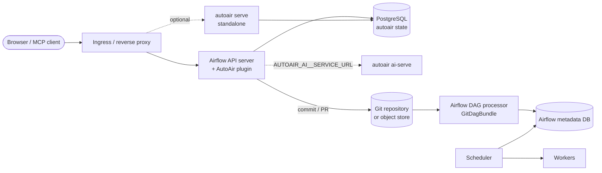

A production AutoAir deployment is the combination of four independent decisions:

1. **Where the server runs**: inside Airflow's API server as a plugin, or as a standalone service (`autoair serve`) next to Airflow.
2. **Where generated DAGs go** (the *deploy target*): a local folder, an object-storage prefix, or a git repository. This must be a location every Airflow DAG processor and scheduler reads.
3. **Where AutoAir keeps its own state** (saved templates, the audit trail, reviews and deploy proposals, the deploy target chosen in the UI, custom icons, AI memory, the AI audit log, AI knowledge overrides, per-user AI model settings, collaboration room snapshots, users seen and replica heartbeats): files, SQLite or PostgreSQL.
4. **Optional services**: a separate AI service (`autoair ai-serve`), Redis for collaboration fan-out, an internal marketplace index, LLM endpoints.

The decision guide below points to the page that covers each decision in depth.

## Decision guide

| Question | Small / single host | Multi-replica production |
|---|---|---|
| Server | Plugin in one Airflow API server, or one `autoair serve` | Plugin in every API-server replica (official Helm chart), or several `autoair serve` replicas behind a proxy |
| Deploy target | `local` on the DAG folder | `git` (pairs with `GitDagBundle` or git-sync) or `object` (pairs with S3/GCS bundles) |
| State backend | `file` (default) or `sqlite` | `postgresql` |
| Collaboration | in memory | `collab.sync=database` (default with PostgreSQL) or Redis |
| AI | in-process (default) | in-process, or a separate AI service |

Use these rules of thumb:

- **One host, one process**: everything works with defaults. `database.backend=file`, `storage.mode=local`.
- **One host, several worker processes**: switch to `database.backend=sqlite` (or PostgreSQL) so locks and the collaboration ticket key are shared.
- **Several hosts or pods**: use PostgreSQL for state and a `git` or `object` deploy target. File-backed state on a shared volume works only with sticky sessions and has known limits, listed in [State and scaling](/docs/admin/scaling).

## Deployment modes

| Mode | Started by | UI | API | Typical use |
|---|---|---|---|---|
| Plugin | Airflow's API server loads the `airflow.plugins` entry point `autoair` | **Browse → DAG Builder** and an **AutoAir** tab on every DAG page (Airflow 3.1 and later); `/autoair/ui/` on Airflow 3.0 | `/autoair/api` | Recommended: one deployment, Airflow's own sign-in, per-DAG permissions evaluated by Airflow |
| Standalone | `autoair serve` | `/ui/` | `/api` | Separate scaling, separate network zone, or Airflow you cannot change |
| Local | `autoair local` | `/ui/` | `/api` | A laptop without an Airflow server; not for production |

Installation of each mode is covered in [Installation](/docs/installation/overview); the [plugin](/docs/installation/plugin) and [standalone](/docs/installation/standalone) pages explain the authentication differences.

## Service endpoints

| Endpoint | Plugin mode | Standalone | Auth |
|---|---|---|---|
| UI | `/autoair/ui/` | `/ui/` | Airflow session |
| REST API | `/autoair/api/...` | `/api/...` | Airflow token or session |
| Liveness | `/autoair/api/health` | `/api/health` | none |
| Readiness | `/autoair/api/ready` | `/api/ready` | none |
| Prometheus metrics | `/autoair/api/metrics` | `/api/metrics` | none (`server.metrics_enabled`) |
| Collaboration WebSocket | `/autoair/collab/<dag_id>` | `/collab/<dag_id>` | ticket from `POST /autoair/api/collab/<dag_id>/ticket` (standalone: `POST /api/collab/<dag_id>/ticket`) |
| Language-server WebSocket | `/autoair/api/lsp/ws/<language>` | `/api/lsp/ws/<language>` | session ticket (`features.ide_language_server`) |
| MCP (streamable HTTP) | `/autoair/mcp/` | `/mcp/` | same as the API |

`/api/ready` answers 503 when a check fails. It always checks that the operator catalog loads, checks the deploy target when `server.ready_check_storage=true` (default; a read-only target counts as a failure), and checks Airflow's `/api/v2/monitor/health` when `server.ready_check_airflow=true` (default `false`).

## Reference architecture

The full Kubernetes version, with replica counts and probes, is on [Kubernetes reference architecture](/docs/deployment/kubernetes).

## Pages in this section

| Page | Covers |
|---|---|
| [Kubernetes reference architecture](/docs/deployment/kubernetes) | Components, replicas, probes, sticky sessions, network flows |
| [Kubernetes with Kustomize](/docs/deployment/kustomize) | `deploy/kustomize`: base, components (PostgreSQL, git, validator, AI service, Ingress, HPA, NetworkPolicies) and overlays for `autoair serve` |
| [Plugin with the Airflow Helm chart](/docs/deployment/helm-plugin) | Building the image from `deploy/docker/Dockerfile`, `deploy/helm/values-autoair.yaml` |
| [Git bundles and git-sync](/docs/deployment/git-bundles) | The `storage.git` settings, providers, PR vs push, `bundle_version` |
| [Object storage](/docs/deployment/object-storage) | S3/GCS bundles and the `object` target |
| [Standalone behind a proxy](/docs/deployment/standalone-proxy) | nginx and Traefik, forwarded headers, WebSockets, SSE |
| [PostgreSQL for AutoAir state](/docs/deployment/postgres) | Separate database or schema, migrations, pooling |
| [Separate AI service](/docs/deployment/ai-service) | `autoair ai-serve` manifests and environment |
| [Air-gapped installation](/docs/deployment/air-gapped) | Offline wheels, prebuilt catalog, mirrors, local LLMs, outbound TLS and proxy settings |

## Production checklist

- Install the **same wheel and the same providers** on every replica (API servers, standalone servers, the AI service). The operator catalog is derived from installed packages; precompute it with `autoair catalog build` and point `AUTOAIR_CATALOG_FILE` at it.
- Use `database.backend=postgresql` for more than one host, run `autoair db upgrade` once per release, and set `AUTOAIR_DATABASE__MIGRATE_ON_START=false` on the replicas.
- Choose a deploy target every DAG processor reads. Writing into a folder that git-sync or a `GitDagBundle` owns is pointless: the next sync overwrites it.
- Set `AUTOAIR_COLLAB_SECRET` (standalone with several replicas), `AUTOAIR_AI__USER_LLM__ENCRYPTION_KEY` (per-user AI keys) and `AUTOAIR_AI__SERVICE__SHARED_SECRET` (separate AI service) from a secret store.
- Set `AUTOAIR_SERVER__PUBLIC_URL` so commits, pull requests and SSO return URLs link back correctly.
- Map Airflow roles to AutoAir roles ([IAM](/docs/admin/iam)) and verify allowed and denied actions with the production auth manager.
- Review the [security model](/docs/security/overview) and the [hardening checklist](/docs/security/overview#hardening-checklist).
- Back up the AutoAir database, the deploy repository and the encryption keys together ([Backup and restore](/docs/admin/backup-restore)).
