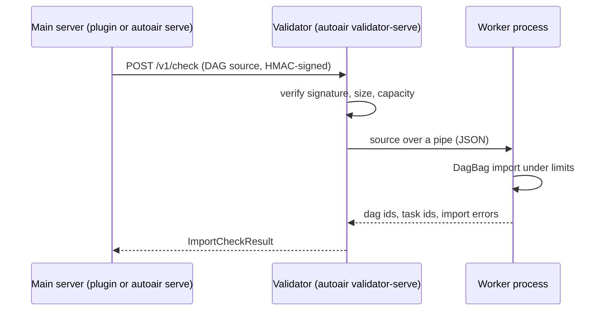

The import check imports a DAG file with Airflow's `DagBag`, so it executes the DAG's module-level code, inline Python task bodies, raw-code DAGs and imported DAG files. By default it runs in warm worker processes of the AutoAir process itself: inside the Airflow API server (plugin) or `autoair serve`. Those processes are not a security sandbox (see [Code execution boundaries](/docs/security/overview#code-execution-boundaries)).

`autoair validator-serve` moves the check, and the builder's task and DAG [test runs](#test-runs), into its own service. The main server then sends each check and run over HTTP, and no DAG code runs where AutoAir's credentials, its database and Airflow's API server live. Deploy it when DAG authors are not fully trusted, or when you want the import check to have hard resource limits.

## How it works



- **Main server.** With `validator.url` set, every import check (live **Validate in Airflow**, deploys with `import_check_on_deploy`, raw-code DAGs, MCP and AI tools that validate) goes to the validator. The request is signed with an HMAC key; signatures are bound to the method, path and body, valid for 5 minutes and single-use. The validator signs its answer with the same key, bound to the request's nonce (header `x-autoair-validator-response-signature`); the main server rejects an unsigned or mismatched answer and treats the validator as unavailable (`validator.fail_mode` applies).
- **Validator.** Runs only a pool of DagBag worker processes. It reads no AutoAir state (no database, no storage, no catalog), needs no outbound network, and holds one credential: the HMAC key.
- **Workers.** A fresh interpreter per check by default (`validator.max_tasks_per_child=1`), so one check cannot observe or alter the next. Each worker applies the limits below before it imports any DAG code.

## Containment

| Layer | What it does | Setting |
|---|---|---|
| Wall-clock timeout | The worker is killed when the check exceeds the request's timeout (`import_check_timeout`, at most `validator.max_check_seconds`); the deadline covers reading the whole reply, so DAG code that writes part of a reply and stops cannot hold a pool slot | `validator.max_check_seconds` (120 s) |
| Address space | An import that allocates more fails with `MemoryError` | `validator.memory_limit_mb` (1024) |
| CPU time | The worker is killed after this many CPU seconds (about 2 s go to importing Airflow) | `validator.cpu_limit_seconds` (120) |
| File size | Writes beyond the limit fail with "File too large" | `validator.file_size_limit_mb` (16) |
| Open files, processes | `RLIMIT_NOFILE`, `RLIMIT_NPROC` | `validator.open_files_limit` (1024), `validator.process_limit` (0: inherited) |
| Request size | Larger requests get HTTP 413, reported as an `import` problem | `validator.max_request_bytes` (4 MiB) |
| Privileges | `PR_SET_NO_NEW_PRIVS`, no core dumps; the service and every worker are non-dumpable, so a worker cannot read another process's environment or memory through `/proc` | always (Linux) |
| Network namespace | Each worker gets its own empty network namespace when the kernel allows unprivileged user namespaces | `validator.network_isolation` (`auto`) |
| Audit hook | Denies subprocesses, `fork`/`exec`, signals, `ctypes`, socket connections and DNS lookups, writes outside the worker's scratch folder, and reads of other workers' folders and other processes' `/proc` entries | `validator.audit_hook` (`true`) |
| Environment | AutoAir secrets, Airflow secrets (metadata DB URL, Fernet key, JWT and API secrets, `*_CMD`/`*_SECRET` indirections, `AIRFLOW_CONN_*`, `AIRFLOW_VAR_*`) and cloud credentials are removed, the same list as on the main server ([Environment scrubbing](/docs/security/overview#environment-scrubbing-sandbox)); the HMAC key's connection variable is never passed to workers, and each worker gets its own `HOME` and `AIRFLOW_HOME` in its scratch folder with `PYTHONNOUSERSITE=1`, so a check cannot plant configuration or modules that a later worker loads | `sandbox.credential_env_pattern`, `sandbox.env_passthrough`, `sandbox.scrub_env_extra` |
| Process group | Each worker runs in its own process group; killing it also kills processes it started | always |

The audit hook and the network namespace are defence in depth: Python code that reaches native internals can bypass an audit hook, and container runtimes usually block unprivileged user namespaces (the `/ready` answer says which layers are active). The boundary is the container: run the validator read-only, as a non-root user, without capabilities, without credentials and with a network policy that denies all egress. The Helm chart and the Compose file below do that.

## The HMAC key

AutoAir stores no secret of its own. The key is the **password of an Airflow connection**, `validator.secret_conn_id` (default `autoair_validator`):

- the **main server** reads it like any Airflow connection (secrets backend, metadata database or environment variable), and again after `validator.key_cache_seconds` (60 s) so a rotated key is picked up;
- the key must be at least 16 bytes; use 32 or more random characters;
- on the main server the variable is removed from every process that runs DAG code (Python DAG import, test runs, the local pool);
- the **validator** reads only the environment variable `AIRFLOW_CONN_AUTOAIR_VALIDATOR` (JSON or URI form) and never touches a metadata database or secrets backend.

```bash
# the same value on both sides, at least 32 random characters
AIRFLOW_CONN_AUTOAIR_VALIDATOR='{"conn_type": "generic", "password": "<random key>"}'
```

To rotate the key, update the validator first, then the main server's connection; checks fail with HTTP 401 for up to `validator.key_cache_seconds` in between.

## Command and endpoints

```bash
autoair validator-serve --host 0.0.0.0 --port 8791
```

| Option | Default | Description |
|---|---|---|
| `--host` | `127.0.0.1` | Bind address |
| `--port` | `8791` | Port |
| `--no-auth` | off | Accept unsigned checks. For tests only, and refused unless `--host` is a loopback address |
| `--config`, `-c` | none | Configuration file, as for every command |

The command exits with code 1 when Apache Airflow is not installed and with code 2 when no key is configured (unless `--no-auth`). Install the same providers as your Airflow workers: the validator imports your DAGs, so a missing provider is reported as an import error.

| Path | Purpose |
|---|---|
| `POST /v1/check` | `{"source", "filename", "timeout"}`, signed. Answers `{"ok", "dag_ids", "task_ids", "import_errors"}`. 401: missing, wrong, expired or replayed signature; 413: body over `validator.max_request_bytes`; 422: invalid request (the file name must be a bare `*.py` name); 503: `pool_size + max_queue` checks already running, or no key configured |
| `POST /v1/run` | A task or DAG test run, signed like `/v1/check`: `{"kind": "task" or "dag", "source", "dag_id", "task_id", "conf", "mock_xcoms", "logical_date", "timeout", "max_log_chars", "max_value_chars"}`. Answers the same result as `POST /api/runner/test-task` / `test-dag`, signed. 401, 413 and 422 as for checks (a task run without `task_id` and `mode` other than `memory` are 422); 503: `validator.max_concurrent_runs` runs already executing |
| `GET /health` | Liveness |
| `GET /ready` | 200 after a self-test DAG imported; reports `network_isolated`, `audit_hook` and the resource limits in force. 503 before |
| `GET /metrics` | Prometheus metrics (`validator.metrics_enabled`) |

## Settings

On the **main server** (plugin: the Airflow API server's environment; standalone: `autoair serve`):

| Setting | Default | Purpose |
|---|---|---|
| `validator.url` | empty | Base URL of the validator. Empty: checks run in the local pool (`dagbag_pool*`) |
| `validator.secret_conn_id` | `autoair_validator` | Airflow connection holding the key |
| `validator.fail_mode` | `open` | When the validator cannot be asked: `open` reports a warning and skips the import, so deploys go ahead without it; `closed` reports an error, so deploys are blocked; `local` runs the check in the local pool (DAG code then runs in the main server again) |
| `validator.retries` | `2` | Extra attempts after a connection error or HTTP 429/502/503/504. A request that timed out is not retried |
| `validator.retry_backoff_seconds` | `0.5` | First retry delay, doubled per retry |
| `validator.request_overhead_seconds` | `30` | Added to `import_check_timeout` for the HTTP request |
| `validator.health_check_interval_seconds` | `10` | After an outage (connection error, HTTP 401/403/502/504, invalid answer) the validator counts as down: checks fail at once and `/ready` is probed at most this often. A busy validator (429/503 after the retries) or a check that timed out fails only that check |
| `validator.health_timeout_seconds` | `3` | Timeout of that probe |
| `validator.key_cache_seconds` | `60` | How long the key is reused before the connection is read again |
| `validator.test_runs` | `true` | Send test runs to the validator. `false`: test runs stay on the main server |
| `validator.run_url` | empty | Validator for test runs only; empty: `validator.url`. See [Network for test runs](#network-for-test-runs) |

On the **validator**: `validator.pool_size` (2), `validator.max_tasks_per_child` (1), `validator.start_timeout_seconds` (120), `validator.max_check_seconds` (120), `validator.max_request_bytes`, `validator.max_queue` (8), the limits in [Containment](#containment), the [test-run settings](#test-runs) and `validator.metrics_enabled`. All settings, with their environment variables (`AUTOAIR_VALIDATOR__*`), are in the [configuration reference](/docs/reference/configuration#validator). TLS options for the connection to the validator are `outbound.clients.validator`.

## What users see

When the validator cannot be asked, the import check becomes an `import_service` problem. By default (`fail_mode=open`) it is a warning: "The import check service is unavailable (HTTP 503). The DAG was not imported with Airflow, so import errors are not detected.", and the deploy goes ahead without the import check. With `fail_mode=closed` it is an error that blocks deploys: "The import check service is unavailable (not reachable: ConnectError). Deploys are blocked until it answers again; ask an administrator to check the validator service." A rejected signature names the cause: both sides need the same key and synchronised clocks.

**Production: use `fail_mode=closed`.** The application default stays `open` so a missing or restarting validator never blocks a first installation, but in production an unreachable validator should not let DAGs reach Airflow unchecked. The production Kustomize overlay (`overlays/production/settings/settings.env`) and the Helm example values (`deploy/helm/values-autoair.yaml`) set `AUTOAIR_VALIDATOR__FAIL_MODE=closed`. Run at least two validator replicas (the PodDisruptionBudget keeps one up during node drains) so a closed fail mode does not turn a single pod restart into a deploy outage.

## Test runs

With `validator.url` (or `validator.run_url`) set and `validator.test_runs` on, **Test selected task…** and **Test whole DAG…** in memory mode run on the validator (`POST /v1/run`). `dag.test()` (`mode=db`) still runs on the main server: it needs the metadata DB, which the validator does not have, and it is off unless `runner.allow_db_mode` is set ([dag.test() mode](/docs/user-guide/runs#dagtest-mode)).

Each run is a fresh process (`python -m autoair.runner._child`) in its own folder below the service's scratch folder, with its own `HOME` and `AIRFLOW_HOME` there and `PYTHONNOUSERSITE=1`. It applies the **run** profile of the sandbox, which differs from the check profile because task code legitimately starts processes, opens connections and writes files:

| Layer | Import check | Test run |
|---|---|---|
| Resource limits | `memory_limit_mb`, `cpu_limit_seconds`, `file_size_limit_mb`, `open_files_limit`, `process_limit` | `run_memory_limit_mb` (2048), `file_size_limit_mb`, `open_files_limit`, `process_limit`; CPU bounded by the run's timeout (at most `max_run_seconds`) |
| `PR_SET_NO_NEW_PRIVS`, no core dumps, non-dumpable | yes | yes |
| Audit hook (`validator.audit_hook`) | everything in [Containment](#containment) | only reads of other processes' `/proc/<pid>` entries and of other workers' and runs' folders |
| Own PID + user + mount namespaces with a fresh `/proc` | no | `validator.run_process_isolation` (`auto`) |
| Network | none (`network_isolation`, the NetworkPolicy) | allowed (`validator.run_network`, default `true`); `false` gives each run an empty network namespace |
| HMAC key in the environment | never | never |

| Setting | Default | Purpose |
|---|---|---|
| `validator.max_run_seconds` | `600` | Largest run timeout a request may ask for |
| `validator.max_concurrent_runs` | `2` | Runs executing at once (one process each); more requests get 503 and the main server retries |
| `validator.run_memory_limit_mb` | `2048` | Address-space limit of a run process (MiB) |
| `validator.run_network` | `true` | Runs may open network connections |
| `validator.run_process_isolation` | `auto` | Own PID namespace per run: `auto`, `required`, `off` |
| `validator.runs_enabled` | `true` | Serve `/v1/run`; `false` (404) on an import-check-only deployment |

Without a validator, local test runs use `runner.process_isolation` (default `auto` in every mode, the Airflow plugin included): where the host does not allow the namespaces they run with the audit hook only and are marked **Not fully isolated**, which this service avoids. Set `runner.process_isolation=required` on the main server to refuse such local runs instead.

A run request is retried only when it surely did not run (connection refused, 429, 503): after a timeout, a connection lost once the request was sent, or a 502/504 from a proxy, the run fails instead of starting again, because tasks can have side effects. When the validator cannot be asked, `validator.fail_mode` applies differently from checks: `local` runs the test on the main server; `open` and `closed` both fail it with state `error` ("the test-run service is unavailable … the test did not run"). A test run is never moved to the main server unless you chose `local` (and never after a request that may have run), because in plugin mode that is the Airflow API server. A validator older than this version answers 404 for `/v1/run`; the error says to upgrade it.

### Network for test runs

Task tests often call services (an HTTP API, a database), so runs have network by default. The validator's NetworkPolicy, however, denies all egress, and a NetworkPolicy applies to the whole pod: it cannot give run processes network while keeping it from the import-check workers next to them. The cleanest setup is therefore a **second validator for runs only**:

1. Keep the import-check validator as it is (no egress).
2. Install the chart a second time, for example as `autoair-validator-runs`, with `networkPolicy.egress` listing what the task tests may reach (DNS plus those services). Size `resources.limits.memory` for `max_concurrent_runs` runs.
3. Set `AUTOAIR_VALIDATOR__RUN_URL=http://autoair-validator-runs:8791` on the main server. Both use the same HMAC key.

```bash
helm upgrade --install autoair-validator-runs deploy/helm/autoair-validator -n airflow \
  -f my-runs-egress.yaml   # networkPolicy.egress: [...]
```

A separate deployment also keeps runs and checks apart in every other way: all processes of one pod share a uid, a run may start subprocesses, and without PID namespaces (most container runtimes) a run could read or disturb the scratch folders of check workers and other runs, or use up the pod's process and memory budget. On the import-check deployment set `AUTOAIR_VALIDATOR__RUNS_ENABLED=false`. With a single validator and the default policy, runs still execute there, but a task that opens a connection fails. Widening the single validator's policy instead gives import-time code the same network. The Kustomize component ships the no-egress policy only; add a second Deployment with its own policy the same way.

## Kubernetes (Helm)

The chart [`deploy/helm/autoair-validator`](https://github.com/ctolon/autoair/tree/main/deploy/helm/autoair-validator) installs a Deployment, a Service, a PodDisruptionBudget and a NetworkPolicy next to Airflow's official chart:

```bash
kubectl -n airflow create secret generic autoair-validator \
  --from-literal=connection='{"conn_type":"generic","password":"<random key>"}'
helm upgrade --install autoair-validator deploy/helm/autoair-validator -n airflow \
  --set image.repository=registry.example.com/my-airflow-autoair --set image.tag=3.3.2
```

- The image is the one AutoAir runs in ([`deploy/docker/Dockerfile`](https://github.com/ctolon/autoair/blob/main/deploy/docker/Dockerfile)), so the validator has the same providers as your DAGs.
- Pods run as uid 50000 with `readOnlyRootFilesystem`, `allowPrivilegeEscalation: false`, all capabilities dropped, the `RuntimeDefault` seccomp profile, no service account token, an `emptyDir` for `/tmp` (`AIRFLOW_HOME=/tmp/airflow`), CPU and memory limits, and `dumb-init` as PID 1.
- The NetworkPolicy allows ingress on port 8791 from the Airflow API server pods (`component: api-server`) and `app.kubernetes.io/name: autoair` pods (`networkPolicy.allowFrom`), plus `networkPolicy.allowMetricsFrom`, and denies all egress, DNS included. It needs a CNI that enforces network policies.
- Probes: startup and readiness on `/ready`, liveness on `/health`.

Then enable it in the Airflow values ([`deploy/helm/values-autoair.yaml`](https://github.com/ctolon/autoair/blob/main/deploy/helm/values-autoair.yaml) has the lines commented out):

```yaml
env:
  - { name: AUTOAIR_VALIDATOR__URL, value: "http://autoair-validator:8791" }
secret:
  - envName: AIRFLOW_CONN_AUTOAIR_VALIDATOR
    secretName: autoair-validator
    secretKey: connection
```

The same Deployment, PodDisruptionBudget and NetworkPolicy also come as a Kustomize Component, [`deploy/kustomize/components/validator`](https://github.com/ctolon/autoair/tree/main/deploy/kustomize/components/validator), which also wires the standalone server to it ([Kubernetes with Kustomize](/docs/deployment/kustomize)).

## Docker Compose

[`deploy/compose/docker-compose.validator.yml`](https://github.com/ctolon/autoair/blob/main/deploy/compose/docker-compose.validator.yml) adds the validator to the demo stack: read-only, no capabilities, `no-new-privileges`, uid 50000, memory, CPU and process limits, on an internal network that has no route out.

```bash
cd deploy/compose
docker compose -f docker-compose.demo.yml -f docker-compose.validator.yml up -d --wait
```

## Scaling and replicas

- Run two or more validator replicas behind the Service. Each holds its own pool; size `validator.pool_size` to the CPU limit and `memory_limit_mb x pool_size` (plus about 300 MiB for the service) to the memory limit.
- A busy validator answers 503 and the main server retries, so the Service spreads the load.
- The single-use check of signatures is per validator replica: a request captured on the wire could be replayed once to another replica within the 5-minute window. For a check that only runs the same side-effect-free import again; a replayed test run would run the test again, with whatever side effects its tasks have. Use TLS (`https://` in `validator.url`, `outbound.clients.validator` for a private CA) when the network between the two is not trusted.
- The health state ("down until the next probe") is kept per main-server process; replicas decide independently.

## Upgrades

The validator service and the main server (the Airflow plugin or `autoair serve`) must run the **same AutoAir version**. There is no mixed-version compatibility window: the request and response protocol, including the signed answers, can change between releases, and a main server treats a validator whose answers it rejects as unavailable (`validator.fail_mode` applies). Upgrade both together, for example in one Helm or Compose rollout, and roll back both together.

## Metrics

| Metric | Where | Labels |
|---|---|---|
| `autoair_import_checks_total` | main server, `/api/metrics` | `backend` (`local`, `remote`), `result` (`ok`, `failed`, `unavailable`) |
| `autoair_validator_checks_total` | validator, `/metrics` | `result` (`ok`, `failed`, `timeout`, `crashed`, `worker_error`) |
| `autoair_validator_check_seconds` | validator | histogram, queueing included |
| `autoair_validator_rejected_total` | validator | `reason` (`unauthorized`, `too_large`, `busy`, `invalid`, `no_key`) |
| `autoair_validator_in_flight` | validator | checks running or waiting |
| `autoair_validator_workers_started` | validator | worker processes started |
| `autoair_validator_runs_total` | validator | `kind` (`task`, `dag`), `state` (the run's result state) |
| `autoair_validator_run_seconds` | validator | histogram of test-run duration |

## Limits

- The validator covers the DagBag import check and test runs in memory mode. These still run in the main server's subprocesses: Python DAG imports into a spec (`/interchange/python/import`, code mode apply), the round-trip import of source-preserving deploys and of the source preview (`POST /api/specs/{dag_id}/source-preview`), and `dag.test()` runs (`mode=db`, off by default). Withhold `code:execute` from untrusted authors.
- `autoair serve`, `autoair local` and their uvicorn workers, `autoair mcp-serve --http` and `autoair ai-serve` make their own process non-dumpable at start-up (Linux), so DAG code in those subprocesses cannot read the server's environment or memory through `/proc`. `server.harden_process` (`AUTOAIR_SERVER__HARDEN_PROCESS`, default `true`) controls this; set it to `false` only to debug a server with py-spy, gdb or core dumps. With `false` the server logs a warning at start-up that its process stays dumpable. The validator service itself is always non-dumpable. The Airflow plugin never changes the Airflow API server's process, whatever the setting; there, `validator.url` is the way to keep user code away from the API server's environment.
- DAGs that read Airflow connections or variables at parse time fail in the validator, which has neither. That is intended: parse-time access to secrets is an anti-pattern, and the validator holds no credentials.
- The local pool is used only without `validator.url`, with `fail_mode=local`, or by code that asks for it explicitly.
- Workers of one validator pod run as the same user. Code that bypasses the audit hook (it is not a boundary) can signal or disturb a concurrent worker of the same pod, or read its scratch folder. Where authors must not affect each other's checks at all, run `validator.pool_size=1` per pod and scale with replicas.
- The single-use nonce cache of a validator process holds 100,000 entries; when it is full, signed requests are refused until entries expire (fail closed).
- The Compose overlay cannot make the validator's network one-way: the validator can reach the plugin and the replicas on its internal network. The Helm chart's NetworkPolicy denies all egress.

Architecture notes: [`docs/architecture/import-checks.md`](https://github.com/ctolon/autoair/blob/main/docs/architecture/import-checks.md).
