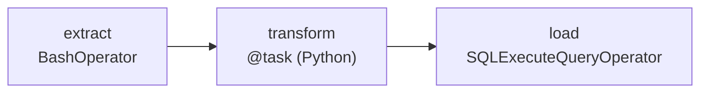

This tutorial builds a three-task pipeline named `orders_daily`:



- `extract` is a `BashOperator` that downloads the day's orders as a JSON file.
- `transform` is a Python task (TaskFlow `@task`) that reads the file and returns the day's order total. The returned value goes to XCom.
- `load` is a `SQLExecuteQueryOperator` that inserts the total into a warehouse table, reading it from XCom with Jinja.

The DAG runs daily. Along the way you fix a problem that live validation finds, preview the generated Python and deploy it. The screenshots below were taken while building exactly this DAG.

<Video name="build-dag" title="Building a DAG on the canvas" />

## Before you start

You need a running AutoAir with `BashOperator` and `SQLExecuteQueryOperator` in its palette. `BashOperator` comes with `apache-airflow-providers-standard`; `SQLExecuteQueryOperator` with `apache-airflow-providers-common-sql`. Both must be installed next to AutoAir (and in Airflow, to run the DAG):

- **Local mode** is enough for every step except running the DAG: follow [Quick start: local mode](/docs/getting-started/quick-start#local-mode-no-airflow-server). Install the `airflow` extra (or Airflow itself) so that `apache-airflow-providers-standard` is present and **Validate in Airflow** can import the DAG.
- **Plugin or standalone mode** additionally lets you trigger the deployed DAG and watch it run. In Airflow 3.1 and newer, open **Browse → DAG Builder**; in Airflow 3.0 open `/autoair/ui/`.

To deploy you need the permission to save specs (the **Author** role or more; in local mode every user has full rights). See [IAM](/docs/admin/iam).

## 1. Start with an empty DAG

A new builder opens on an empty canvas with **Start your DAG**: drag an operator from the palette, or use **Search operators…**, **Start from a template…**, **Generate with AI…** or **Write it as code**. This tutorial uses the canvas. If another DAG is open, use **File → New DAG**.

<Screenshot name="tutorial-empty" alt="An empty canvas showing the Start your DAG panel with buttons to search operators, start from a template, generate with AI or write code" />

Click an empty spot of the canvas. With no node selected, the inspector on the right shows **DAG settings** with the tabs **General**, **Schedule**, **Params**, **Defaults**, **Alerts**, **Environments** and **Docs**. On **General**:

1. Set **DAG id** to `orders_daily`. The DAG id is unique in Airflow and is also the file name (`orders_daily.py`); it may contain letters, digits, `_`, `-` and `.`. A new DAG starts as `my_new_dag`.
2. Set **Description** to `Daily orders export into the warehouse`.
3. Keep the **Tags** entry `autoair`; add more with **Add tag** if you like.

Leave **Output** at **Generated Python file (readable, reviewable)**.

## 2. Add the extract task

The palette on the left lists every operator, sensor and transfer found in the installed packages, plus built-in nodes. Its tabs are **All**, **Operators**, **Sensors**, **Transfers**, **Built-in**, **Favorites** and **Recent**.

1. Type `bash` into **Search operators…**.
2. Drag `BashOperator` onto the canvas, or double-click it, or select it with the arrow keys and press Enter.

<Screenshot name="tutorial-palette" alt="The palette filtered by the search term bash, listing BashOperator and the @task.bash decorator" />

The node appears with a generated task id and is selected, so the inspector shows its parameters.

1. Set **Task id** (at the top of the inspector) to `extract`.
2. In **bash_command**, type:

   ```text
   curl -sf -o /data/orders/{{ ds }}.json https://shop.example.com/api/orders?date={{ ds }}
   ```

   `bash_command` is a template field, so the editor is Jinja-aware: typing `{{` offers the context variables (`ds`, `ds_nodash`, `params`, `var`, `conn`, macros, `ti.xcom_pull`). Each parameter shows its Python type, and a red `*` marks required ones.

<Screenshot name="tutorial-task-added" alt="The extract BashOperator node on the canvas with the inspector showing its Task id and the bash_command template editor containing the curl command" />

:::tip
Ctrl/⌘+K opens the command palette, which can also insert nodes. The [shortcuts page](/docs/user-guide/shortcuts) lists the rest.
:::

## 3. Add the transform and load tasks

1. In the palette, open the **Built-in** tab and add **Python task** ("Plain @task function with your own code"). For Python tasks the first inspector tab is **Code**.
2. Set **Task id** and **Function name** to `transform`. The function name must be a valid Python identifier.
3. Replace the **Function body** with:

   ```python
   import json

   with open(f"/data/orders/{ds}.json") as f:
       orders = json.load(f)
   return sum(o["total"] for o in orders)
   ```

   `return` pushes the total to XCom. (This body has a deliberate mistake that step 5 fixes.)
4. Search the palette for `SQLExecuteQueryOperator`, add it and set its **Task id** to `load`.
5. In **sql**, type:

   ```sql
   INSERT INTO sales.daily_orders VALUES ('{{ ds }}', {{ ti.xcom_pull('transform') }})
   ```

   In a real DAG also choose the database connection in **conn_id**. The connection picker lists Airflow's connections, filtered by connection type, and can create one with **New connection**; in local mode, without an Airflow server, you type the connection id. See [Connections](/docs/user-guide/connections).

Now connect the tasks: drag from the handle on the **right** edge of `extract` to the handle on the **left** edge of `transform`, then from `transform` to `load`. An edge means "runs after"; a connection that would create a cycle is refused. Press Shift+L (or **Auto layout** in the toolbar) to tidy the graph.

<Screenshot name="tutorial-connected" alt="extract, transform and load connected left to right; transform is selected and shows 1 error, and the inspector lists the problem code: Undefined name ds" />

Select `transform`: its node already carries a red **1 error** badge, and the inspector lists the problem at the top. **Inputs from upstream tasks** shows `extract`'s `return_value`; you could drag it onto an argument to pass `extract`'s XCom to the function (see [Jinja, XCom and Python](/docs/user-guide/jinja-xcom-python)).

## 4. Schedule it daily

Click an empty part of the canvas to return to **DAG settings** and open the **Schedule** tab.

1. Set **Schedule** to **Preset (@daily, …)** and pick `@daily` ("every day at midnight").
2. Set **Start date**. A new DAG starts on 1 January of the current year (UTC). The scheduler never creates runs before it.
3. Leave **Catchup** off unless you want a run for every missed interval between the start date and now.
4. Optionally set **DAG timezone** to an IANA name such as `Europe/Istanbul`. Start and end dates and the `@daily` preset are then local to that zone (DST aware). An unknown zone is flagged ("Unknown timezone") and not applied.

**Next runs** previews the upcoming run times, in your local time and in UTC, computed by Airflow's timetable engine.

<Screenshot name="tutorial-schedule" alt="The Schedule tab of DAG settings with the @daily preset selected, start date, catchup switch, DAG timezone and the Next runs preview" />

Other schedule types (cron, fixed interval, multiple crons, specific dates, assets, assets-or-time, partitioned schedules) are described in [Scheduling and assets](/docs/user-guide/scheduling-and-assets).

## 5. Fix the problems

AutoAir validates the spec while you edit. The **Problems** tab of the bottom panel (Ctrl/⌘+J toggles the panel) lists every problem grouped by task, with filters **All**, **Errors**, **Warnings** and **Info**. Clicking a problem selects the node and focuses the exact field, including fields inside nested editors.

<Screenshot name="tutorial-problems" alt="The Problems tab listing one error on transform: code: Undefined name ds, reported by ruff as F821" />

Here ruff reports `F821 Undefined name 'ds'`: inside a TaskFlow function, `ds` is not a global. Click the problem to jump to the function body and read the date from the task context instead:

```python
import json
from airflow.sdk import get_current_context

ds = get_current_context()["ds"]
with open(f"/data/orders/{ds}.json") as f:
    orders = json.load(f)
return sum(o["total"] for o in orders)
```

The Problems tab then shows "No problems detected." Other typical problems are:

- a required parameter that is empty, for example a `BashOperator` without `bash_command`;
- a duplicate task id;
- a Jinja error or an undeclared `params.<name>` in a template;
- a policy rule set by your administrator, such as a required owner or a minimum number of retries;
- a hard-coded secret (a password or token typed into a field), with a hint to use Connections or Variables.

While there are errors, the **Deploy** button explains "Fix 1 problem to deploy (click to see it)" and clicking it opens the Problems tab. Warnings and info items do not block a deploy. Details: [Validation](/docs/user-guide/validation).

## 6. Preview the generated code

Open the **Code** tab of the bottom panel. It shows the file AutoAir will deploy, regenerated as you edit. The selector switches between **Python**, **Airflow YAML**, **dag-factory** and **Spec JSON** (the document AutoAir stores). If the spec has errors, the tab says "Fix the problems to see the generated code."

<Screenshot name="tutorial-code" alt="The Code tab of the bottom panel showing the generated orders_daily Python DAG file" />

The DAG body of the generated file for this tutorial starts like this (the module docstring and imports are above it):

```python
with DAG(
    dag_id="orders_daily",
    description="Daily orders export into the warehouse",
    schedule="@daily",
    start_date=datetime.datetime(2026, 1, 1, tzinfo=datetime.timezone.utc),
    catchup=False,
    tags=["autoair"],
    default_args={"owner": "airflow", "retries": 1, "retry_delay": datetime.timedelta(seconds=300)},
) as dag:
    t_extract = BashOperator(
        task_id="extract",
        bash_command="curl -sf -o /data/orders/{{ ds }}.json https://shop.example.com/api/orders?date={{ ds }}",
    )

    @task(task_id="transform")
    def transform():
        import json

        from airflow.sdk import get_current_context

        ds = get_current_context()["ds"]
        with open(f"/data/orders/{ds}.json") as f:
            orders = json.load(f)
        return sum((o["total"] for o in orders))

    t_transform = transform()
    t_load = SQLExecuteQueryOperator(
        task_id="load",
        sql="INSERT INTO sales.daily_orders VALUES ('{{ ds }}', {{ ti.xcom_pull('transform') }})",
    )
    t_extract >> t_transform
    t_transform >> t_load
```

The default arguments (`owner`, `retries`, `retry_delay`) come from the **Defaults** tab of DAG settings; a new DAG starts with one retry after 300 seconds. The imports follow the target Airflow version shown in the toolbar. Airflow YAML output does not support Python tasks, so the **Airflow YAML** view reports that this DAG cannot be expressed in YAML.

To edit the file directly instead, switch to code mode; applying it imports the code back into the spec. See [Code mode](/docs/user-guide/code-mode).

## 7. Validate in Airflow

Live validation is static. To import the generated file in a real `DagBag`, choose **Run → Validate in Airflow**. A clean import reports **Valid**: "The DAG imports cleanly in Airflow (DagBag)." Import errors (a missing provider, a syntax error in a task body) are listed with their messages.

The import runs in a subprocess on the AutoAir server, so the providers your DAG uses must be installed there. In plugin mode that is Airflow's own environment. Every deploy runs the same check again unless `import_check_on_deploy` is off.

## 8. Deploy

Click **Deploy** in the toolbar, or press Ctrl/⌘+S. The arrow next to it opens **Deploy…**, a dialog that shows:

- **Target**: where the files go, for example `local · /opt/airflow/dags/autoair` or a Git repository and branch;
- **Environment**, when environments are configured (otherwise "No environments are configured; the base spec is deployed.");
- **Message**: the version or commit message ("What changed and why?"); Ctrl+Enter deploys;
- for Git targets, whether the deploy pushes or opens a pull request, and a preview of the commit and pull request text.

<Screenshot name="tutorial-deploy" alt="The Deploy orders_daily dialog with the target, environment and message fields and the Deploy button" />

On success the toolbar shows **Deployed** and the status chip changes from **new** to **deployed**. With the local target, the deploy writes two files into the DAG folder (`./dags` in local mode, `<dags_folder>/autoair` by default otherwise):

| File | Content |
| --- | --- |
| `orders_daily.autoair.json` | The spec. AutoAir reads it back when you reopen the DAG. |
| `orders_daily.py` | The generated DAG file Airflow parses. |

What can go differently:

- **Someone else deployed the DAG since you opened it.** AutoAir uses ETags; instead of overwriting their work you get "Someone else changed this DAG" and a three-way merge dialog.
- **The generated file was edited by hand.** The deploy stops and reports the file as ejected; AutoAir overwrites it only when you force the deploy.
- **A file with the same name was not created by AutoAir.** It is never overwritten.
- **Git target in pull-request mode.** The deploy opens a pull request ("Pull request opened"); the DAG goes live when the pull request is merged.
- **Four-eyes approvals enabled.** The deploy is stored as a proposal until another reviewer approves this version.

See [Deploy](/docs/user-guide/deploy) and [Reviews and approvals](/docs/user-guide/reviews-and-approvals).

## 9. Run it (plugin and standalone)

Airflow's dag-processor picks the file up on its next parse. New DAGs usually start paused (Airflow's `dags_are_paused_at_creation`); the toolbar chip shows the paused state and can unpause the DAG. Then:

1. Choose **Run → Trigger…** to start a run.
2. Open the **Runs** tab of the bottom panel and select the run. Task states are painted on the canvas.
3. Select `transform` and open the **Task** tab to read its **Logs** and **XCom**. The XCom holds the day's order total.

In local mode runs are switched off (`features.runs`), so these items are not available; open the deployed file in an Airflow of your own instead. See [Runs](/docs/user-guide/runs).

## Where to go next

- [Concepts](/docs/getting-started/concepts): what the spec, validation and deploy targets are.
- [Operators and parameters](/docs/user-guide/operators-and-parameters) and [Jinja, XCom and Python](/docs/user-guide/jinja-xcom-python).
- [TaskFlow and loops](/docs/user-guide/taskflow-and-loops): mapping over the transform output.
- [Versions and diff](/docs/user-guide/versions-and-diff): compare what you just deployed with the next change.
