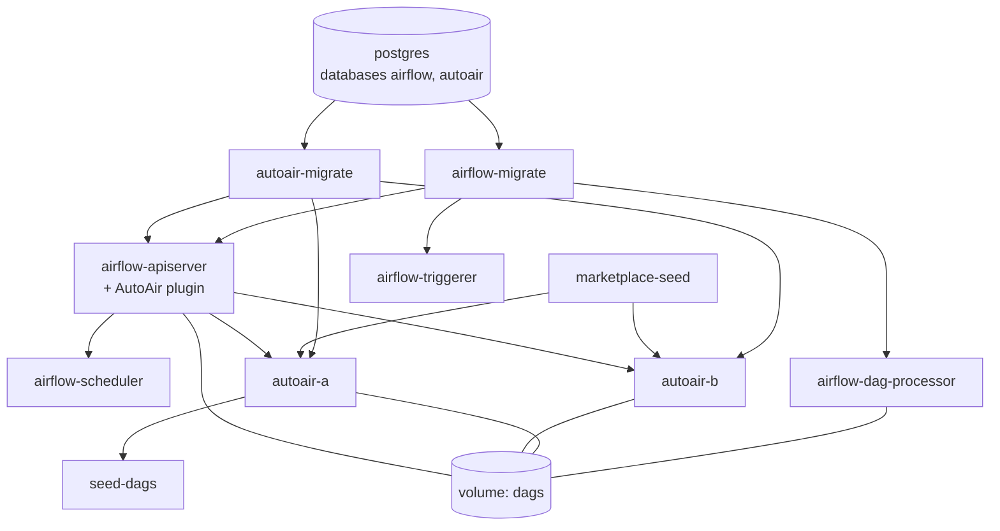

`deploy/compose/` contains two Compose files for workstations:

| File | What it runs | Use it to |
| --- | --- | --- |
| `docker-compose.demo.yml` | PostgreSQL, Airflow 3 split into API server, scheduler, dag-processor and triggerer with the AutoAir plugin, two standalone AutoAir replicas, seed jobs, and seven opt-in profiles | Evaluate plugin and standalone mode together, shared PostgreSQL state, collaboration across replicas, a Git deploy target with pull requests, the separate AI service, TLS and tracing |
| `docker-compose.yaml` | One `airflow standalone` container with the plugin | The smallest plugin setup, built from a prebuilt wheel |

:::danger Workstation only
Every Airflow visitor is an administrator (SimpleAuthManager `all_admins`), every secret has a public default, and the demo ports bind to `127.0.0.1`. Before exposing anything, use a real auth manager, unique secrets, TLS and the IAM role mapping. For production see [Helm](/docs/installation/helm) and [Deployment](/docs/deployment/overview).
:::

The default start runs no AI provider, so it cannot incur provider charges.

## Prerequisites

- Docker Engine with Compose v2 (`docker compose`). The demo uses `depends_on` with `required: false`, `env_file` with `required: false` and `--wait`, so use a current Compose release.
- Free loopback ports 8080, 8765, 8766 and 5433, or the overrides in [Ports and credentials](#ports-and-credentials).
- A clone of the repository. The demo builds everything from the working tree; no local Python or Node.js is required.

## Quick start

```bash
git clone https://github.com/ctolon/autoair.git
cd autoair/deploy/compose
cp .env.example .env                       # optional: every value has a default
docker compose -f docker-compose.demo.yml up --build -d --wait
```

The first build compiles both editor bundles and a wheel from the working tree and takes a few minutes; later starts take about a minute. When `--wait` returns:

| Open | URL |
| --- | --- |
| Airflow, then **Browse → DAG Builder** (the plugin) | `http://localhost:8080` |
| Plugin, direct | `http://localhost:8080/plugin/dag-builder` |
| Standalone replica A | `http://localhost:8765/ui/` |
| Standalone replica B | `http://localhost:8766/ui/` |
| AutoAir API docs (replica A) | `http://localhost:8765/api/docs` |

Two demo DAGs, `demo_hello` and `demo_pipeline`, are deployed through replica A's API on first start (`seed-dags`), and the signed template marketplace from `examples/marketplace` is available in the template gallery ([Marketplace](/docs/user-guide/marketplace)).

Commands on this page assume the working directory is `deploy/compose`. From the repository root, add `-f deploy/compose/docker-compose.demo.yml` and prefix `--env-file` paths with `deploy/compose/`.

## Services

### Core services

These start on every `up`:

| Service | Image | Role | Health check |
| --- | --- | --- | --- |
| `postgres` | `postgres:17-alpine` | Two roles and databases created by `initdb/001-databases.sh`: `airflow` (Airflow metadata) and `autoair` (AutoAir state) | `pg_isready` against both databases |
| `airflow-migrate` | demo image | One-shot `airflow db migrate` | exits 0 |
| `autoair-migrate` | demo image | One-shot `autoair db upgrade`. All other AutoAir processes run with `database.migrate_on_start=false` | exits 0 |
| `marketplace-seed` | demo image | One-shot: signs `examples/marketplace` with a generated Ed25519 key into the `marketplace` volume | exits 0 |
| `airflow-apiserver` | demo image | Airflow UI and REST API, the execution API, and the AutoAir plugin (`/autoair/...`) | `/api/v2/monitor/health` |
| `airflow-scheduler` | demo image | Scheduler with the `LocalExecutor` (runs the tasks) | scheduler health server `:8974/health` |
| `airflow-dag-processor` | demo image | Parses the DAG bundles | `airflow jobs check --job-type DagProcessorJob` |
| `airflow-triggerer` | demo image | Deferrable operators | `airflow jobs check --job-type TriggererJob` |
| `autoair-a`, `autoair-b` | demo image | `autoair serve` replicas sharing the `autoair` database and the `dags` volume | `/api/health` (readiness: `/api/ready`, with `server.ready_check_airflow=true`) |
| `seed-dags` | demo image | One-shot: deploys `seed/specs/*.json` through replica A, skipping DAGs that already exist. Disable with `DEMO_SEED_DAGS=false` | exits 0 |

Start order is enforced with `depends_on` conditions: PostgreSQL healthy, then both migrations complete, then Airflow, then the replicas (after `marketplace-seed` and a healthy `airflow-apiserver`), then the seed. With profile `git`, `git-bootstrap` completes before any Airflow component or replica starts, because the `GitDagBundle` and AutoAir's Git target read the Airflow connection at startup. With profile `redis`, the replicas also wait for a healthy `redis`.



### The demo image

Every Airflow component, replica and AutoAir job uses one image, `${DEMO_IMAGE:-autoair-demo:local}`, built from `deploy/docker/Dockerfile.demo`: `apache/airflow:${DEMO_AIRFLOW_VERSION:-3.3.2}` plus the AutoAir wheel from the working tree with the `standalone`, `format`, `git`, `collab`, `collab-redis`, `postgres`, `otel` and `yaml` extras, and the Airflow `standard` and `git` providers. Set `DEMO_AIRFLOW_VERSION` in `.env` to build against another Airflow 3.x release.

The replicas start through `scripts/autoair-entrypoint.sh`, which reads `/opt/airflow/marketplace/sources.json` (written by `marketplace-seed`) into `AUTOAIR_MARKETPLACE_SOURCES` unless that variable is already set, then runs `autoair serve`.

### Shared AutoAir settings

All AutoAir processes (the plugin inside `airflow-apiserver`, the replicas, `autoair-migrate` and `autoair-ai`) share the `x-autoair-env` block of the Compose file. The values that shape the demo:

```yaml
AUTOAIR_CONFIG_FILE: /etc/autoair/autoair.yaml
AUTOAIR_AIRFLOW_URL: http://airflow-apiserver:8080
AUTOAIR_DAGS_FOLDER: /opt/airflow/dags
AUTOAIR_DATABASE__BACKEND: postgresql
AUTOAIR_DATABASE__URL: postgresql+psycopg://autoair@postgres:5432/autoair
AUTOAIR_DATABASE__PASSWORD: ${DEMO_AUTOAIR_DB_PASSWORD:-autoair-demo-only}
AUTOAIR_DATABASE__MIGRATE_ON_START: "false"          # autoair-migrate migrates once
AUTOAIR_COLLAB__SYNC: ${DEMO_COLLAB_SYNC:-database}  # PostgreSQL LISTEN/NOTIFY, or redis
AUTOAIR_COLLAB_SECRET: ${DEMO_COLLAB_SECRET:-local-demo-collab-secret}
AUTOAIR_IAM__LOGIN_ENABLED: "true"
AUTOAIR_SSO__AIRFLOW_PUBLIC_URL: http://localhost:${DEMO_AIRFLOW_PORT:-8080}
AUTOAIR_STORAGE__MODE: ${DEMO_STORAGE_MODE:-local}   # git with env/git.env
AUTOAIR_STORAGE__GIT__PROVIDER: gitea
AUTOAIR_STORAGE__GIT__MODE: ${DEMO_GIT_MODE:-pr}
AUTOAIR_STORAGE__GIT__USE_AIRFLOW_BUNDLE: "true"
AUTOAIR_STORAGE__GIT__BUNDLE_NAME: gitea
AUTOAIR_STORAGE__GIT__SUBDIR: autoair
AUTOAIR_AI__ENABLED: ${DEMO_AI_ENABLED:-false}
AUTOAIR_AI__SERVICE_URL: ${DEMO_AI_SERVICE_URL:-}
AUTOAIR_AI__SERVICE__SHARED_SECRET: ${DEMO_AI_SERVICE_SECRET:-local-demo-ai-hmac-secret}
AUTOAIR_OTEL_ENABLED: ${DEMO_OTEL_ENABLED:-false}
OTEL_EXPORTER_OTLP_ENDPOINT: http://otel-collector:4318
AUTOAIR_FEATURES__IDE_LANGUAGE_SERVER: "false"
```

The replicas add `AUTOAIR_SERVER__HOST=0.0.0.0`, `AUTOAIR_SERVER__PORT=8765`, `AUTOAIR_SERVER__FORWARDED_ALLOW_IPS='["*"]'` (inside the Compose network only the load balancers forward to them) and `AUTOAIR_SERVER__READY_CHECK_AIRFLOW=true`. Language servers are disabled; see [Extras](/docs/installation/extras) to enable them in your own image.

AutoAir's state (templates, audit, proposals, collaboration rooms) lives in the `autoair` database. DAG files are on the shared `dags` volume. Shared PostgreSQL state does not distribute DAG files; in a real multi-host deployment use a Git or object-storage deploy target ([Scaling](/docs/admin/scaling), [Git and DAG bundles](/docs/deployment/git-bundles)).

### Volumes

| Volume | Content |
| --- | --- |
| `postgres` | Both databases |
| `dags` | Airflow's `dags_folder`; the local deploy target writes to `dags/autoair/` |
| `logs` | Task logs (the scheduler writes, the API server reads) |
| `marketplace` | Signed example marketplace, its key pair and `sources.json` |
| `gitea-data`, `gitea-config` | Profile `git` |
| `certs` | Profile `tls`: demo CA and server certificate |
| `ollama` | Profile `ollama`: downloaded models |

## Profiles

Profiles add services. When a profile also needs the core services configured differently, a preset in `env/` sets the matching `DEMO_*` values. Pass the preset as a second `--env-file` after `.env`.

| Profile | Adds | Preset | Purpose |
| --- | --- | --- | --- |
| `lb` | `lb` (nginx) | none | Round-robin over both replicas, WebSockets and SSE included, no sticky sessions |
| `redis` | `redis` | `env/redis.env` | Collaboration fan-out through Redis pub/sub instead of PostgreSQL `LISTEN/NOTIFY` |
| `ai` | `autoair-ai` | `env/ai.env` (hosted provider) or `env/ollama.env` | `autoair ai-serve` as a separate service. Replicas and the plugin proxy `/api/ai/*` to it, signing the caller with the HMAC secret |
| `ollama` | `ollama`, `ollama-pull` | `env/ollama.env` | Local model server and a one-shot model pull. No provider charges |
| `git` | `gitea`, `gitea-init`, `git-bootstrap` | `env/git.env` | Gitea as the deploy target in pull-request mode, read back by an Airflow `GitDagBundle` |
| `tls` | `certs-init`, `tls-proxy`, `autoair-tls` | none | Self-signed CA, an HTTPS proxy, and a replica that serves HTTPS itself and reaches Airflow over verified HTTPS |
| `observability` | `otel-collector`, `jaeger` | `env/observability.env` | OpenTelemetry traces from every AutoAir process, viewed in Jaeger |

```bash
# one profile
docker compose -f docker-compose.demo.yml --profile lb up -d --wait

# profile + preset
docker compose -f docker-compose.demo.yml --env-file .env --env-file env/git.env \
  --profile git up -d --wait

# several at once
docker compose -f docker-compose.demo.yml --env-file .env \
  --env-file env/git.env --env-file env/redis.env --env-file env/observability.env \
  --profile git --profile redis --profile lb --profile observability up -d --wait
```

`.env` must exist when it is named with `--env-file`: run `cp .env.example .env` first (an all-comments `.env` is fine). Keep passing the same `--env-file` and `--profile` flags to later `ps`, `logs` and `down` commands, or set `COMPOSE_PROFILES=git,redis` in `.env`.

The AI service and the tracing exporter are inert without their presets. Setting `DEMO_AI_SERVICE_URL` without starting profile `ai` makes `/api/ai/*` answer with proxy errors; everything else keeps working.

What each preset sets:

| Preset | Values |
| --- | --- |
| `env/redis.env` | `DEMO_COLLAB_SYNC=redis`, `DEMO_COLLAB_REDIS_URL=redis://:${DEMO_REDIS_PASSWORD:-redis-demo-only}@redis:6379/0` |
| `env/ai.env` | `DEMO_AI_ENABLED=true`, `DEMO_AI_SERVICE_URL=http://autoair-ai:8790`. Put `DEMO_AI_PROVIDER` and `DEMO_AI_API_KEY` in `.env` |
| `env/ollama.env` | `DEMO_AI_ENABLED=true`, `DEMO_AI_SERVICE_URL=http://autoair-ai:8790`, `DEMO_AI_PROVIDER=ollama`, `DEMO_AI_BASE_URL=http://ollama:11434`, `DEMO_AI_MODEL=${DEMO_OLLAMA_MODEL:-qwen2.5:1.5b}`, empty `DEMO_AI_API_KEY` |
| `env/git.env` | `DEMO_STORAGE_MODE=git`, `DEMO_GIT_MODE=pr`, and a `DEMO_DAG_BUNDLE_CONFIG_LIST` with the local `dags-folder` bundle plus a `GitDagBundle` named `gitea` (`git_conn_id=gitea_dags`, `tracking_ref=main`, `refresh_interval=30`) |
| `env/observability.env` | `DEMO_OTEL_ENABLED=true` |

### `lb`: load balancer

```bash
docker compose -f docker-compose.demo.yml --profile lb up -d --wait
curl -sI localhost:8780/api/health | grep X-Upstream
```

`lb` is `nginx:1.28-alpine` with `nginx/lb.conf`, listening on `DEMO_LB_PORT` (8780). It starts after both replicas are healthy. Use `http://localhost:8780/ui/`. No sticky sessions are configured; each response carries `X-Upstream` with the replica that answered. nginx balances per worker process, so a series of one-off `curl` calls can land on the same replica, while requests over one keep-alive connection alternate. This is the setup the [Scaling](/docs/admin/scaling) page describes: any replica can serve any request because state and collaboration fan-out are shared.

### `redis`: collaboration over Redis

```bash
docker compose -f docker-compose.demo.yml --env-file .env --env-file env/redis.env \
  --profile redis up -d --wait
```

`redis` is `redis:7.4-alpine` with `--requirepass ${DEMO_REDIS_PASSWORD:-redis-demo-only}` and persistence off. The preset switches `collab.sync` to `redis` and points `collab.redis_url` at it, so collaboration rooms fan out through Redis pub/sub instead of PostgreSQL `LISTEN/NOTIFY` ([Collaboration](/docs/user-guide/collaboration)).

### `ai` and `ollama`: separate AI service

Local model, no provider charges:

```bash
docker compose -f docker-compose.demo.yml --env-file .env --env-file env/ollama.env \
  --profile ai --profile ollama up -d --wait
```

`ollama` runs `ollama/ollama:${DEMO_OLLAMA_VERSION:-latest}` on `DEMO_OLLAMA_PORT` (11434). `ollama-pull` downloads `DEMO_OLLAMA_MODEL` (default `qwen2.5:1.5b`, about 1 GB) before `autoair-ai` starts. CPU inference is slow; expect tens of seconds per answer.

Hosted provider (billed per token): set `DEMO_AI_PROVIDER` (`anthropic`, `openai`, `gemini` or `ollama`) and `DEMO_AI_API_KEY` in `.env`, optionally `DEMO_AI_MODEL` and `DEMO_AI_BASE_URL`, then:

```bash
docker compose -f docker-compose.demo.yml --env-file .env --env-file env/ai.env \
  --profile ai up -d --wait
```

`autoair-ai` runs `autoair ai-serve --host 0.0.0.0 --port 8790` with `AUTOAIR_AI__ENABLED=true`, published on `DEMO_AI_PORT` (8790). The replicas and the plugin set `AUTOAIR_AI__SERVICE_URL=http://autoair-ai:8790` and proxy `/api/ai/*` there. The proxy signs the caller's identity with `AUTOAIR_AI__SERVICE__SHARED_SECRET` (`DEMO_AI_SERVICE_SECRET`), and the service trusts only signed requests. Its health check is `http://localhost:8790/health`. See [AI service](/docs/ai/ai-service) and [Deploying the AI service](/docs/deployment/ai-service).

### `git`: Gitea deploy target with pull requests

```bash
docker compose -f docker-compose.demo.yml --env-file .env --env-file env/git.env \
  --profile git up -d --wait
```

What happens:

1. `gitea` runs `gitea/gitea:${DEMO_GITEA_VERSION:-1.24-rootless}` with SQLite, registration disabled, SSH disabled and `main` as the default branch, on `DEMO_GITEA_PORT` (3000).
2. `gitea-init` creates the admin user `DEMO_GITEA_USER` (`autoair`).
3. `git-bootstrap` creates the private repository `autoair/dags` (`DEMO_GITEA_REPO`) with a `main` branch and an access token. It stores URL, user and token in the Airflow connection `gitea_dags` (`DEMO_GIT_CONN_ID`) and never prints the token. On later `up` runs it keeps a token that still works.
4. Airflow's dag-processor reads two bundles: `dags-folder` (the local volume) and `gitea`, a `GitDagBundle` on `main` with `git_conn_id=gitea_dags`.
5. AutoAir runs with `storage.mode=git`, `storage.git.use_airflow_bundle=true` and `storage.git.bundle_name=gitea`. Repository, branch and credentials come from the bundle and its connection; AutoAir stores no credentials. AutoAir re-reads the connection after an authentication failure and every `storage.git.credentials_ttl` seconds, so a rotated token is picked up on the next deploy.
6. AutoAir uses `storage.git.provider=gitea`. In PR mode every deploy pushes the branch `autoair/<dag_id>` with git and opens a pull request into `main` through Gitea's REST API, with the connection's token. Each commit and pull request carries the governance context block, and each commit the `X-AutoAir-*` trailers. The seed DAGs arrive as two pull requests.

Merge a deploy:

1. Open `http://localhost:3000/autoair/dags/pulls` and sign in as `autoair` / `autoair-demo-only`. The deploy result in AutoAir links to the pull request as well.
2. Open the pull request of `autoair/demo_hello` and merge it.
3. Within `refresh_interval` (30 s) the DAG shows up in Airflow with bundle `gitea`. Its runs are pinned to the merged commit SHA (`bundle_version`).

`DEMO_GIT_MODE=push` commits straight to `main` instead. The `gitea` provider also works with Forgejo; GitHub, GitLab, Bitbucket and Azure DevOps have their own providers ([Git and DAG bundles](/docs/deployment/git-bundles)). The **Versions & Git → Deploy target…** dialog lists the `gitea` bundle as well, and you can switch between the local folder and the Git target there without a restart.

If you change `DEMO_GIT_CONN_ID` in `.env`, change `git_conn_id` in `env/git.env` to match.

### `tls`: HTTPS in and out

```bash
docker compose -f docker-compose.demo.yml --profile tls up -d --wait
docker compose -f docker-compose.demo.yml --profile tls run --rm --no-deps --entrypoint cat \
  certs-init /certs/ca.pem > demo-ca.pem
curl --cacert demo-ca.pem https://localhost:8443/api/health       # proxy -> replicas
curl --cacert demo-ca.pem https://localhost:9443/api/v2/version   # proxy -> Airflow
curl --cacert demo-ca.pem -I https://localhost:8445/api/health    # uvicorn TLS, HSTS header
```

- `certs-init` creates a 30-day demo CA and a server certificate for `localhost`, `tls-proxy`, `autoair-tls`, `autoair-a`, `autoair-b` and `127.0.0.1`, in the `certs` volume. The certificate includes the key identifiers that Python 3.13's strict verification needs.
- `tls-proxy` (`nginx:1.28-alpine`, `nginx/tls.conf`) terminates HTTPS for the replicas on `DEMO_TLS_PORT` (8443) and for Airflow on `DEMO_TLS_AIRFLOW_PORT` (9443).
- `autoair-tls` is a third replica that serves HTTPS itself on `DEMO_TLS_AUTOAIR_PORT` (8445):

  ```yaml
  AUTOAIR_AIRFLOW_URL: https://tls-proxy:9443
  AUTOAIR_OUTBOUND__CA_BUNDLE: /certs/ca.pem
  AUTOAIR_OUTBOUND__VERIFY: "true"
  AUTOAIR_SERVER__SSL_CERTFILE: /certs/server.pem
  AUTOAIR_SERVER__SSL_KEYFILE: /certs/server.key
  AUTOAIR_SERVER__SSL_MIN_VERSION: TLSv1.2
  AUTOAIR_SERVER__PUBLIC_URL: https://localhost:8445
  AUTOAIR_SERVER__HSTS_SECONDS: "300"
  AUTOAIR_SERVER__COOKIE_SECURE: always
  ```

  It trusts only the demo CA for outbound calls. Its `/api/ready` reporting `airflow: ok` proves the outbound TLS path.
- Browsers warn about the demo CA. Import `demo-ca.pem` or accept the warning.

See [TLS and security headers](/docs/admin/tls-and-headers) for the settings.

### `observability`: tracing

```bash
docker compose -f docker-compose.demo.yml --env-file .env --env-file env/observability.env \
  --profile observability up -d --wait
```

The preset sets `AUTOAIR_OTEL_ENABLED=true` on every AutoAir process. Spans go over OTLP/HTTP to `otel-collector:4318` (`otel/opentelemetry-collector-contrib:${DEMO_OTEL_COLLECTOR_VERSION:-0.116.1}`, configured by `otel/collector.yaml`), which forwards them to Jaeger (`jaegertracing/all-in-one:${DEMO_JAEGER_VERSION:-1.65.0}`) at `http://localhost:16686`. Service names are `autoair-a`, `autoair-b`, `autoair-tls`, `autoair` (the plugin inside Airflow) and `autoair-ai`. Health, readiness and metrics URLs are not traced (`server.otel_excluded_urls`). Prometheus metrics are always at `/api/metrics`. See [Observability](/docs/admin/observability).

## Ports and credentials

All ports bind to `127.0.0.1`. Change any of them in `.env` to avoid collisions.

| Variable | Default | Service |
| --- | --- | --- |
| `DEMO_AIRFLOW_PORT` | 8080 | Airflow + plugin |
| `DEMO_AUTOAIR_A_PORT` | 8765 | replica A |
| `DEMO_AUTOAIR_B_PORT` | 8766 | replica B |
| `DEMO_POSTGRES_PORT` | 5433 | PostgreSQL |
| `DEMO_LB_PORT` | 8780 | `lb` |
| `DEMO_AI_PORT` | 8790 | `autoair-ai` |
| `DEMO_OLLAMA_PORT` | 11434 | `ollama` |
| `DEMO_GITEA_PORT` | 3000 | `gitea` |
| `DEMO_TLS_PORT` | 8443 | `tls-proxy` → replicas (HTTPS) |
| `DEMO_TLS_AIRFLOW_PORT` | 9443 | `tls-proxy` → Airflow (HTTPS) |
| `DEMO_TLS_AUTOAIR_PORT` | 8445 | `autoair-tls` (HTTPS from uvicorn) |
| `DEMO_JAEGER_PORT` | 16686 | Jaeger UI |

| What | Credentials |
| --- | --- |
| Airflow UI | None: SimpleAuthManager `all_admins`, everybody is `Anonymous` with role `ADMIN` |
| Airflow API token | `curl -s localhost:8080/auth/token` (works only in `all_admins` mode) |
| AutoAir replicas | **Sign in with Airflow** (Airflow's session cookie is sent to every port on `localhost`), or paste the token above into **Access token** |
| PostgreSQL | `postgres` / `postgres-demo-only`; `airflow` / `airflow-demo-only`; `autoair` / `autoair-demo-only` |
| Gitea (profile `git`) | `autoair` / `autoair-demo-only` |
| Redis (profile `redis`) | password `redis-demo-only` |
| AI service HMAC | `DEMO_AI_SERVICE_SECRET` (`local-demo-ai-hmac-secret`) |
| Gitea access token | Created by `git-bootstrap` and stored only in the Airflow connection `gitea_dags`, Fernet-encrypted with `DEMO_FERNET_KEY` |

## Configuration

There are three layers, highest precedence first:

1. **`docker-compose.demo.yml` environment**, driven by `DEMO_*` variables from `.env` and the presets. `.env.example` lists every variable with its default and a comment.
2. **`autoair.env`** (optional, git-ignored, next to the Compose file): any extra `AUTOAIR_*` variable for every AutoAir container without editing the Compose file, for example `AUTOAIR_IAM__REQUIRE_APPROVAL=true` or `AUTOAIR_UI__BANNER_TEXT=Staging`.
3. **`config/autoair.yaml`**, mounted at `/etc/autoair/autoair.yaml` (`AUTOAIR_CONFIG_FILE`) in the plugin, the replicas and the AI service. It demonstrates:
   - feature flags: every `features` switch except `airflow` is written out, with `code_edit_inline` turned on and `ide_language_server` left off ([`features`](/docs/reference/configuration#features));
   - IAM: strategies, Airflow role to AutoAir role mapping, the `AutoAir ` role prefix, a custom role, direct-push roles and the four-eyes switch;
   - policy rules: DAG and task id patterns, required description, maximum task count, privileged and secret-parameter patterns ([Policy](/docs/admin/policy));
   - governance: commit, PR title and PR body templates, PR labels, commit author;
   - UI branding: the orange demo banner.

The main `.env` variables besides the ports:

| Variable | Default | Purpose |
| --- | --- | --- |
| `COMPOSE_PROJECT_NAME` | `autoair-demo` | Container and volume prefix |
| `COMPOSE_PROFILES` | empty | Profiles to start, comma-separated |
| `DEMO_IMAGE` | `autoair-demo:local` | Tag of the image built from the working tree |
| `DEMO_AIRFLOW_VERSION` | `3.3.2` | `apache/airflow` base image (any 3.x) |
| `DEMO_POSTGRES_PASSWORD`, `DEMO_AIRFLOW_DB_PASSWORD`, `DEMO_AUTOAIR_DB_PASSWORD` | `postgres-demo-only`, `airflow-demo-only`, `autoair-demo-only` | Applied only on the first start of the `postgres` volume. Use URL-safe characters |
| `DEMO_FERNET_KEY` | public demo key | Encrypts Airflow connection passwords, including the Gitea token |
| `DEMO_JWT_SECRET`, `DEMO_JWT_EXPIRATION_TIME` | public demo secret, `86400` | Airflow token signing key and token lifetime in seconds |
| `DEMO_API_SECRET_KEY`, `DEMO_AIRFLOW_API_WORKERS`, `DEMO_AIRFLOW_LOG_LEVEL` | demo key, `2`, `INFO` | Airflow API server |
| `DEMO_DAG_BUNDLE_CONFIG_LIST` | local `dags-folder` bundle | JSON bundle list for the dag-processor; `env/git.env` adds the Gitea bundle |
| `DEMO_EXPOSE_CONFIG` | `non-sensitive-only` | `expose_config`: `false`, `true` or `non-sensitive-only` |
| `DEMO_AUTOAIR_LOG_LEVEL`, `DEMO_AUTOAIR_LOG_FORMAT` | `INFO`, `text` | AutoAir logging (`text` or `json`) |
| `DEMO_COLLAB_SECRET` | `local-demo-collab-secret` | HMAC of collaboration tickets, shared by all replicas |
| `DEMO_SEED_DAGS` | `true` | Deploy `seed/specs/*.json` once the stack is up |
| `DEMO_COLLAB_SYNC`, `DEMO_COLLAB_REDIS_URL`, `DEMO_REDIS_PASSWORD` | `database`, empty, `redis-demo-only` | Collaboration fan-out (`database`, `redis` or `memory`) |
| `DEMO_STORAGE_MODE`, `DEMO_GIT_MODE`, `DEMO_GIT_CONN_ID` | `local`, `pr`, `gitea_dags` | Deploy target |
| `DEMO_GITEA_USER`, `DEMO_GITEA_PASSWORD`, `DEMO_GITEA_REPO`, `DEMO_GITEA_VERSION` | `autoair`, `autoair-demo-only`, `dags`, `1.24-rootless` | Profile `git` |
| `DEMO_AI_ENABLED`, `DEMO_AI_PROVIDER`, `DEMO_AI_MODEL`, `DEMO_AI_API_KEY`, `DEMO_AI_BASE_URL` | `false`, `openai`, empty, empty, empty | Central LLM |
| `DEMO_AI_SERVICE_URL`, `DEMO_AI_SERVICE_SECRET` | empty, `local-demo-ai-hmac-secret` | Separate AI service |
| `DEMO_OLLAMA_MODEL`, `DEMO_OLLAMA_VERSION` | `qwen2.5:1.5b`, `latest` | Profile `ollama` |
| `DEMO_OTEL_ENABLED`, `DEMO_OTEL_COLLECTOR_VERSION`, `DEMO_JAEGER_VERSION` | `false`, `0.116.1`, `1.65.0` | Profile `observability` |

Check the effective values and where each one comes from:

```bash
docker compose -f docker-compose.demo.yml exec autoair-a autoair config show --changed
```

The demo sets `expose_config=non-sensitive-only`, so administrators can also read the configuration at `GET /api/config` and on the configuration page of the admin panel ([Configuration](/docs/admin/configuration), [all settings](/docs/reference/configuration)).

Changes to `config/autoair.yaml` and `autoair.env` take effect on restart, for example `docker compose -f docker-compose.demo.yml restart autoair-a autoair-b airflow-apiserver`. Changes to `.env` need `up -d` so that Compose recreates the affected containers.

## Walkthroughs

### Build, validate and deploy in the plugin

1. Open `http://localhost:8080/plugin/dag-builder`. The banner comes from `config/autoair.yaml`.
2. Drag an **EmptyOperator** and a **BashOperator** onto the canvas, connect them, and set `bash_command` to `echo hello`.
3. The Problems tab shows the policy at work: without a description the deploy is blocked (`require_description: true`), and a DAG id with capitals breaks `policy.dag_id_pattern`.
4. Add a description, then **Deploy**. The file appears as `dags/autoair/<dag_id>.py`.
5. Find the DAG in Airflow, unpause it, trigger it and read the task log.

[Build your first DAG](/docs/getting-started/first-dag) walks through the editor in detail.

### Two replicas, one state

1. Sign in on `http://localhost:8765/ui/` and `http://localhost:8766/ui/` with **Sign in with Airflow**.
2. Open `demo_pipeline` on both. Click **Collaborate** in both browsers and edit different task parameters. Both converge through PostgreSQL `LISTEN/NOTIFY`, or through Redis with profile `redis`.
3. Save an operator template on A and open it from B. In **Admin**, the audit trail and the replica list are the same on both.

## Troubleshooting

| Symptom | Cause and fix |
| --- | --- |
| `port is already allocated` | Another service uses the port. Change the matching port variable in `.env` (all twelve are listed under [Ports and credentials](#ports-and-credentials)) |
| `all predefined address pools have been fully subnetted` | Docker has no free network ranges. Remove unused networks (`docker network prune` affects every project), or add an override file that pins the default network to a free subnet with `networks.default.ipam.config[0].subnet` |
| `postgres` stays unhealthy, or `password authentication failed` | The volume was initialised with other passwords. Initialisation runs only once: `down -v` or `ALTER ROLE` |
| `autoair-migrate` fails | `docker compose logs autoair-migrate`. Usually the database password does not match the volume. Every replica waits for this job |
| Plugin page empty, `main.js` returns HTML | The AutoAir plugin failed to initialise. See `docker compose logs airflow-apiserver \| grep -A20 "AutoAir plugin failed"`. With `git`, check that `git-bootstrap` succeeded before Airflow started |
| A replica is healthy but `/api/ready` answers 503 | Readiness checks the operator catalog, the deploy target (`server.ready_check_storage`; a target that could not be built at startup reports `storage: error: ...`) and, with `server.ready_check_airflow=true`, Airflow's health endpoint. The JSON body (`ready`, `checks`) names the failing check ([Observability](/docs/admin/observability)) |
| Git deploy: `Authentication failed` | AutoAir re-reads the Airflow connection after an authentication failure and every `storage.git.credentials_ttl` seconds, so a rotated token is picked up on the next deploy. If it persists, the token in `gitea_dags` itself is wrong: rerun `git-bootstrap` |
| A merged Git DAG does not appear | Wait for `refresh_interval` (30 s), then check `docker compose logs airflow-dag-processor`. The bundle's `git_conn_id` in `env/git.env` must match `DEMO_GIT_CONN_ID` (`gitea_dags`) |
| `seed-dags` exited 1 | Its log lists the failing DAG and the reason. It is idempotent: `docker compose up seed-dags` |
| Replicas show the sign-in page | Normal in a new browser profile. Use **Sign in with Airflow** after opening Airflow once, or paste the output of `curl -s localhost:8080/auth/token` |
| Marketplace shows nothing | `docker compose logs marketplace-seed`. The replicas read `sources.json` from the `marketplace` volume at startup |
| AI answers 503 | AI is off by default. Use profile `ai` with a preset. `/api/ai/*` errors with `DEMO_AI_SERVICE_URL` set mean `autoair-ai` is not running |
| Ollama answers very slowly | CPU inference. Pick a smaller `DEMO_OLLAMA_MODEL` |
| `x509: Missing Authority Key Identifier` | Certificates from an older `certs-init`. Remove the `certs` volume of this project and start again |
| Everything is slow to start the first time | The image build (Node and Python) and Airflow's first migration. Later starts reuse both |

Useful commands:

```bash
docker compose -f docker-compose.demo.yml ps -a                      # one-shot jobs included
docker compose -f docker-compose.demo.yml logs -f autoair-a
docker compose -f docker-compose.demo.yml exec autoair-a autoair db current
curl -s localhost:8765/api/ready
```

More in the [FAQ](/docs/troubleshooting/faq).

## Stop and tear down

```bash
docker compose -f docker-compose.demo.yml stop          # stop, keep containers and data
docker compose -f docker-compose.demo.yml down          # remove containers, keep volumes
docker compose -f docker-compose.demo.yml down -v       # also erase databases, DAGs, Gitea
```

Pass the same `--profile` and `--env-file` flags as for `up`. Without them, `down` leaves the profile services running.

To run a second copy next to the first, for example to test a branch, use another project name and other ports:

```bash
docker compose -p autoair-demo-2 -f docker-compose.demo.yml --env-file my-ports.env up -d --wait
docker compose -p autoair-demo-2 -f docker-compose.demo.yml down -v  # removes only that copy
```

## The single-container setup

`docker-compose.yaml` builds `deploy/docker/Dockerfile` (the official Airflow image plus a prebuilt AutoAir wheel and a precomputed operator catalog) and runs `airflow standalone` with the plugin:

```bash
cd autoair            # repository root
make build            # frontend bundles + dist/autoair-*.whl
docker compose -f deploy/compose/docker-compose.yaml up --build
```

Open `http://localhost:8080` and go to **Browse → DAG Builder**. The container sets:

```yaml
AIRFLOW__CORE__LOAD_EXAMPLES: "False"
AIRFLOW__CORE__SIMPLE_AUTH_MANAGER_ALL_ADMINS: "True"   # development only
AIRFLOW__DAG_PROCESSOR__REFRESH_INTERVAL: "5"
AUTOAIR_STORAGE__MODE: local
AUTOAIR_ENVIRONMENTS: '["dev","prod"]'
```

DAGs are written to the `dags` volume, and two environments, `dev` and `prod`, are configured ([Environments](/docs/user-guide/environments)). The port is published on all interfaces (`8080:8080`) and the all-admins mode is on: do not run it on a shared network.

`make build` needs Node.js 22 and uv on the host; the image build fails with a `COPY dist/autoair-*.whl` error when the wheel is missing.
