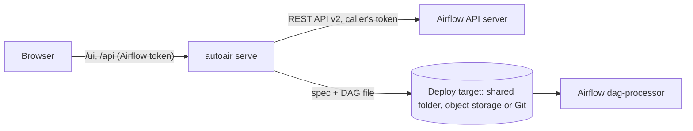

`autoair serve` runs AutoAir as a separate web service. It talks to Airflow only through Airflow's REST API, so it can be installed, upgraded and scaled independently, and it works with an Airflow you cannot add packages to.



## Install

```bash
python -m venv /opt/autoair && . /opt/autoair/bin/activate
pip install 'autoair[standalone,format,git,mcp,collab]'
# plus the providers your DAGs use, at the versions Airflow runs:
pip install apache-airflow-providers-standard apache-airflow-providers-amazon
```

- `standalone` provides uvicorn; without it `autoair serve` cannot start.
- The operator palette is built from the packages installed **next to AutoAir**. Install the same providers as your Airflow image, or the palette and validation will not match what Airflow can import.
- The `DagBag` import check (Validate in Airflow, and on every deploy) needs `apache-airflow` in this environment. Install the same Airflow version as the cluster (`pip install "apache-airflow==3.3.2"`) or set `import_check_on_deploy=false` and rely on static validation.
- Add `postgres` when you run more than one replica.

See [Extras](/docs/installation/extras) for every optional group.

## Run

```bash
autoair serve \
  --airflow-url https://airflow.example.com \
  --dags-folder /shared/airflow/dags \
  --host 0.0.0.0 --port 8765
```

The command prints `AutoAir: writing DAGs to /shared/airflow/dags/autoair; Airflow at https://airflow.example.com` and serves:

| Path | Purpose |
| --- | --- |
| `/ui/` | The builder (`/` redirects here) |
| `/api/...` | REST API ([reference](/api)) |
| `/api/health`, `/api/ready`, `/api/metrics` | Liveness, readiness, Prometheus (unauthenticated) |
| `/mcp/` | MCP endpoint (with the `mcp` extra) |
| `/collab/<dag_id>` | Collaboration WebSocket (with the `collab` extra) |

### Command-line options

| Option | Setting | Default |
| --- | --- | --- |
| `--host` | `server.host` (`AUTOAIR_SERVER__HOST`) | `127.0.0.1` |
| `--port` | `server.port` (`AUTOAIR_SERVER__PORT`) | `8765` |
| `--airflow-url` | `airflow_url` (`AUTOAIR_AIRFLOW_URL`) | Airflow's `[api] base_url` when Airflow is installed, else `http://localhost:8080` |
| `--dags-folder` | `dags_folder` (`AUTOAIR_DAGS_FOLDER`) | Airflow's `[core] dags_folder`, else `./dags` |
| `--workers` | `server.workers` | `1` |
| `--ssl-certfile`, `--ssl-keyfile` | `server.ssl_certfile`, `server.ssl_keyfile` | unset (HTTP) |
| `--ssl-ca-certs`, `--ssl-cert-reqs` | `server.ssl_ca_certs`, `server.ssl_cert_reqs` | unset, `none` (mutual TLS) |
| `--forwarded-allow-ips` | `server.forwarded_allow_ips` (comma separated) | `127.0.0.1` |
| `--no-auth` | | off |
| `--config`, `-c` | `AUTOAIR_CONFIG_FILE` | none |

Command-line options win over environment variables, which win over configuration files. Every other option is a setting: [Configuration](/docs/admin/configuration).

## Connecting to Airflow

`airflow_url` is the base URL of Airflow's API server **as AutoAir reaches it** (for example the in-cluster service). AutoAir calls `<airflow_url>/api/v2/...` for token checks, pickers, DAG status, runs, logs and XComs, and `<airflow_url>/auth/token` for password sign-in.

If browsers reach Airflow under another URL, set `AUTOAIR_SSO__AIRFLOW_PUBLIC_URL` (used for "Sign in with Airflow" and links to Airflow), and `AUTOAIR_SERVER__PUBLIC_URL` to AutoAir's own public URL (return URL after sign-in, links in commits and pull requests).

Airflow's TLS certificate is verified against the default trust store. For a private CA set `AUTOAIR_OUTBOUND__CA_BUNDLE=/etc/ssl/certs/corp-root.pem`; proxies are `AUTOAIR_OUTBOUND__HTTPS_PROXY` and `AUTOAIR_OUTBOUND__NO_PROXY`. Each Airflow call times out after `airflow_timeout` (15 s).

## Authentication

Every API request must carry an Airflow access token. AutoAir verifies it by calling `GET <airflow_url>/api/v2/dags?limit=1` with it, caches the result for `auth_cache_ttl` seconds (60; never past the token's expiry), and forwards the same token on every call to Airflow. Airflow's permissions therefore apply to everything AutoAir does on the user's behalf; AutoAir's own roles are layered on top ([IAM](/docs/admin/iam)).

The sign-in page offers up to three ways to obtain a token:

| Method | When it is offered | Setting |
| --- | --- | --- |
| **Sign in with Airflow** | The browser can send Airflow's session cookie (`_token`) to AutoAir: AutoAir on the same host as Airflow (any port), under the same proxy, or on a sibling sub-domain when the proxy widens the cookie's domain | `sso.enabled` (default `true`), `sso.cookie_name` |
| Username and password | Always in standalone mode, unless disabled. AutoAir forwards the credentials once to Airflow's `/auth/token` and never stores them. Failed attempts are rate limited (5 per 300 s per IP and per user, then HTTP 429). | `iam.login_enabled`, `iam.login_max_failures`, `iam.login_window_seconds` |
| **Access token** | Always. Paste a token issued by Airflow. | |

To get a token for scripts or for pasting:

```bash
curl -s -X POST https://airflow.example.com/auth/token \
  -H 'Content-Type: application/json' \
  -d '{"username": "alice", "password": "..."}'
# {"access_token": "eyJ...", ...}
```

API clients send it as `Authorization: Bearer <token>`. Tokens expire with Airflow's `[api_auth] jwt_expiration_time`. The session-sharing setups, CSRF protection for cookie sessions and logout propagation are described in [SSO](/docs/admin/sso).

:::danger
`autoair serve --no-auth` accepts requests without a token and gives every caller the roles in `iam.anonymous_roles` (default `["Viewer"]`; set `AUTOAIR_IAM__ANONYMOUS_ROLES='["Admin"]'` to edit and deploy). It serves only on a loopback address (`127.0.0.1`, `::1`) and answers only requests whose `Host` and `Origin` are loopback or `server.public_url`, so a web page cannot reach it through DNS rebinding. Calls to Airflow are made without credentials. Use it only on a development machine; in a container, check health from inside it.
:::

## Getting the DAG files to Airflow

AutoAir writes the spec and the generated file to its deploy target. In standalone mode that target must be something Airflow's dag-processor also reads:

| Setup | Configuration |
| --- | --- |
| Shared volume mounted by AutoAir and the dag-processor | `--dags-folder` pointing at the mounted DAG folder (files go to `<dags_folder>/autoair/`) |
| Git repository read by a `GitDagBundle` or git-sync | `AUTOAIR_STORAGE__MODE=git`, `AUTOAIR_STORAGE__GIT__PROVIDER`, `AUTOAIR_STORAGE__GIT__REPO` and credentials (`AUTOAIR_STORAGE__GIT__CONN_ID` or `AUTOAIR_STORAGE__GIT__TOKEN`); all options: [`storage.git`](/docs/reference/configuration#storagegit) |
| Object storage read by an S3/GCS bundle | `AUTOAIR_STORAGE__MODE=object`, `AUTOAIR_STORAGE__OBJECT_URL` |

Administrators can also pick the target in the UI (**Versions & Git → Deploy target…**). See [Deploy](/docs/user-guide/deploy), [Git bundles](/docs/deployment/git-bundles) and [Object storage](/docs/deployment/object-storage).

## TLS, proxies and headers

Either terminate TLS in AutoAir:

```bash
autoair serve --ssl-certfile /etc/autoair/tls.pem --ssl-keyfile /etc/autoair/tls.key
# encrypted key: AUTOAIR_SERVER__SSL_KEYFILE_PASSWORD (environment only)
```

or behind a reverse proxy, trusting its forwarded headers:

```bash
AUTOAIR_SERVER__PUBLIC_URL=https://autoair.example.com
AUTOAIR_SERVER__FORWARDED_ALLOW_IPS='["10.0.0.10"]'
AUTOAIR_SERVER__HSTS_SECONDS=31536000      # only when every client uses HTTPS
```

Standalone mode sends a Content-Security-Policy and related security headers by default (`server.security_headers`). Details: [TLS and headers](/docs/admin/tls-and-headers) and [Reverse proxy](/docs/deployment/standalone-proxy).

## Workers and replicas

`--workers N` starts several worker processes. With more than one worker or replica:

- set `AUTOAIR_COLLAB_SECRET` to the same value everywhere (collaboration tickets are HMAC-signed with it; otherwise it is derived from Airflow's `[api_auth] jwt_secret`, which a standalone server usually does not know);
- move state to PostgreSQL (`AUTOAIR_DATABASE__BACKEND=postgresql`) and run `autoair db upgrade` once before starting, with `AUTOAIR_DATABASE__MIGRATE_ON_START=false`;
- use a Git or object-storage deploy target when replicas run on different hosts.

See [Scaling](/docs/admin/scaling) and [PostgreSQL](/docs/deployment/postgres).

## Container example

`deploy/docker/Dockerfile.demo` builds the frontend and the wheel inside Docker and installs them, with `standalone,format,git,collab,postgres`, into the official Airflow image (which also gives the import check a real Airflow):

```bash
docker build -f deploy/docker/Dockerfile.demo \
  --build-arg AIRFLOW_VERSION=3.3.2 -t autoair:local .

docker run -d --name autoair -p 8765:8765 \
  -e AUTOAIR_AIRFLOW_URL=http://airflow-api-server:8080 \
  -e AUTOAIR_DAGS_FOLDER=/opt/airflow/dags \
  -e AUTOAIR_COLLAB_SECRET="$(openssl rand -hex 32)" \
  -e AUTOAIR_LOGGING__FORMAT=json \
  -v airflow-dags:/opt/airflow/dags \
  --entrypoint autoair \
  autoair:local serve --host 0.0.0.0 --port 8765
```

Health check for the orchestrator:

```bash
python -c "import urllib.request; urllib.request.urlopen('http://localhost:8765/api/health', timeout=5)"
```

The Compose demo runs two such replicas against PostgreSQL: [Docker Compose](/docs/installation/docker-compose).

## Verify

1. `curl -s http://localhost:8765/api/health` answers `200`.
2. `curl -s http://localhost:8765/api/ready` answers `200` when the deploy target is reachable (`server.ready_check_storage`; add `server.ready_check_airflow=true` to include Airflow).
3. Sign in at `/ui/`. "Cannot reach the AutoAir API" or `502 cannot reach Airflow` means `airflow_url` is wrong or blocked: see [Troubleshooting](/docs/troubleshooting/faq).

Production topology, Kubernetes manifests and ingress: [Deployment](/docs/deployment/overview).
