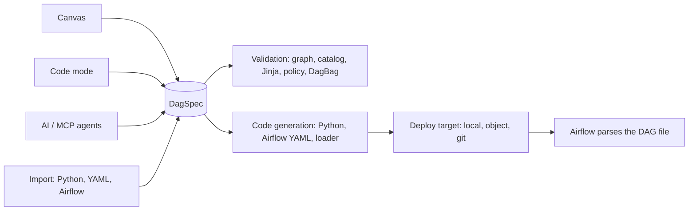

AutoAir is a DAG builder for Apache Airflow 3. You design a DAG on a canvas (or in a code editor, or through an AI assistant or MCP agent), and AutoAir stores it as a versioned **DAG specification**, generates a readable Python DAG file from that specification, validates it with Airflow's own `DagBag`, and deploys it to the place Airflow reads DAGs from: a local folder, object storage, or a Git repository (directly or as a pull request).

AutoAir is one Python package (`autoair`, Apache-2.0) with a React frontend shipped inside the wheel. It supports Airflow 3.0 or later, below 4, on Python 3.10 to 3.14. CI covers Airflow 3.0.6, 3.1.8, 3.2.2 and 3.3.2 plus the 3.4.0b2 pre-release, and generated imports follow the target Airflow version. Releases are published to PyPI as `autoair` and as the container image `ghcr.io/ctolon/autoair` (the official Airflow image with AutoAir installed).

<Screenshot name="canvas-dag" alt="The AutoAir builder: operator palette on the left, a DAG of connected tasks on the canvas, the inspector on the right and the Problems and Code tabs in the bottom panel" caption="The builder: palette, canvas, inspector and bottom panel." />

## The spec-centric model

Every DAG built with AutoAir is a JSON document, the **DagSpec** (`spec_version: 3`), saved as `<dag_id>.autoair.json` next to the generated file. Everything else is derived from it:

- **One source of truth.** The canvas, the code preview, the validator, the version history, the diff view, reviews and deployment all read the same spec. There is no second model that can drift.
- **Readable output.** The default output is an ordinary Python DAG file that uses `airflow.sdk` and the operator classes you picked. Generated imports follow the target Airflow version. The file carries a header saying it is generated; AutoAir refuses to overwrite a generated file that someone edited by hand unless the deploy is forced.
- **Validation before deploy.** Graph rules (cycles, duplicate ids), operator parameters against the installed operator catalog, Jinja templates, organisation policy and an import check in a real `DagBag` run before anything is written.
- **Deployment is a write to the place Airflow already reads.** AutoAir does not run DAGs itself; Airflow's dag-processor picks up the file. Runs, logs and XComs are read back from Airflow's REST API.

The [concepts](/docs/getting-started/concepts) page explains each of these parts in more detail.

## Three run modes

The same package runs in three ways. They share the UI, the API and the settings; they differ in where the server runs and how users authenticate.

| Mode | Command / entry point | Authentication | Needs an Airflow server | Typical use |
| --- | --- | --- | --- | --- |
| Airflow plugin | `airflow.plugins` entry point, loaded by the Airflow API server | Airflow's auth manager (the Airflow UI session) | Yes, AutoAir runs inside it | Teams that already run Airflow 3 and want the builder in the Airflow UI |
| Standalone | `autoair serve` | Airflow token verified against Airflow: the Airflow session cookie, username/password exchanged for a token, or a pasted token | Yes, reached over its REST API | Running AutoAir as its own service, scaled and upgraded separately from Airflow |
| Local | `autoair local` | None on loopback; optional static token | No | Trying AutoAir or authoring DAG files on a workstation |

[Installation overview](/docs/installation/overview) compares the modes in detail and links to the setup page of each.

## What AutoAir is not

- **Not a scheduler or executor.** AutoAir writes DAG files; Airflow schedules and runs them. Triggering, backfill, clearing and the run overlay call Airflow's REST API with the caller's own token.
- **Not a replacement for Airflow's permissions.** In plugin and standalone mode every request is authorized by Airflow (per-DAG access stays with Airflow). AutoAir adds its own roles on top for builder actions such as deploy, review and administration; see [IAM](/docs/admin/iam).
- **Not a closed format.** Generated Python is plain Airflow code. You can export a DAG as Python, Airflow YAML, dag-factory YAML or spec JSON at any time and stop using AutoAir.
- **Not a sandbox for untrusted code.** Python task bodies, inline functions and script files end up in DAG files that Airflow executes. Restrict them with `allow_python_code`, `features.python_code` and the policy settings; see [policy](/docs/admin/policy).

## Feature summary

| Area | What you get | Read more |
| --- | --- | --- |
| Canvas | Operator palette for every installed provider and custom operator, task groups, notes, command palette, copy/paste, auto layout, undo/redo | [Canvas](/docs/user-guide/canvas), [Shortcuts](/docs/user-guide/shortcuts) |
| Code mode | Edit the generated file and apply it back into the spec | [Code mode](/docs/user-guide/code-mode) |
| Editors | Jinja-aware template fields, XCom drag-to-map, Python and shell completion, Markdown docs | [Editors](/docs/user-guide/editors), [Jinja, XCom and Python](/docs/user-guide/jinja-xcom-python) |
| TaskFlow | `@task` and its variants, dynamic task mapping, task loops (Airflow 3.4) | [TaskFlow and loops](/docs/user-guide/taskflow-and-loops) |
| Scheduling | Presets, cron, intervals, events, asset and asset-or-time schedules, partitions, with a next-runs preview | [Scheduling and assets](/docs/user-guide/scheduling-and-assets) |
| Validation | Live problems that jump to the field, import check in Airflow's `DagBag` | [Validation](/docs/user-guide/validation) |
| Deploy | Local folder, object storage or Git (push or pull request on GitHub, GitLab, Bitbucket, Azure DevOps, Gitea/Forgejo or any remote through the git CLI), ETag locking and three-way merge | [Deploy](/docs/user-guide/deploy) |
| Governance | Reviews and four-eyes approvals, organisation policy, audit trail | [Reviews and approvals](/docs/user-guide/reviews-and-approvals), [Audit](/docs/admin/audit) |
| Runs | Trigger, backfill, clear; run states, logs and XComs on the canvas | [Runs](/docs/user-guide/runs) |
| Environments | dev/staging/prod overlays and promotion | [Environments](/docs/user-guide/environments) |
| Collaboration | Live co-editing with presence and per-user undo | [Collaboration](/docs/user-guide/collaboration) |
| Reuse | Templates, fragments, operator templates, signed marketplaces | [Templates and fragments](/docs/user-guide/templates-and-fragments), [Marketplace](/docs/user-guide/marketplace) |
| AI | Generate and edit DAGs, explain problems, write docs; MCP server for agents | [AI introduction](/docs/ai/introduction), [MCP](/docs/ai/mcp) |
| Operations | Health, readiness and Prometheus endpoints, OpenTelemetry, PostgreSQL state for several replicas | [Observability](/docs/admin/observability), [Scaling](/docs/admin/scaling) |
| Extending | Custom operators, catalog sources, node SDK, REST API | [Extending](/docs/extending/overview), [REST API](/docs/extending/rest-api) |

## Who it is for

- **Data and analytics engineers** who know what their pipeline should do but do not want to hand-write Airflow boilerplate, and who still want reviewable Python in Git.
- **Platform teams** that run Airflow 3 for many users and need guard rails: policy rules, operator allow and deny lists, reviews before deploy, and an audit trail.
- **Airflow developers** who want fast feedback (parameter types, Jinja completion, live `DagBag` validation) and can switch to code mode at any time.
- **Agent builders** who want an AI assistant or an MCP client to author DAGs through the same validated path as humans.

## Next steps

1. [Quick start](/docs/getting-started/quick-start): run AutoAir in a few minutes.
2. [Build your first DAG](/docs/getting-started/first-dag): a step-by-step tutorial.
3. [Concepts](/docs/getting-started/concepts): the model behind the UI.
4. [Installation](/docs/installation/overview): choose a mode for a real deployment.
